# Distance Transform

!!! abstract "How far is every pixel from the thing you care about?"

## Overview

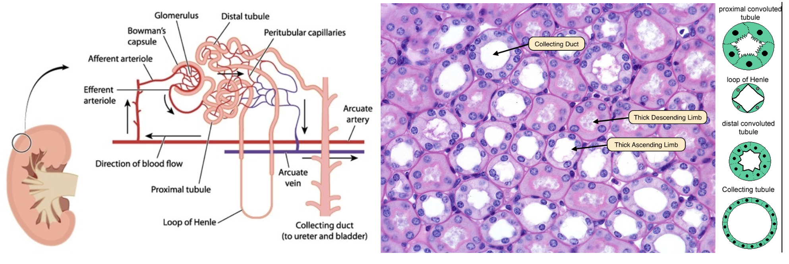{ width="900"}

A cross-section through the kidney medulla cuts through several kinds of tubules. Two of them can look similar in an H&E section: the thin limbs of the **loop of Henle**, lined by flat cells with only a few nuclei, and **collecting ducts**, lined by cuboidal cells with many nuclei. To tell them apart automatically, we need to count the nuclei surrounding each tubule—which means identifying all the nuclei near a given duct, but none of the nuclei that belong to its neighbors. That requires a way to measure distance *inside* an image. This is exactly what the **distance transform** does.

The plan for this module:

1. Segment the nuclei and the duct lumens using k-means clustering (from [Color Segmentation](ImageColorSegmentation.md))
2. Use the distance transform to draw a ring of a fixed width around each duct
3. Count the nuclei that touch each ring
4. Classify each duct by how many nuclei it has, normalized by its size

Before we get to pixels, though, it's worth reviewing where "distance" comes from in the first place.

### Things you should know

- Calculate the distance between two points using the Pythagorean theorem and **`hypot`**
- Explain what the distance transform (**`bwdist`**) measures, and what a zero in its output means
- Use **`imregionalmax`** to find the ridge lines exactly halfway between objects
- Threshold a distance transform to draw a ring of a specific width around a mask
- Use **`imreconstruct`** to keep only the objects in one mask that touch a marker in another
- Normalize a count (like nuclei touching a duct) by a size measurement (like perimeter) to make fair comparisons across objects of different sizes

### Key Terminology you should know

- **Euclidean distance**: straight-line distance, calculated via the Pythagorean theorem
- **Distance transform**: an image where every pixel's value is its distance to the nearest `TRUE` pixel in a reference mask
- **Regional maximum**: a pixel (or connected region of pixels) whose value is higher than all of its immediate neighbors
- **Morphological reconstruction**: a technique that keeps whole objects in a *mask* image that are touched by a *marker* image, and discards the rest

### Key Functions

- [hypot](https://www.mathworks.com/help/matlab/ref/hypot.html): Square root of the sum of squares (the hypotenuse)
- [diff](https://www.mathworks.com/help/matlab/ref/diff.html): Differences between consecutive elements
- [bwdist](https://www.mathworks.com/help/images/ref/bwdist.html): Distance transform of a binary image
- [imregionalmax](https://www.mathworks.com/help/images/ref/imregionalmax.html): Regional maxima of an image
- [imreconstruct](https://www.mathworks.com/help/images/ref/imreconstruct.html): Morphological reconstruction
- [bwconncomp](https://www.mathworks.com/help/images/ref/bwconncomp.html): Find connected components in a binary image

---

## Measuring Distance Between Points

Consider a triangle with three vertices:

- (0,0)
- (3,0)
- (3,4)

We can represent these vertices in the matrix `V`, where column 1 holds the x-coordinates and column 2 holds the y-coordinates:

```matlab linenums="1" title="Define and plot a triangle"
V = [0 0; 3 0; 3 4];

scatter(V(:,1),V(:,2),'filled');
xlabel('x'); ylabel('y')
grid on
axis([-1 9 -1 9])
```

We can use the **`patch`** function to fill in the triangle's interior, or *face*:

```matlab title="Fill the triangle"
patch(V(:,1),V(:,2),'cyan','LineStyle',':')
text(1, 2.5, 'c = ?')
```

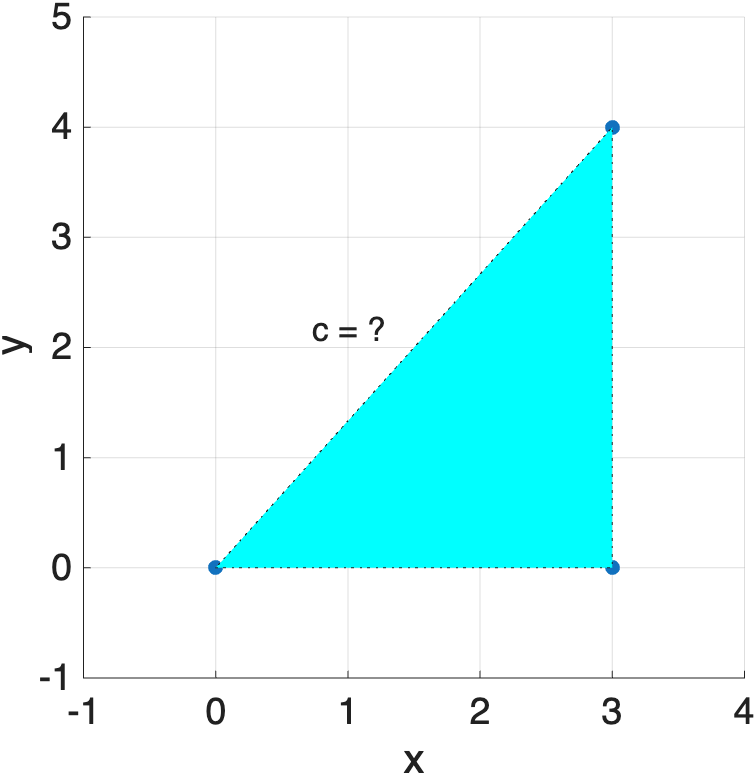{ width="250"}

How long is the hypotenuse, *c*? The Pythagorean theorem gives us the answer, once we know the lengths of the two legs, *a* and *b*:

```matlab linenums="1" title="Pythagorean theorem"
a = 3-0; % length of a
b = 4-0; % length of b
c = sqrt(a^2+b^2) % length of c
```

```matlab title="result"
c = 5
```

The function **`hypot`** does the same calculation in one step:

```matlab title="hypot"
c = hypot(a,b) % c = 5
```

### Distance Between Two Points

The same trick measures the straight-line (**Euclidean**) distance between any two points—just build the implied triangle:


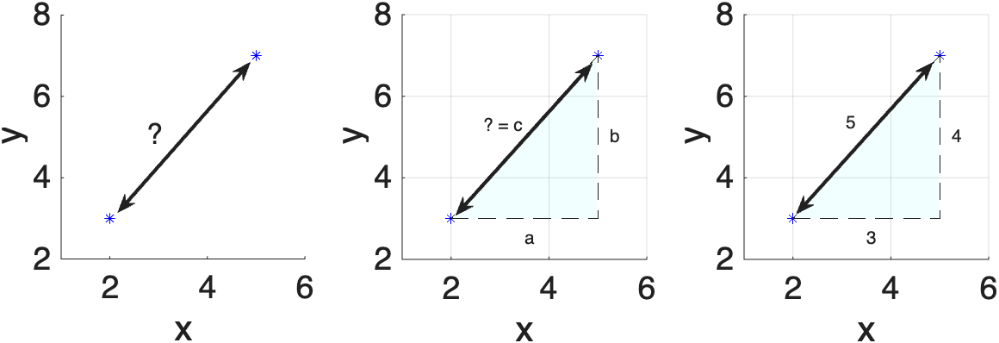{ width="550"}

>When measuring two points, visualize the triangle that the two points imply: *a* is the horizontal leg, *b* is the vertical leg, and *c*, the hypotenuse, is the straight-line distance between the points.

```matlab linenums="1" title="Assign Points"
pts = [2 3; 5 7] % (2,3) and (5,7)
```

```matlab
pts = 2×2
2	3
5	7
```

```matlab title="Calculate sides"
sides = [5-2 7-3] % a and b sides
```

```matlab
sides = 1×2
3	4
```

```mat linenums="1" title="Calculate Distance (hypotenuse)"
dist = hypot(sides(1),sides(2))
```

```matlab
dist =

     5
```


### Length of a Polyline

The same idea, repeated for every consecutive pair of points, gives the total length of a connected line:

```matlab linenums="1" title="Total length of a polyline"
pts = [0 0; 1 3; 2 1; 3 6; 4 7];

D = diff(pts);               % the sides of each segment's triangle
H = hypot(D(:,1), D(:,2));   % the length of each segment
L = sum(H)                   % total length
```

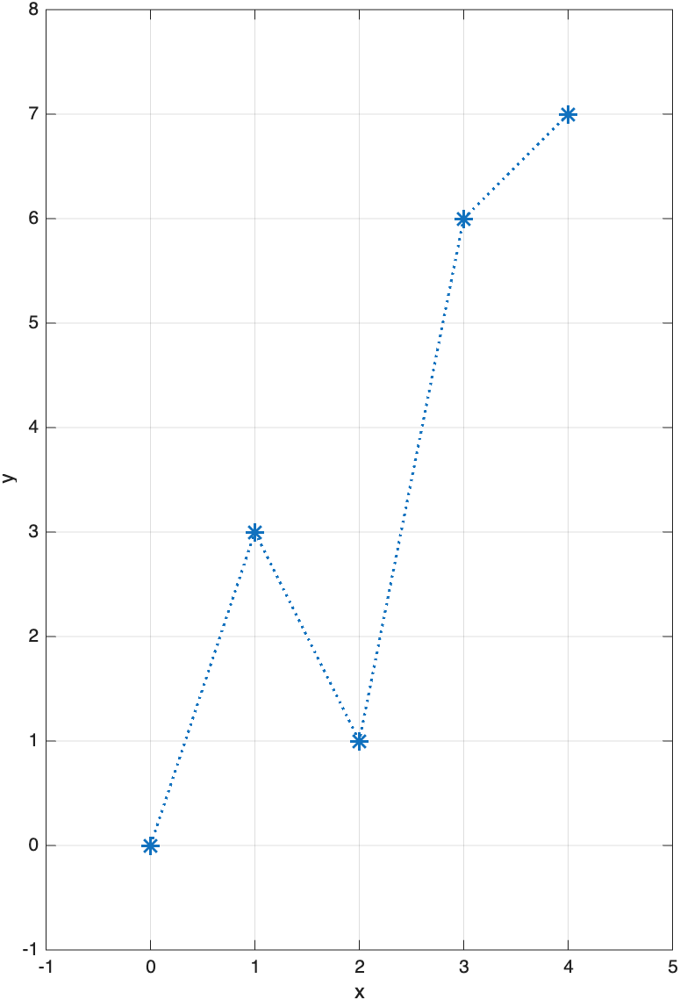{ width="450"}

>It really is "triangles all the way down": each segment of this zig-zagging line is the hypotenuse of its own small right triangle.

This also collapses into a single line of MATLAB math:

```matlab title="One-line distance formula"
L = sum(sqrt(sum(diff(pts).^2,2)))
```

$$\text{Distance}=\sum_n \sqrt{\left(x_{n+1} -x_n \right)^2 +\left(y_{n+1} -y_n \right)^2 }$$

>This formula—repeated distance-to-nearest-point calculations—is exactly what the distance transform does, except instead of a handful of named points, it does this for *every single pixel* in an image, all at once.

## What Is the Distance Transform?

The distance transform replaces every pixel in a binary image with its distance (in pixels) to the **nearest `TRUE` pixel**. `TRUE` pixels themselves get a distance of 0. By default, **`bwdist`** measures straight-line (Euclidean) distance, so a diagonal neighbor is √2 ≈ 1.41 pixels away—exactly the Pythagorean calculation above, just automated for the whole image.

Consider a 5×5 logical array with a single `TRUE` at its center:

```matlab linenums="1" title="Distance transform of a single point"
M = false(5);
M(3,3) = true;

B = bwdist(M);
```

```matlab title="result"
B =
    2.8284    2.2361    2.0000    2.2361    2.8284
    2.2361    1.4142    1.0000    1.4142    2.2361
    2.0000    1.0000         0    1.0000    2.0000
    2.2361    1.4142    1.0000    1.4142    2.2361
    2.8284    2.2361    2.0000    2.2361    2.8284
```

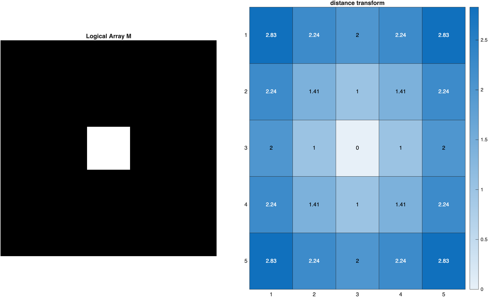{ width="650"}

>`B` is the same size as `M`. Every element contains the distance in pixels from that location to the nearest `TRUE` pixel. The location of the `TRUE` itself is zero, and diagonal neighbors are calculated with the Pythagorean theorem—just as we did by hand above.

### Multiple `TRUE` Pixels

What happens with more than one `TRUE` pixel? Here we place four single points in a 100×100 array:

```matlab linenums="1" title="Distance transform with multiple points"
binmat = false(100);
binmat([2425 2475 7425 7475]) = true;

B2 = bwdist(binmat);
imshow(B2,parula(35))
```

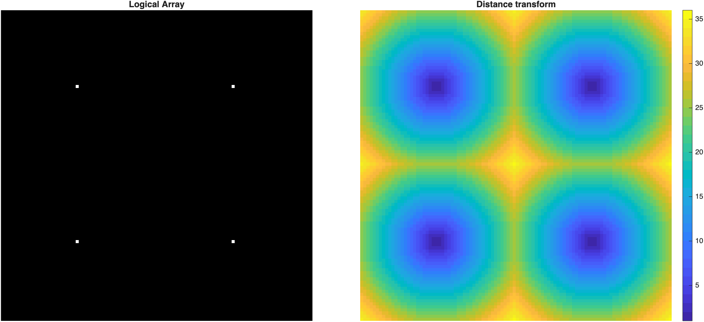{ width="550"}

>The distance transform is zero (dark) at each of the four points. Close to each point, the distance rings are circular, since every pixel measures its distance to its **nearest** `TRUE`. Where rings from neighboring points meet, they form straight lines exactly halfway between the points—so each point ends up "owning" one square quadrant of the image, with its rings morphing from circular near the center into a squared-off "squircle" as they approach the quadrant's edges. The largest distances (brightest) fall at the center and corners—the pixels farthest from any point.

!!! tip "Distance isn't always Euclidean"

    **`bwdist`** can measure distance several other ways by passing a method name as a second input: `'cityblock'` (only horizontal/vertical steps), `'chessboard'` (diagonal steps count the same as straight ones), and `'quasi-euclidean'` (a fast Euclidean approximation). Applied to a single point, each produces a different shape instead of a circle:

    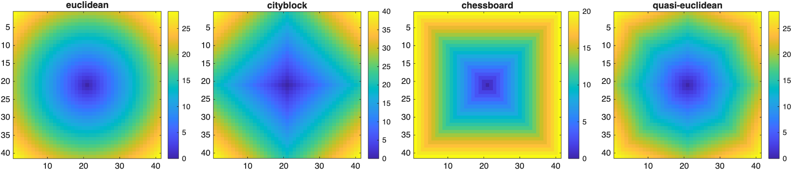{ width="650"}

    Euclidean gives a circle, cityblock gives a diamond, and chessboard gives a square—a nice reminder that "distance" is a choice, not just a fact about the pixels.

## Example: Classifying Kidney Tubules

Consider this cross-section through kidney tissue:

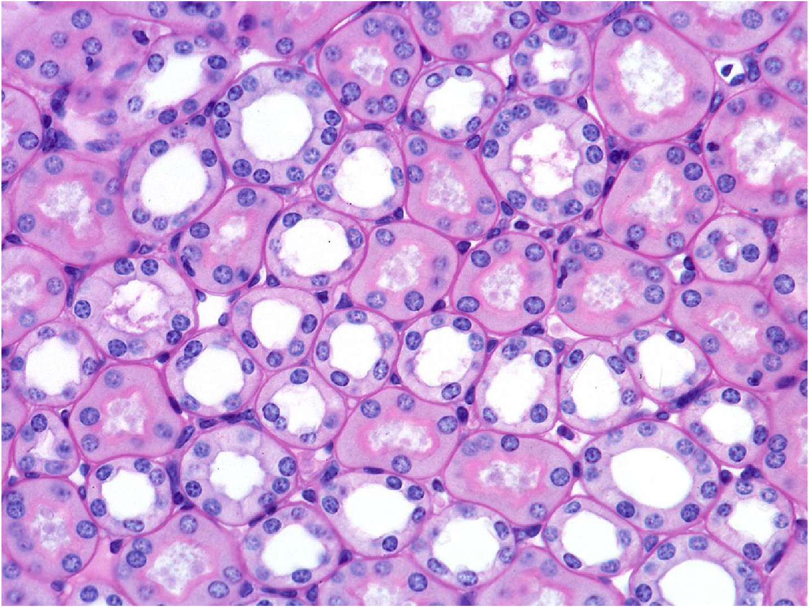{ width="550"}

We'll segment the dark nuclei and the white duct lumens, then use the distance transform to figure out which nuclei surround which duct.

### Segmenting Nuclei and Ducts

First, a median filter smooths out noise (applied to each color channel separately via the `[7 7 1]` neighborhood), then we convert to L\*a\*b\* and cluster with **`imsegkmeans`**—the same programmatic color segmentation technique from the [Color Segmentation](ImageColorSegmentation.md) module:

```matlab linenums="1" title="Segment nuclei and lumens by color"
p.medf = medfilt3(p.rgb, [7 7 1]);
p.lab = rgb2lab(p.medf);

p.ab = im2single(p.lab(:,:,2:3));
nColors = 4; % white lumen, dark blue nuclei, pink cytoplasm, dark pink
p.label = imsegkmeans(p.ab,nColors, 'NumAttempts',3);
```

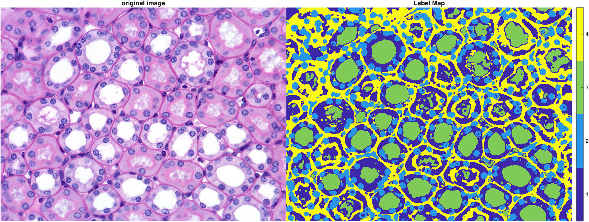{ width="650"}

Rather than hard-coding which label number means what—cluster numbers are arbitrary, as we saw in Color Segmentation—we find the nuclei and duct clusters by their **lightness** (L\*): nuclei are the darkest cluster, lumens are the brightest.

```matlab linenums="1" title="Identify clusters by mean lightness"
rpL = regionprops('table',categorical(p.label),p.lab(:,:,1),'MeanIntensity');

[~, nucLabel] = min(rpL.MeanIntensity); % darkest cluster = nuclei
[~, ductLabel] = max(rpL.MeanIntensity); % brightest cluster = duct lumens

nuc.mask = p.label == nucLabel;
```

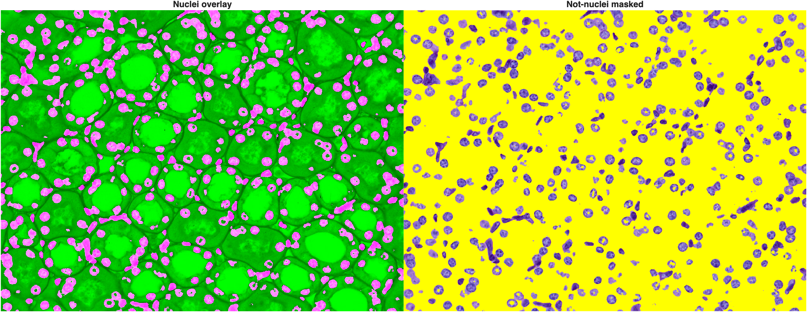{ width="650"}

>Nice—the nuclei are correctly identified. A standard morphological cleanup (fill holes, remove small noise) followed by a repeated watershed (run three times, with progressively smaller minima, to separate touching nuclei) finishes the job:

```matlab linenums="1" title="Clean and separate the nuclei"
nuc.mask = imfill(nuc.mask, 'holes');
nuc.mask = bwareaopen(nuc.mask, 50);
nuc.mask = mmGetWatershed(nuc.mask,[3 2 2]);
```

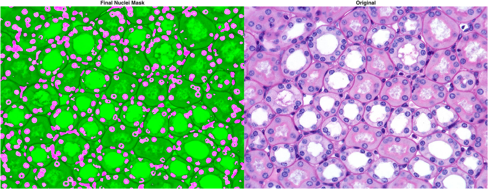{ width="650"}

The duct lumens—the brightest cluster—are just as easy to pull out:

```matlab linenums="1" title="Capture the duct lumens"
duct.maskLAB = p.label == ductLabel;
duct.maskLAB = bwareaopen(duct.maskLAB,1000);
```

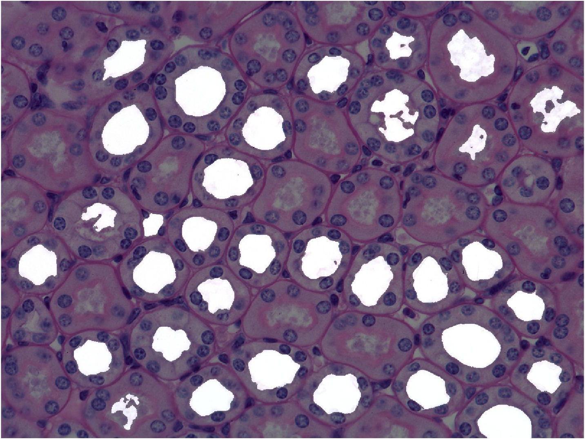{ width="550"}

>Many of the ducts are captured well, but notice we miss the ones with pink-stained material inside the lumen—their interior isn't part of the "brightest" cluster, so k-means alone can't recover them.

!!! tip "Recovering missed ducts with SAM"

    The Segment Anything Model (SAM), available through `imageSegmenter` or the `segmentAnythingModel` function, can recover ducts that k-means misses, by feeding it the k-means duct and nuclei centroids as foreground and background points respectively (via **`regionprops`**). SAM's first run on an image is slow—it has to compute image **embeddings**, a compact numerical summary—but after that, segmenting with different points is fast. Since it requires the separate *Image Processing Toolbox Model for Segment Anything Model* support package and a one-time model download, this module continues with the k-means-only duct mask, which is enough to demonstrate the distance transform.

A light morphological cleanup—fill holes, discard any duct touching the image border (a partial duct would give a bad measurement), and discard tiny leftover noise—gives us the final duct mask:

```matlab linenums="1" title="Clean up the duct mask"
duct.mask = imfill(duct.maskLAB,'holes');
duct.mask = imclearborder(duct.mask);
duct.mask = bwareaopen(duct.mask,750);
```

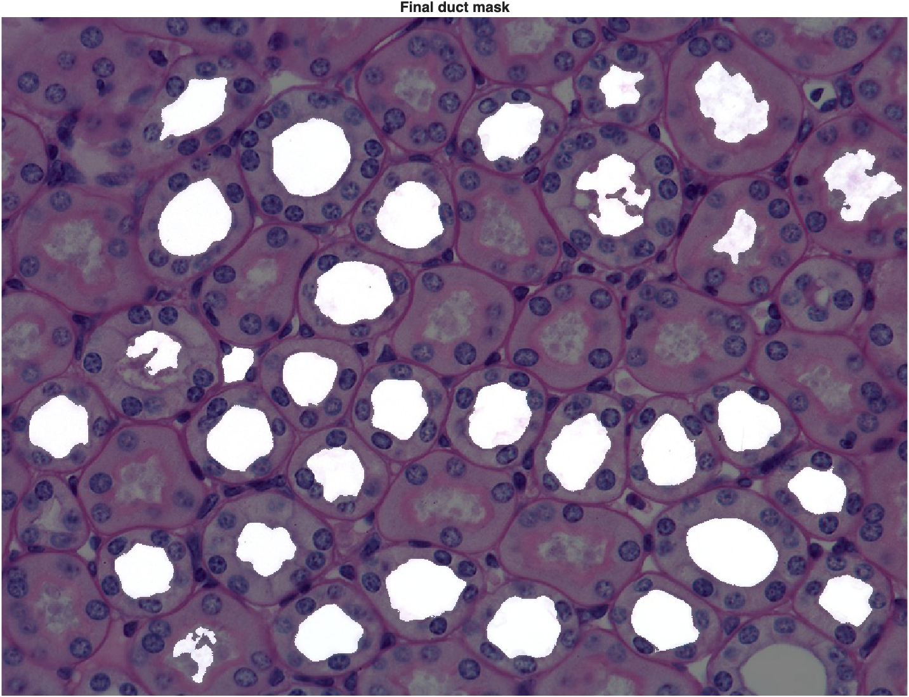{ width="550"}

### How Far Apart Are the Ducts?

With a duct mask in hand, we can use the distance transform to estimate the typical spacing between ducts:

```matlab linenums="1" title="Distance transform of the duct mask"
distTxfm = bwdist(duct.mask);
imshow(distTxfm,[])
```

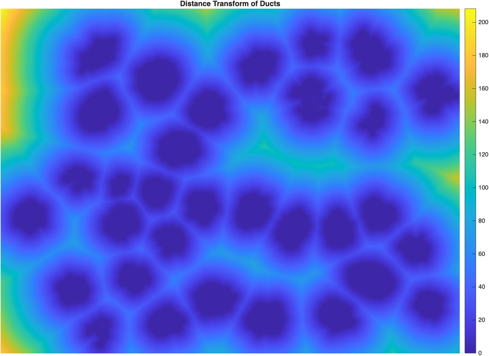{ width="650"}

>This is exactly the same squircle-tessellation pattern from the four-point toy example above, now shaped by 32 real ducts instead of 4 synthetic points. The ridges (bright lines) mark the halfway points between neighboring ducts.

**`imregionalmax`** finds those ridges directly—pixels whose distance value is higher than every one of their immediate neighbors:

```matlab linenums="1" title="Find the ridge lines between ducts"
regMax = imregionalmax(distTxfm);
```

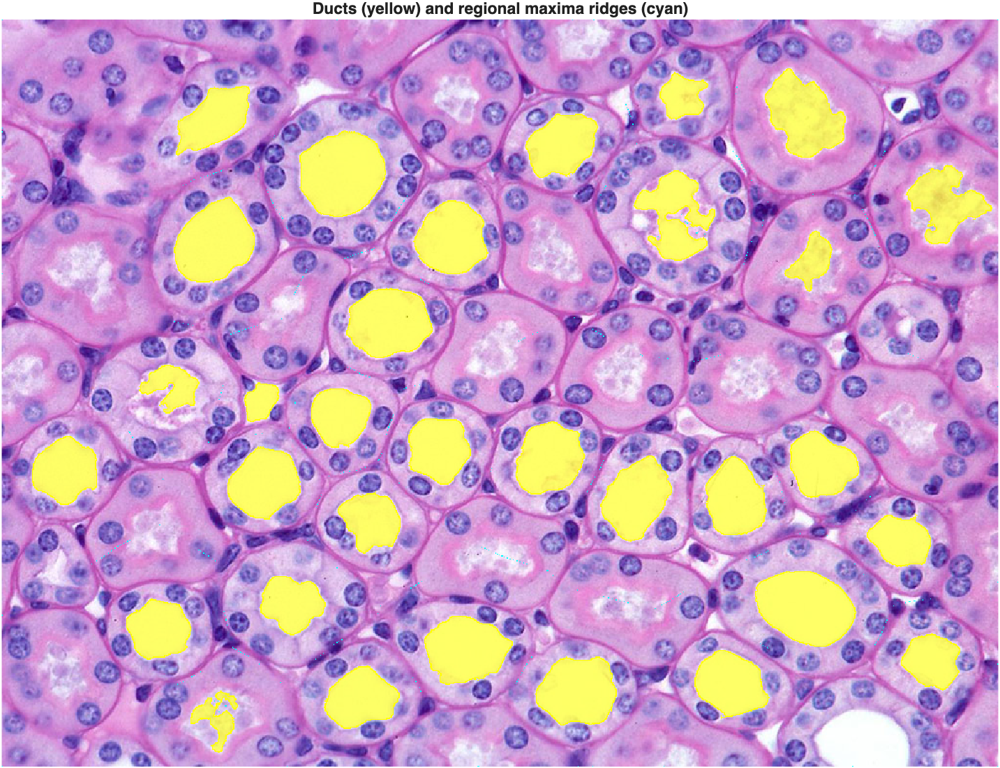{ width="550"}

Doubling the distance at each ridge pixel (since a ridge marks the *halfway* point) gives us a distribution of duct-to-duct separations:

```matlab linenums="1" title="Estimate duct spacing"
separation = distTxfm(regMax) * 2;
histogram(separation)
title(sprintf('Median Separation = %1.2f',median(separation)))
```

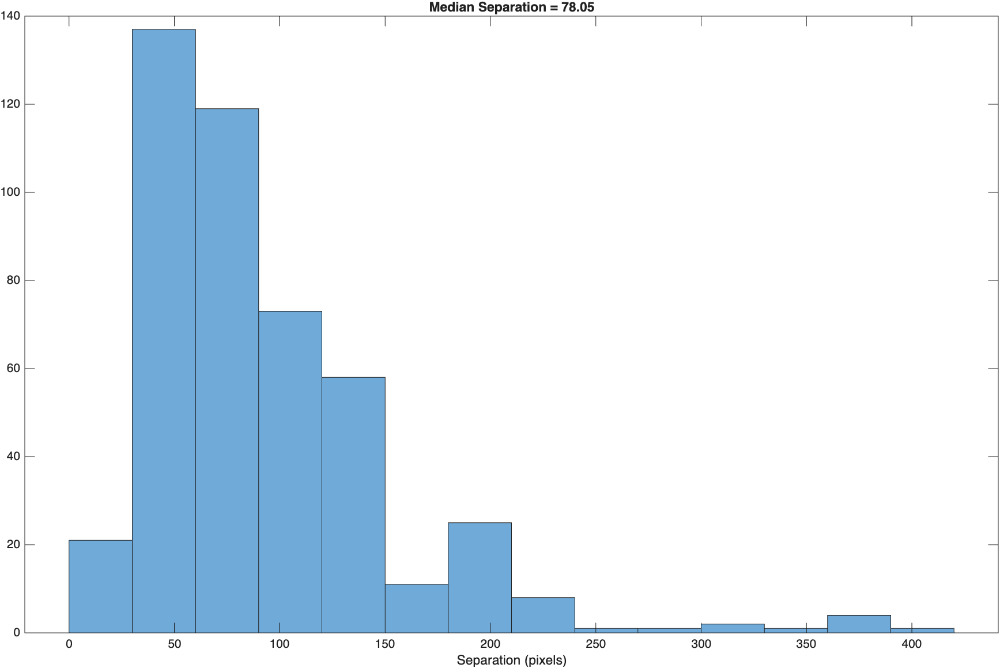{ width="550"}

```matlab title="result"
Median Separation = 78.05
```

>The distribution is right-skewed—a median is a more robust summary here than a mean would be.

### Drawing a Boundary Around Each Duct

Now the main event. **Why we need the distance transform:** if we threshold the distance transform of the duct mask, every pixel between two chosen distances forms a ring around each duct. Nuclei that touch that ring belong to that duct. First, a label map, so we can work with one duct at a time:

```matlab linenums="1" title="Label each duct uniquely"
duct.label = bwlabel(duct.mask);
max(duct.label(:)) % 32
```

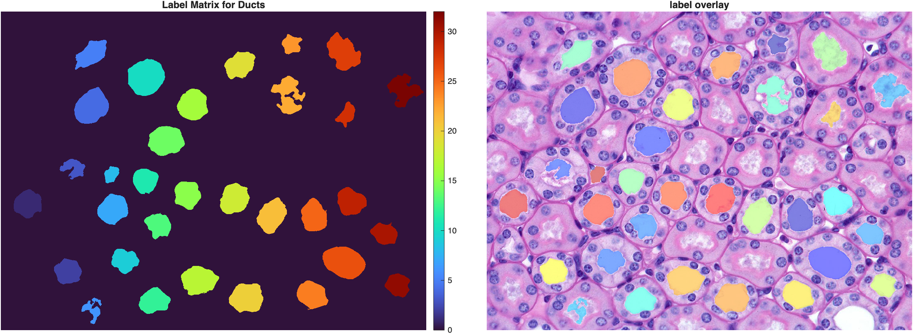{ width="650"}

How wide should the ring be? A good width is about one nucleus diameter—wide enough to touch the nuclei lining the duct, but narrow enough to exclude the nuclei of neighboring ducts. The nuclei we already segmented give us a sense of scale:

```matlab title="Typical nucleus size"
groupsummary(nuc.rp,[],["mean","std"],"EquivDiameter")
```

```matlab title="result"
mean_EquivDiameter = 18.24    std_EquivDiameter = 10.17
```

>Roughly 18 pixels on average—so a boundary width of 20 pixels is a reasonable starting point. Visualizing the distance transform of just one duct makes the ring concept concrete:

```matlab linenums="1" title="Distance transform of a single duct"
ductID = 15;
duct.mask1 = duct.label == ductID;
duct.distTxfm1 = bwdist(duct.mask1);

imshowpair(duct.mask1,p.rgb,'blend');
hold on
imcontour(duct.distTxfm1,'c-'); % cyan contour lines
```

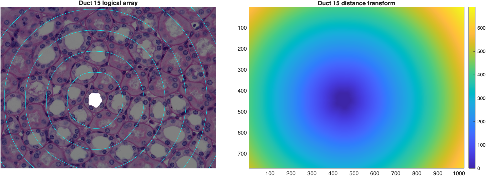{ width="650"}

>Inside the duct mask itself, the distance transform is zero; the contour lines radiate outward in concentric rings, exactly like the toy examples above.

Thresholding the distance transform between 0 and 20 (excluding 0, which is the duct itself) produces the ring:

```matlab linenums="1" title="Threshold a 20-pixel ring around every duct"
duct.distTxfm = bwdist(duct.mask);
duct.boundary = duct.distTxfm > 0 & duct.distTxfm < 20;
```

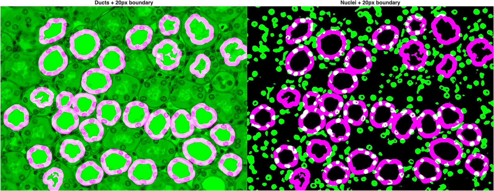{ width="650"}

>Optimally, the rings shouldn't overlap too much, and should touch—without necessarily fully enclosing—the nuclei that line each duct.

### Capturing the Surrounding Nuclei

A ring tells us *where* to look, but we still need to select the whole nuclei it touches—not just the sliver of each nucleus that happens to fall inside the ring. **`imreconstruct(marker, mask)`** keeps every object in *mask* that touches *marker*, in full, and drops the rest. Here, the ring is the marker and the nuclei mask is the mask to reconstruct from:

```matlab linenums="1" title="Keep whole nuclei touching the ring"
boundaryMask1 = duct.distTxfm1 < 20 & duct.distTxfm1 > 0; % ring around duct 15
BWencircling = imreconstruct(boundaryMask1, nuc.mask);
```

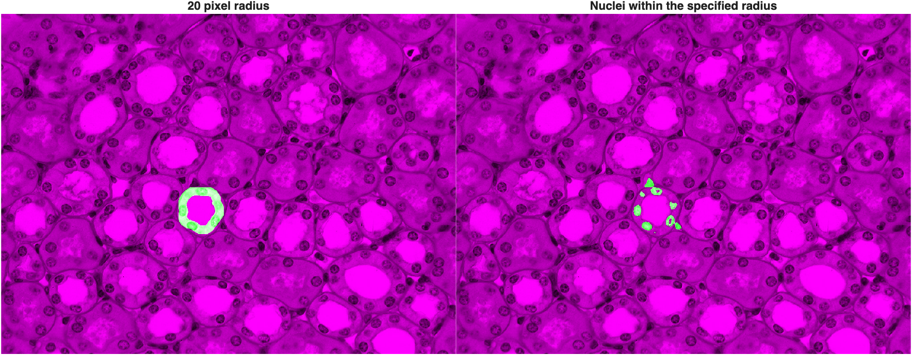{ width="650"}

```matlab linenums="1" title="Count the nuclei found"
cc = bwconncomp(BWencircling);
cc.NumObjects % 7
```

>**`bwconncomp`** is a quick way to count distinct objects in a mask—`NumObjects` is the count, and `PixelIdxList` holds the linear indices of each one.

Looping this process over every duct (with a `for` loop, iterating over each duct's label) gives us a nuclei count per duct, and labels each set of surrounding nuclei to match its duct:

```matlab linenums="1" title="Count nuclei around every duct"
boundaryWidth = 20;
nuc.label = zeros(size(duct.label),'like',duct.label);
nuc.count = zeros(max(duct.label(:)),1);

for n = 1:max(duct.label(:))
    Dn = bwdist(duct.label == n);
    boundaryMask = Dn < boundaryWidth & Dn > 0;

    BWencircling = imreconstruct(boundaryMask, nuc.mask);
    cc = bwconncomp(BWencircling);

    nuc.count(n) = cc.NumObjects;
    nuc.label(BWencircling) = n; % match nuclei label to duct label
end
```

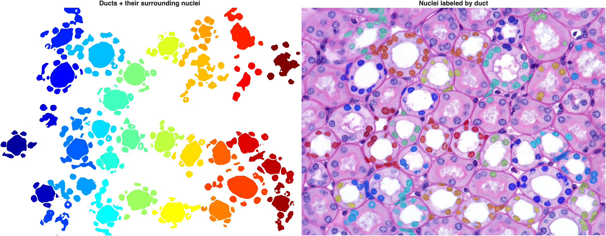{ width="650"}

>Nuclei counts per duct ranged from 2 to 10 in this image. A nucleus sitting between two ducts touches both rings and gets counted for both—but in the label map, it keeps only the label of whichever duct it was assigned to last in the loop.

### Classifying the Ducts

Larger ducts have longer perimeters, so they'll touch more nuclei no matter what type they are. To compare ducts fairly, we normalize the nuclei count by each duct's perimeter:

```matlab linenums="1" title="Normalize nuclei count by perimeter"
ductStats = regionprops("table", duct.label, "Centroid","Perimeter", "Area");
ductStats.NucleiCount = nuc.count;
ductStats.NucleiPer100px = 100 * ductStats.NucleiCount ./ ductStats.Perimeter;

histogram(ductStats.NucleiPer100px)
xlabel("Nuclei per 100 px of perimeter")
```

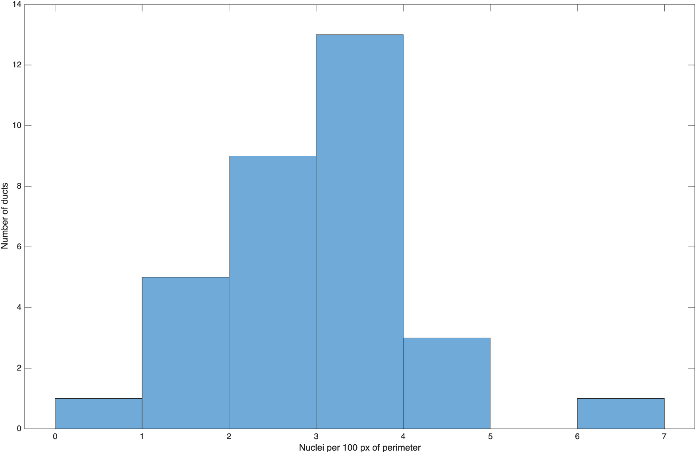{ width="550"}

>Unlike the earlier toy examples, real tissue doesn't always split as cleanly as we'd like—this distribution is right-skewed with a single high outlier, but no sharp gap separating two obvious groups. That's a realistic result, not a failure: some ducts are irregular or ambiguous (their mask doesn't follow the lumen edge precisely, which throws off both the perimeter and which nuclei the ring happens to touch), and a single global ring width can't be perfectly tuned for every duct's size and shape. Picking a cutoff here (for example, labeling anything above roughly 3.5 nuclei per 100 px as a likely collecting duct) is a judgment call, not something the data hands you automatically—exactly the kind of "the algorithm gives you a number, you still have to interpret it" lesson from [Color Segmentation](ImageColorSegmentation.md).

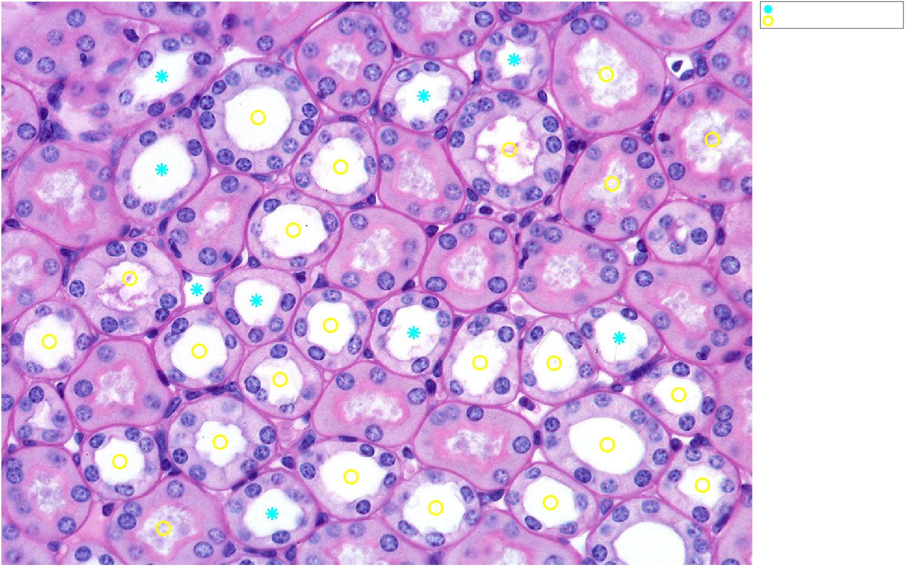{ width="550"}

## Summary

- **`bwdist`** gives every pixel its distance to the nearest `TRUE` pixel in a reference mask.
- Thresholding a distance transform draws a ring (or a disk) of any width around a mask.
- **`imregionalmax`** finds the ridges exactly halfway between objects—useful for estimating spacing.
- **`imreconstruct`** keeps whole objects that touch a marker, rather than just the pixels that happen to overlap it.
- Normalizing a count by a size measurement (like perimeter) makes comparisons fair across objects of different sizes.

## Challenge

??? question "How much does the ring width change the nuclei count?"

    === "Question"

        We chose a boundary width of 20 pixels because it's close to the average nucleus diameter. Using duct 15 from this module, try boundary widths of 10 and 30 pixels instead of 20. How does the nuclei count change, and why?

    === "Answer"

        ```matlab linenums="1" title="Compare nuclei counts at three ring widths"
        for bw = [10 20 30]
            boundaryMaskBW = duct.distTxfm1 < bw & duct.distTxfm1 > 0;
            enc = imreconstruct(boundaryMaskBW, nuc.mask);
            cc = bwconncomp(enc);
            fprintf('boundaryWidth=%d -> nuclei found: %d\n', bw, cc.NumObjects);
        end
        ```

        ```matlab title="result"
        boundaryWidth=10 -> nuclei found: 6
        boundaryWidth=20 -> nuclei found: 7
        boundaryWidth=30 -> nuclei found: 12
        ```

        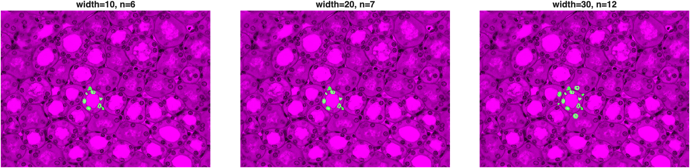{ width="650"}

        A narrower ring (10 px) barely grazes the inner nuclei and can miss some entirely. The 20 px ring—our original choice—cleanly captures the full ring of nuclei lining the duct. At 30 px, the ring has grown wide enough to start reaching into the next tier of nuclei, and even nuclei belonging to a neighboring duct, nearly doubling the count. There's nothing special about 20; it's a reasonable choice *for this image's magnification and nucleus size*, not a universal constant—exactly the kind of parameter the summary at the end of [Color Segmentation](ImageColorSegmentation.md) warned about.

Congratulations, you have made it to the end! 📏
