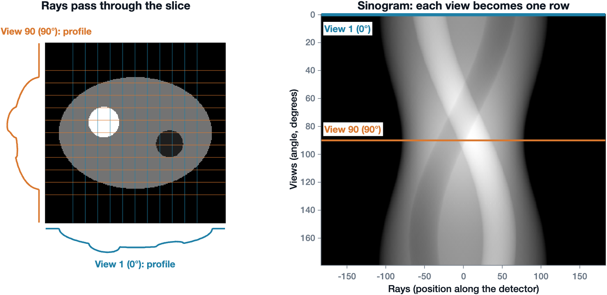
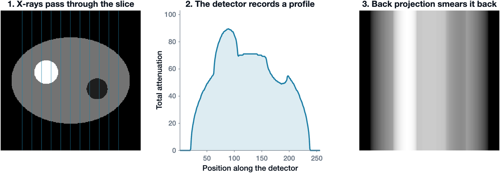
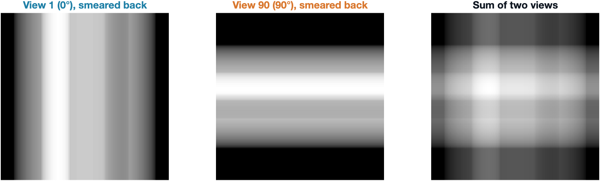
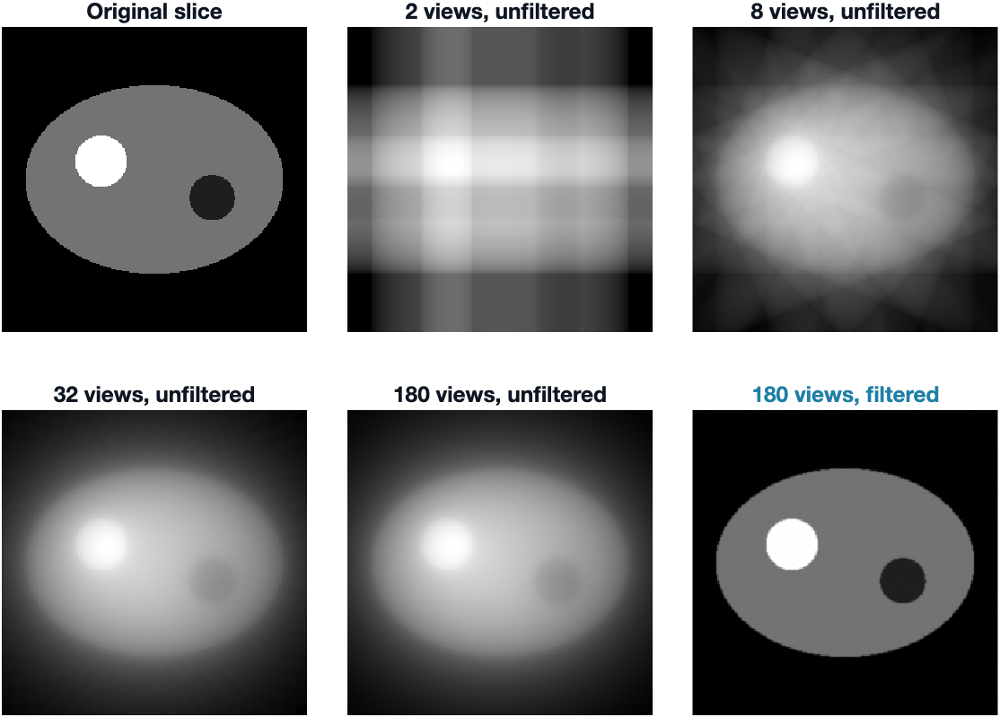
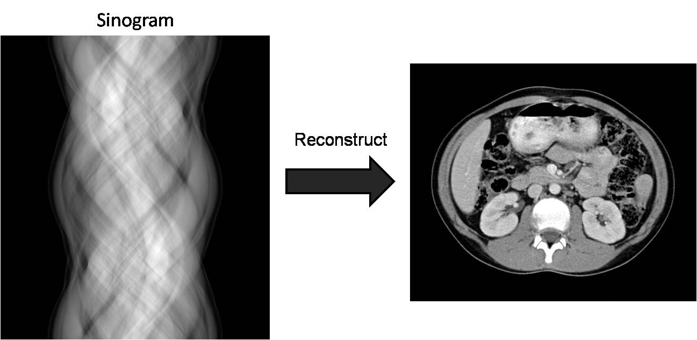
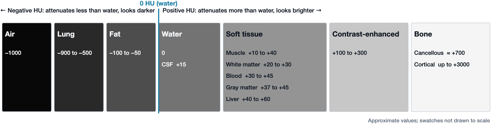
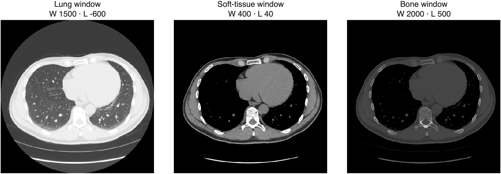
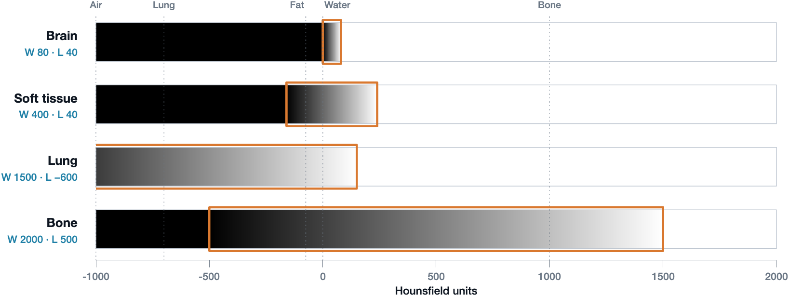

# Computed Tomography Overview

In this page we cover how a CT scanner captures and reconstructs an image, how Hounsfield units and windowing work, the settings that shape the image, how CT datasets are oriented, and how CT is used clinically.

## Learning Objectives

- Explain the difference between an X-ray (radiograph) and a CT scan
- Explain how a CT scanner captures and creates an image
- Define back projection, the Radon transform, and the sinogram
- Define Hounsfield units
- Know where various tissue intensities fall along the Hounsfield scale

## Important Terminology

| Term                         | Definition                                                   |
| ---------------------------- | ------------------------------------------------------------ |
| **Tomography**               | From Greek *tomos*, "slice": an image of a cross-section through the body, built by computation from a penetrating wave (typically X-rays or ultrasound) rather than captured directly |
| **CT**                       | Computed Tomography, or Computed Axial Tomography (CAT scan): using X-ray projections taken from many angles to compute tomographic slices |
| **Projection**               | A 1D intensity profile recorded by the detector array at one angle: the sum of the attenuation along each ray |
| **Radon Transform**          | The mathematical operation that computes linear projections of an image along specified directions |
| **Sinogram**                 | The raw CT data: all of the projections of a slice, stacked by angle |
| **Back projection**          | Reconstructing a 2D image by smearing each projection back across the image along the direction it was measured |
| **Filtered back projection** | Back projection after sharpening (filtering) each projection, which removes the blur of plain back projection |
| **Hounsfield unit (HU)**     | A calibrated scale of X-ray attenuation, anchored at water = 0 HU and air = −1000 HU |
| **Window level / width**     | Display settings that choose which part of the HU scale is spread across the gray shades |
| **Pitch**                    | How fast the table moves through the scanner during a helical scan |

## Important Resources

- [Basic CT intro - Sprawls CT tutorial](http://www.sprawls.org/resources/CTIMG/module.htm#1)
- [More detailed discussion of Tomography and CT](http://tomroelandts.com/articles/tomography-part-1-projections)
- [Wikiradiography](http://www.wikiradiography.net)

## Overview: What Is CT?

A **radiograph** stacks everything along the X-ray beam into a single shadow, so structures overlap. **Computed tomography** instead images a *slice*. An X-ray source and a detector array on the opposite side rotate together around the patient, collecting projections from many angles. A computer then reconstructs each slice mathematically, so the structures within a slice don't overlap.

{width=250px}
> **Illustration of a tomograph**. S1 and S2 are the tomographic cross-sections. P is the projection

Many projections → computer reconstruction → 2D slice

## Acquisition

### The Scanner Rotates Around the Patient

- A flat **fan** of X-rays passes through the patient to a detector array on the opposite side
- At each angle, the detectors record a **1D intensity profile** (a projection)
- The source and detector rotate together, capturing profiles at many small angle steps
    - At least **180˚** of profiles are needed to reconstruct a slice
    - Clinical scanners rotate a full 360˚ and capture about 1000 profiles per rotation
- Stacking these profiles by angle creates the **sinogram**

### The Sinogram

CT captures Radon transform data, which is often called a **sinogram** because the Radon transform of an off-center point traces a sinusoid. Each horizontal line of a sinogram is a 1D projection of the 2D slice at one angle.

{ width="720" }
> **Views become rows of the sinogram**. Left: a simple slice with a soft-tissue body, a dense (bone-like) disc, and a low-density (fat-like) disc. At view 1 (0˚, cyan), vertical rays pass through the slice and the detector records the profile below. At view 90 (90˚, orange), horizontal rays give the profile on the left. Right: the sinogram stacks the profile from every view, one row per angle. The two highlighted rows are the profiles from the left

For each angle, the detectors capture a projection (a line integral): the sum of the *attenuation* of everything along each ray. Brightness in the sinogram therefore corresponds to the total radiographic density along that ray.

<video src="../videos/ct-forward-projection.mp4" poster="../videos/ct-forward-projection.jpg" width="720" style="max-width:100%" autoplay loop muted playsinline controls></video>

> **Forward projection: creating the sinogram**. At each angle, the rays (lines) pass through the slice and the detector records an intensity profile (the curve). Each profile becomes one row of the sinogram (right), which fills in as the angle steps from 0˚ to 180˚. The animation uses a PET emission slice; CT projections are built the same way (Animation: Adam Leon Kesner, PhD, University of Colorado Anschutz Medical Campus)

### Back Projection

To see the slice, the sinogram must be computationally reconstructed into an image. The simplest method is **back projection** (an inverse Radon transform): each profile is smeared back across the image along the direction it was measured, and the smears from all angles are added up.

{ width="720" }
> **Back projection of one view**. X-rays pass through the slice (1), and the detector records a profile (2). Back projection smears that profile back across the image along the direction of the rays (3). One view says *how much* material lies along each ray, but not *where* along the ray it is

{ width="720" }
> **Back projection of two views**. The view at 0˚ smears into vertical bands and the view at 90˚ into horizontal bands. Where the bands add up, the dense disc starts to appear

{ width="600" }
> **Adding more views**. With more views, the object emerges, but even 180 views give a blurry, haloed image without filtering. Filtered back projection (bottom right) recovers the sharp slice. You can make these figures yourself with MATLAB's `radon` and `iradon` functions (see the X1 CT Radon Transform live script)

<video src="../videos/ct-back-projection.mp4" poster="../videos/ct-back-projection.jpg" width="720" style="max-width:100%" autoplay loop muted playsinline controls></video>

> **Back projection: reconstructing the slice**. Row by row, each line of the sinogram (right) is smeared back across the image (left). As more angles are added, the object emerges, but it stays blurry (Animation: Adam Leon Kesner, PhD, University of Colorado Anschutz Medical Campus)

### Filtered Back Projection

Plain back projection blurs the image, because every smear also spreads signal into places where there is no tissue. **Filtered back projection** fixes this by sharpening (filtering) each projection before smearing it back. The filter adds small negative side lobes that cancel the blur. Clinical scanners use filtered back projection or iterative methods built on the same idea.

<video src="../videos/ct-filtered-back-projection.mp4" poster="../videos/ct-filtered-back-projection.jpg" width="720" style="max-width:100%" autoplay loop muted playsinline controls></video>

> **Filtered back projection: reconstructing the slice, but prettier**. The same reconstruction, using the filtered sinogram (right). The result (left) is sharp instead of blurry (Animation: Adam Leon Kesner, PhD, University of Colorado Anschutz Medical Campus)

{ width="450"}
> Final 2D recreation of the object from the sinogram

### Axial vs Helical Scans

| | Axial scan | Helical scan |
| :-- | :-- | :-- |
| **Table** | Stationary while each slice is acquired, then steps forward | Moves continuously while the gantry rotates |
| **X-ray tube** | Not on all the time | On continuously |
| **Speed** | Slower (gantry rotation of about 0.5 s per slice) | Faster |
| **Best for** | Single slices | Volumes and multiplanar reconstructions |

## Hounsfield Units

Each CT voxel stores how strongly that tissue attenuates X-rays, described by its **linear attenuation coefficient (µ)**. Raw µ values depend on the scanner and the X-ray energy, so CT converts them to a standard scale: **Hounsfield units (HU)**. The scale is anchored to two reference materials: **water = 0 HU** and **air = −1000 HU**.

!!! note "Hounsfield Units"

    \(HU = 1000 \times \frac{\mu - \mu_{water}}{\mu_{water} - \mu_{air}}\)

    Where:

    - \(\mu\) is the linear attenuation coefficient of the tissue in the voxel
    - \(\mu_{water}\) and \(\mu_{air}\) are the linear attenuation coefficients of water and air

    Read the formula in pieces:

    - **Numerator**: how much more (or less) the tissue attenuates than water
    - **Denominator**: the attenuation gap between water and air, used as the ruler
    - **× 1000**: spreads that gap over 1000 steps

### Check the anchors in the HU formula

- For water, the numerator is µwater − µwater = 0, so water is **0 HU**.
- For air, the fraction becomes −1, so air is **−1000 HU**. Because µair is nearly zero, the formula is often written with just µwater in the denominator.

### Hounsfield Scale

**Negative HU** values attenuate less than water (fat, lung, air) and look darker. **Positive HU** values attenuate more than water (soft tissue, blood, bone) and look brighter. HU values are widely used in clinical practice to tell tissues and pathology apart.

> **Where tissues fall on the Hounsfield scale**. Air, lung, and fat attenuate less than water and have negative HU. Soft tissues cluster just above water, between about +10 and +60 HU, which is why they are hard to tell apart on CT. Contrast-enhanced tissue and bone attenuate much more. The gray of each swatch increases with HU; the values are approximate and the swatches are not drawn to scale

### Windowing: One Scan, Many Views

A CT scan stores values from about −1000 to over +3000 HU, but a monitor shows a limited number of gray levels, and the eye can tell apart far fewer. If the whole HU range were spread across the grays, gray and white matter (only about 10 HU apart) would look identical. **Windowing** chooses which part of the HU scale gets the gray shades:

- **Level (L)**: the center HU of the window
- **Width (W)**: the range of HU spread from black to white

Anything below the window is black and anything above it is white.

> **The same chest CT slice in three windows**. The lung window shows the vessels and airways in the lung, the soft-tissue window shows the heart, vessels, and muscle, and the bone window shows the structure of the vertebra and ribs

> **How each window maps HU to gray**. Each bar shows the gray that every HU value gets in that window. The orange outline marks the window: HU values inside it are spread from black to white, everything below it is black, and everything above it is white. The narrow brain window gives all of its grays to 0 to +80 HU, while the wide bone window spreads −500 to +1500 HU across the grays

<!-- | Window | Width (W) | Level (L) | Grays span |
| :----- | :-------: | :-------: | :--------- |
| Brain  | 80        | 40        | 0 to +80 HU |
| Soft tissue (abdomen) | 400 | 40 to 50 | about −160 to +250 HU |
| Lung   | 1500      | −600      | −1350 to +150 HU |
| Bone   | 2000      | 500       | −500 to +1500 HU | -->

- **A narrow window shows soft-tissue detail.** Gray and white matter, blood, and edema differ by only tens of HU, so they need the grays packed close together. In a brain window, fractures disappear into solid white.
- **A wide window shows bone detail.** Cortex, marrow, and fracture lines spread across the grays, but the whole brain collapses into one flat gray, hiding soft-tissue lesions.

The data never changes: windowing is a display choice made after the scan, and the same slice can be re-windowed at any time.

### Radiodensity Terms

Radiologists describe CT findings relative to the surrounding tissue:

- **Hyperdense**: brighter than its surroundings (higher HU), such as an acute hemorrhage
- **Isodense**: about the same as its surroundings
- **Hypodense**: darker than its surroundings (lower HU), such as tissue softened by an old infarction (encephalomalacia)

## Acquisition Parameters

Most CT settings balance **image noise** against **spatial resolution** and **radiation dose**.

| Set during the scan | What it does |
| :------------------ | :----------- |
| **Tube voltage (kVp)** | Sets the maximum X-ray energy; affects penetration and contrast |
| **Tube current (mA)** | Electron flow from cathode to anode; sets the rate of X-ray production |
| **Rotation time (s)** | Time for one tube rotation; like exposure time in radiography |
| **Pitch** | How fast the table moves during acquisition |

| Set when building the image | What it does |
| :-------------------------- | :----------- |
| **Field of view (FOV)** | Size of the reconstructed image; affects noise and spatial resolution |
| **Matrix size** | Number of pixels per image; affects noise and spatial resolution. FOV ÷ matrix size = pixel size |
| **Slice thickness** | Thicker slices are less noisy but blend tissues together (partial volume effects) |
| **Reconstruction filter** | Trades spatial resolution, contrast, and noise: sharp filters show fine detail but add noise |

The reconstruction settings can often be changed afterward from the same raw data.

## CT Image Datasets

### Scan Orientation

By convention, axial CT images are viewed **as if standing at the foot of the patient's bed** looking toward the head. The patient's right side therefore appears on the viewer's **left**, and anterior is at the top of the image.

### Coordinate Systems

A CT dataset can be described in several coordinate systems:

- **Image (intrinsic) coordinates**: row, column, and slice indices (i, j, k) that count voxels
- **World coordinates**: physical positions in millimeters (x, y, z)
- **Anatomical coordinates**: axes named after the anatomical directions they point toward

| System | x increases toward | y increases toward | z increases toward | Used by |
| :----- | :----------------- | :----------------- | :----------------- | :------ |
| **LPS** (Left, Posterior, Superior) | Left | Posterior | Superior | DICOM standard and many scanners |
| **RAS** (Right, Anterior, Superior) | Right | Anterior | Superior | 3D Slicer |

LPS and RAS differ only in the sign of x and y, so converting between them flips those two axes. See [Medical File Formats](../volumeProcessing/medicalFileFormats.md) for how these coordinates are stored.

### Multiplanar Reconstructions

Because CT acquires a full volume, the same data can be resliced into the three orthogonal planes: **axial**, **sagittal**, and **coronal**. Helical scans with thin slices give the best multiplanar reconstructions.

## Contrast Enhancement

Soft tissues such as blood vessels and the GI tract attenuate X-rays about as much as their surroundings, so they are hard to see. **Contrast agents** are added on purpose to make this low-attenuating tissue visible:

| Agent | Atomic number | How it is given | Highlights |
| :---- | :-----------: | :-------------- | :--------- |
| **Iodine** | 53 | Mostly intravenous | Blood vessels and organs |
| **Barium** | 56 | Swallowed or given by enema | The GI tract |

Why it works: a high atomic number → strong X-ray attenuation → appears bright white. Both agents are used in radiography, CT, and fluoroscopy.

### Dual-Energy Subtraction

Images can also be acquired at two different X-ray energies. Because bone and soft tissue attenuate differently at each energy, one image can be subtracted from the other to remove either the bones or the soft tissue.

## Clinical Use

| Indications | Examples |
| :---------- | :------- |
| **Trauma** | Internal injuries, fractures, hemorrhage |
| **Neurological** | Stroke, hydrocephalus, calcification |
| **Localization** | Pinpointing a tumor, infection, or blood clot |
| **Guiding procedures** | Surgery, biopsy, radiotherapy |

**Advantages**: quick, readily available, and excellent for bony structures.

**Disadvantages**: ionizing radiation and poor soft-tissue contrast (compared with MRI). At current rates of use, CT-associated cancers could eventually account for about 5% of new cancer diagnoses each year (Smith-Bindman et al., *JAMA Internal Medicine*, 2025).

## Summary: CT in Six Steps

1. **Capture**: X-ray profiles are recorded line by line over at least 180˚
2. **Reconstruct**: back projection turns the line profiles into 2D slices
3. **Calibrate**: grayscale values are standardized as Hounsfield units
4. **Orient**: images are viewed as if standing at the foot of the patient's bed
5. **Locate**: datasets use several coordinate systems (XYZ, LPS, and RAS)
6. **Enhance**: contrast agents make low-attenuating tissue visible
