# Magnetic Resonance Imaging Overview

This page covers the following MRI topics: nuclear magnetism, excitation, relaxation, contrast, image formation, and clinical applications. 

## Learning Objectives

- Explain how the excitation and relaxation of protons generate a radio-frequency (RF) signal
- Explain how T1, T2, TR, and TE create image contrast:
    - **TR controls T1-weighting**: the longer the TR, the *less* T1-weighted the image
    - **TE controls T2-weighting**: the shorter the TE, the *less* T2-weighted the image
    - A **short TR** and a **short TE** give a **T1-weighted** image
    - A **long TR** and a **long TE** give a **T2-weighted** image
    - A **long TR** and a **short TE** give a **proton density (PD)-weighted** image
- Explain what magnetic field gradients do in MRI
- Explain the Fourier Transform, and how its inverse turns k-space into an image
- Describe the clinical applications of T1- and T2-weighted imaging, FLAIR, Time-of-Flight angiography, fMRI, and diffusion imaging
- Explain the difference between BOLD (fMRI) and diffusion imaging methods

## Important Terminology

| Term | Definition |
| ---- | ---------- |
| **B<sub>0</sub>** | The main static magnetic field of the scanner. It is always on and runs along the bore (the z axis) |
| **B<sub>1</sub>** | The radio-frequency field produced by the RF coil, at right angles to B<sub>0</sub>, switched on only in short pulses |
| **Larmor frequency** | The frequency at which protons precess in a magnetic field: about 64 MHz at 1.5 T |
| **Resonance** | The absorption of energy when a system is driven at its natural frequency. In MRI, protons absorb RF energy only at their Larmor frequency |
| **RF** | Radio frequency: the electromagnetic energy used to excite protons, and the signal they emit as they relax |
| **T1** | The time constant describing how the longitudinal magnetization (M<sub>z</sub>) recovers to its equilibrium value (M<sub>0</sub>) after excitation |
| **T2** | The time constant describing how the transverse magnetization (M<sub>xy</sub>) decays as spins dephase |
| **T2\*** | The faster, real-world decay of M<sub>xy</sub>, which includes dephasing caused by imperfections in the magnetic field |
| **TR** | Repetition time: the time between successive excitation (90˚) pulses |
| **TE** | Echo time: the time between the excitation (90˚) pulse and the peak of the echo signal |
| **Gradient** | A brief, switched magnetic field that makes the field strength vary with position, so frequency encodes location |
| **k-space** | The frequency-domain data the scanner records. The inverse Fourier Transform turns it into the image |

## Useful Resources

- [MRI Questions](http://mriquestions.com/index.html)
- [IMAIOS e-MRI](https://www.imaios.com/en/e-Courses/e-MRI) (requires a free account)
    - [Nuclear Magnetic Resonance](https://www.imaios.com/en/e-Courses/e-MRI/NMR)
    - [MR Signal](https://www.imaios.com/en/e-Courses/e-MRI/MRI-signal-contrast)
    - [Spatial Encoding](https://www.imaios.com/en/e-Courses/e-MRI/Signal-spatial-encoding)
    - [Image Formation](https://www.imaios.com/en/e-Courses/e-MRI/The-Physics-behind-it-all)
    - [Diffusion Tensor Imaging](https://www.imaios.com/en/e-Courses/e-MRI/Diffusion-Tensor-Imaging)
    - [Functional MRI](https://www.imaios.com/en/e-Courses/e-MRI/Functional-MRI)

## Nuclear Magnetism

### Why MRI Images Hydrogen

The MRI signal comes mostly from **hydrogen nuclei** in tissue water and fat. A hydrogen nucleus (<sup>1</sup>H) is a single proton, so in MRI "proton" is shorthand for "hydrogen nucleus".

- The hydrogen atoms in tissue have *not* lost their electrons. They are bound in water and fat molecules. MRI responds to the nucleus, not the electron
- The body is mostly water (and fat), so hydrogen gives by far the strongest signal
- Other nuclei, such as <sup>13</sup>C, <sup>19</sup>F, <sup>31</sup>P, and <sup>23</sup>Na, can be imaged, but they are far less abundant and need RF hardware tuned to their own frequency

### The MRI Magnet

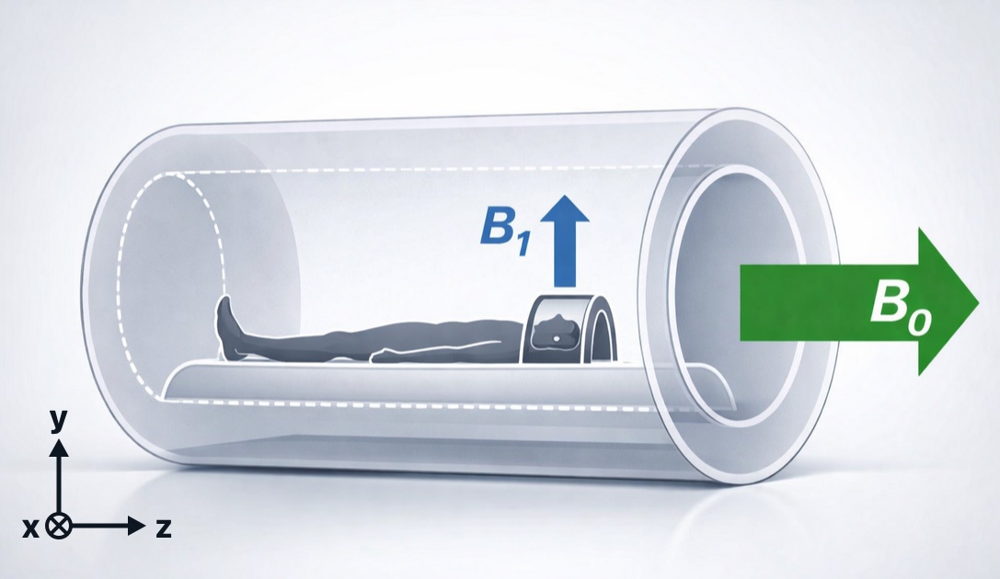{ width="600" }
> **The main field, B<sub>0</sub>, and the RF field, B<sub>1</sub>**. In a closed-bore scanner, B<sub>0</sub> (green) runs along the bore, along the patient's head-to-foot axis: by convention, the **z axis**. B<sub>1</sub> (blue), the radio-frequency field from the coil, points at right angles to B<sub>0</sub>. In the diagrams that follow, B<sub>0</sub> is drawn pointing straight up

The main magnet of an MRI scanner is a large **superconducting electromagnet**:

- Its coils are cooled by liquid helium to about 4 K (−269 °C), where they lose all electrical resistance
- Once the current is started, it keeps circulating, so the magnet is **always on**, even when no one is being scanned
- Field strength is measured in **tesla (T)**. The earth's field is about 0.00005 T; clinical scanners are 0.2 to 3 T (most often 1.5 or 3 T), and research scanners go to 7 T and beyond

??? note "Background: magnets and electromagnets"

    A magnet is a material or object that produces an invisible [magnetic field](https://en.wikipedia.org/wiki/Magnetic_field), which exerts a force on ferromagnetic materials such as iron.

    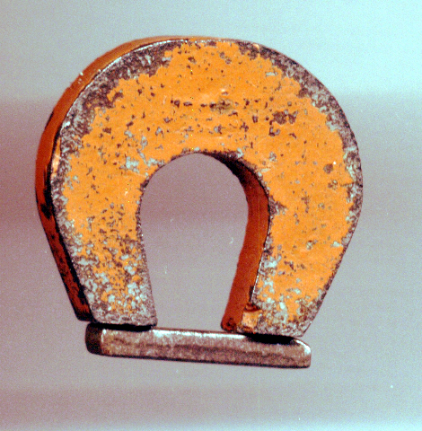{ width="250" }
    > **A permanent magnet** attracting iron filings

    An **electromagnet** is a coil of wire that acts like a magnet when electric current runs through it.

    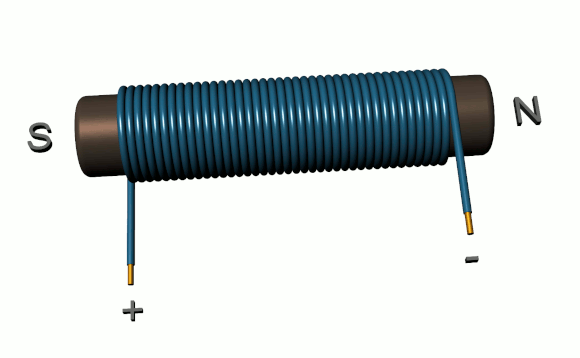{ width="350" }
    > **A simple electromagnet**. Current flowing through the coil generates a magnetic field

    The [right-hand rule](https://en.wikipedia.org/wiki/Right-hand_rule) predicts the direction of the magnetic field (B) around a wire: point your right thumb in the direction of the current (I), and your fingers curl in the direction of the field.

    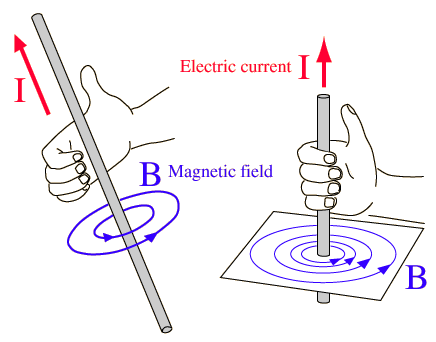{ width="350" }
    > **The right-hand rule**. With the thumb pointing along the current (I), the curled fingers show the direction of the magnetic field (B) circling the wire

    :material-youtube: MinutePhysics: [How Magnets Work](https://www.youtube.com/watch?v=hFAOXdXZ5TM)

### Protons Are Tiny Magnets

Hydrogen nuclei have a property called **spin** (spin ½): they behave as if they were spinning like a top. A spinning charge is magnetic, so each proton is a tiny **magnetic dipole** with a north and a south pole. These nuclear magnets are extremely weak, and outside a magnetic field they point in random directions and cancel out.

### Polarization in B<sub>0</sub>

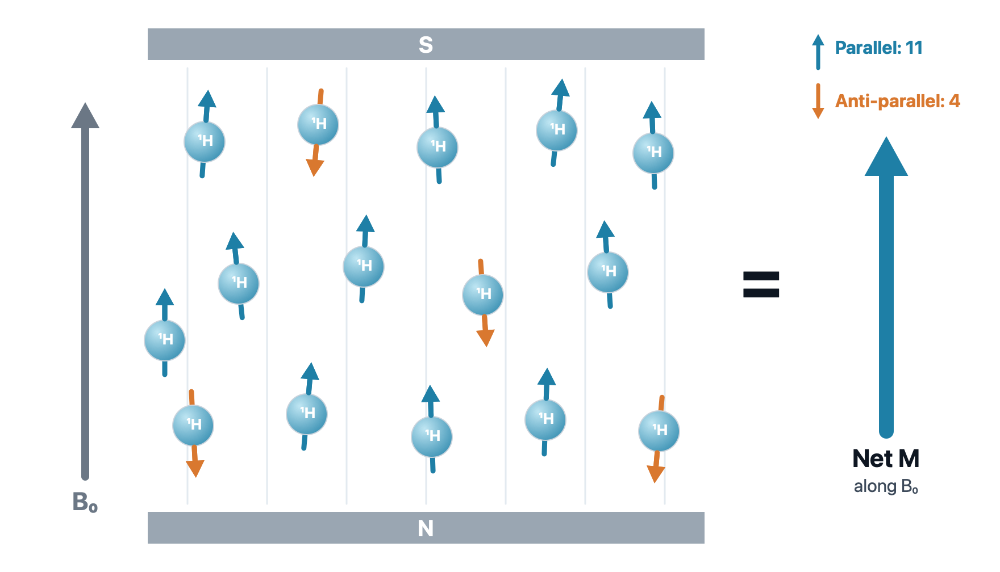{ width="600" }
> **Polarization in B<sub>0</sub>**. Inside the magnet, most spins line up **parallel** to B<sub>0</sub> (the lower-energy state, blue) and some line up **anti-parallel** (the higher-energy state, orange). The small excess of parallel spins adds up to a single **net magnetization (M)** along B<sub>0</sub>. The numbers are for illustration: in a real magnet, the excess is only a few spins per million

A stronger magnet makes a bigger excess of parallel spins, which is one reason 3 T images have more signal than 1.5 T images.

### Precession

The spins don't sit perfectly parallel to B<sub>0</sub>: each one [wobbles around it like a spinning top](https://www.imaios.com/en/e-Courses/e-MRI/NMR/Precession-and-Larmor-frequency), its axis sweeping out a cone. This motion is called **precession**. Because of it, every spin has two components at right angles: a **longitudinal** component along z, which stays steady, and a **transverse** component in the x–y plane, which rotates.

<video src="../videos/mri-precession.mp4" poster="../videos/mri-precession.jpg" width="720" style="max-width:100%" autoplay loop muted playsinline controls></video>

> **Precession**. A proton precesses around B<sub>0</sub>. Its spin splits into a steady longitudinal component along z (blue) and a transverse component (orange) that rotates in the x–y plane

The rate of precession, the **Larmor frequency**, is proportional to the strength of the magnetic field:

\(\omega_0 = \gamma B_0\)

Where:

- \(\omega_0\) is the Larmor (precession) frequency
- \(\gamma\) is the gyromagnetic ratio (42.58 MHz/T for hydrogen)
- \(B_0\) is the strength of the main magnetic field, in tesla

So hydrogen precesses at about **64 MHz at 1.5 T** and **128 MHz at 3 T**. Those are radio frequencies, which is why MRI uses radio waves.

### Net Magnetization

#### Longitudinal Component (Z): the Spins Add Up

<video src="../videos/mri-longitudinal.mp4" poster="../videos/mri-longitudinal.jpg" width="720" style="max-width:100%" autoplay loop muted playsinline controls></video>

> **Longitudinal magnetization**. Parallel spins (blue) precess on an upper cone and anti-parallel spins (orange) on a lower cone. Their x–y parts point every which way and cancel, but their z parts add up: the extra parallel spins leave a [net magnetization](https://www.imaios.com/en/e-Courses/e-MRI/NMR/Net-magnetization) along B<sub>0</sub>

#### Transverse Component (XY): Out of Phase, They Cancel

<video src="../videos/mri-transverse.mp4" poster="../videos/mri-transverse.jpg" width="720" style="max-width:100%" autoplay loop muted playsinline controls></video>

> **Transverse magnetization at rest**. All spins precess at the same frequency, but they are **out of phase**: at any moment, their transverse parts point in different directions. They cancel, so the net transverse magnetization is zero

#### At Rest in B<sub>0</sub>

| Component | At rest | Why |
| :-------- | :------ | :-- |
| **Longitudinal** (M<sub>z</sub>) | Positive | More spins are parallel than anti-parallel |
| **Transverse** (M<sub>xy</sub>) | Zero | The spins are out of phase |

A receiver coil can only detect a magnet that moves. The longitudinal magnetization just sits along B<sub>0</sub>, so to get a signal we need to create **transverse** magnetization. That is the job of excitation.

## Excitation

### Radio Waves

Radio waves are [electromagnetic radiation](electromagneticRadiation.md): self-propagating, transverse oscillating waves of electric *and* **magnetic** fields. That magnetic field is what lets a radio wave push on our tiny proton magnets.

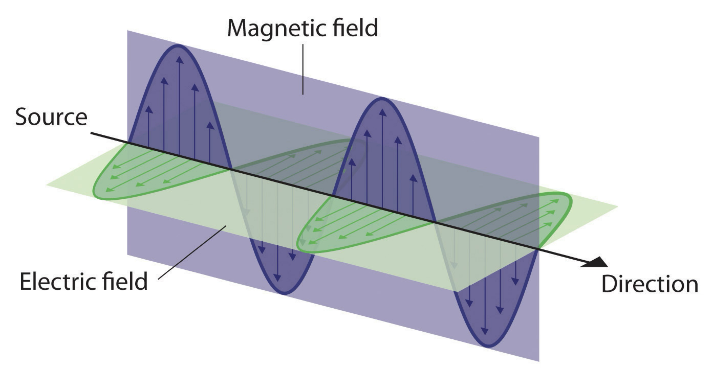{ width="450" }

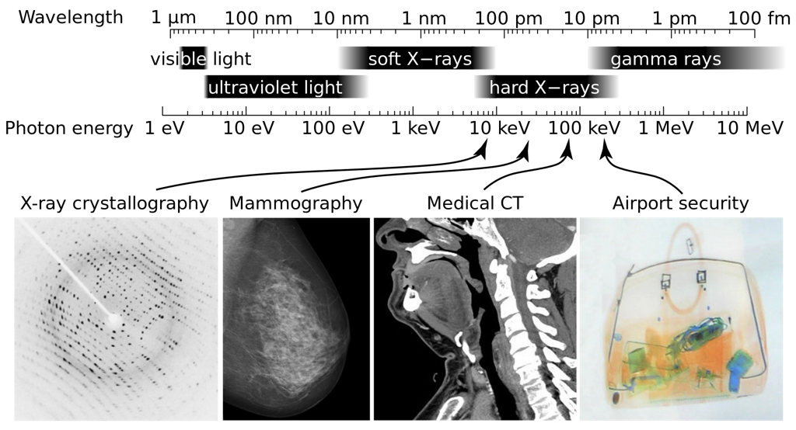{ width="550" }

[Radio frequency](https://en.wikipedia.org/wiki/Radio_frequency) (RF) covers roughly 3 kHz to 300 GHz, with wavelengths from millimeters to kilometers. Clinical MRI operates in the tens to hundreds of megahertz, the same range as FM radio.

### Resonance

**Resonance** is an exchange of energy between two systems at one specific frequency. In MRI, the two systems are the spins and a radio wave, and the spins only respond to RF at their **Larmor frequency**. It's like pushing a child on a swing: push in time with the swing's rhythm and small pushes add up; push at the wrong rhythm and nothing builds.

<video src="../videos/mri-resonance.mp4" poster="../videos/mri-resonance.jpg" width="640" style="max-width:100%" autoplay loop muted playsinline controls></video>

> **Resonance**. An RF wave at the Larmor frequency tips the net magnetization M from z down to 90˚: M<sub>z</sub> (blue) shrinks and M<sub>xy</sub> (orange) grows. When the RF stops, M relaxes back to z. Shown in the rotating frame, so M tips straight down instead of spiraling

This frequency selectivity is why MRI "hears" only hydrogen. The scanner is like a **radio tuned to one station**: at 1.5 T it transmits and listens at about 64 MHz. Electrons also have spin, but their Larmor frequency is about 42 GHz at 1.5 T (microwaves), so the scanner never excites or detects them. Other nuclei, such as sodium and phosphorus, have their own frequencies too.

### RF Excitation: Tipping the Magnetization

<video src="../videos/mri-rf-excitation.mp4" poster="../videos/mri-rf-excitation.jpg" width="560" style="max-width:100%" autoplay loop muted playsinline controls></video>

> **RF excitation in the lab frame**. When the RF pulse switches on, M spirals down from z toward the x–y plane while M<sub>z</sub> (blue) shrinks and M<sub>xy</sub> (orange) grows. The counter shows the **flip angle** rising to 90˚. M spirals because it keeps precessing while it tips

How far M tips, the **flip angle**, depends on the strength and duration of the RF pulse. A 90˚ pulse puts all of the magnetization in the transverse plane. Note that it is the *net* magnetization that tips; the individual spins do not each swing down.

### Bringing the Spins into Phase

The RF pulse does two things at once: it tips the net magnetization, and it brings the spins **into phase**.

<video src="../videos/mri-into-phase.mp4" poster="../videos/mri-into-phase.jpg" width="720" style="max-width:100%" autoplay loop muted playsinline controls></video>

> **Into phase**. At first the spins rotate out of phase, and their transverse arrows, added head to tail (right), close into a loop: the sum is 0. When the RF pulse switches on, the spins swing into line, the chain straightens, and the sum climbs to 100%

Once the spins rotate together, their transverse parts add up to a net M<sub>xy</sub>: a magnet spinning at the Larmor frequency. That rotating magnet is what produces the MR signal.

## Relaxation and the MR Signal

### Recording the Signal

A moving magnet induces a current in a nearby loop of wire ([Faraday's law of induction](https://en.wikipedia.org/wiki/Faraday%27s_law_of_induction), the same principle as an electric generator). In MRI, the moving magnet is the rotating transverse magnetization, and the loop of wire is the **receiver coil** placed around the body part.

<video src="../videos/mri-90-pulse.mp4" poster="../videos/mri-90-pulse.jpg" width="720" style="max-width:100%" autoplay loop muted playsinline controls></video>

> **The 90˚ pulse and the NMR signal**. A [90˚ RF pulse](https://www.imaios.com/en/e-Courses/e-MRI/MRI-signal-contrast/90-RF-pulse) tips M into the x–y plane. As M rotates, it induces a sine-wave signal in the receiver coil (left). As the spins relax, M spirals back up to z and the signal fades

After a single 90˚ pulse, the recorded signal fades away. This decaying signal is called the **free induction decay (FID)**.

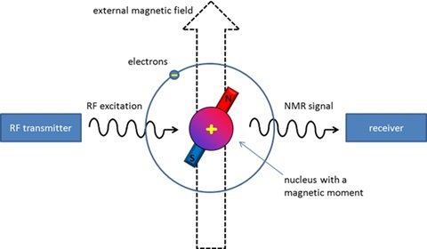{ width="450" }
> **The NMR signal** (adapted from [Applied NMR spectroscopy](https://www.utu.fi/en/units/sci/units/chemistry/research/mcca/Pages/Sub-pages%20of%20Functional%20Materials/Applied-NMR.aspx))

### T1 and T2

During relaxation, two processes run at the same time:

- **Longitudinal (T1)**: the spins return to their parallel and anti-parallel populations, so M<sub>z</sub> grows back
- **Transverse (T2)**: the spins drift back out of phase, so M<sub>xy</sub> shrinks

<video src="../videos/mri-t1-curve.mp4" poster="../videos/mri-t1-curve.jpg" width="640" style="max-width:100%" autoplay loop muted playsinline controls></video>

> **T1 recovery**. M<sub>z</sub> grows back toward 100%. **T1** is the time for M<sub>z</sub> to recover to 63% of its equilibrium value (here, T1 = 250 ms)

<video src="../videos/mri-t2-curve.mp4" poster="../videos/mri-t2-curve.jpg" width="640" style="max-width:100%" autoplay loop muted playsinline controls></video>

> **T2 decay**. As the spins fan out of phase, M<sub>xy</sub> shrinks toward zero. **T2** is the time for M<sub>xy</sub> to fall to 37% of its initial value (here, T2 = 150 ms)

### T1 Relaxation

<video src="../videos/mri-t1-relaxation.mp4" poster="../videos/mri-t1-relaxation.jpg" width="720" style="max-width:100%" autoplay loop muted playsinline controls></video>

> **T1 relaxation**. Just after the 90˚ pulse, all the spins lie in the x–y plane and M<sub>z</sub> is zero. One by one, they leave the plane: most rise to the parallel cone (blue) and about one in four drops to the anti-parallel cone (orange). The net M<sub>z</sub> grows as the recovery curve (right) passes 63% at T1, 86% at 2T1, and 95% at 3T1. The spin counts are only for illustration

T1 relaxation happens because the spins give their extra energy back to the surrounding molecules (the "lattice"), so it is also called **spin–lattice relaxation**. The recovery is exponential:

\(M_z = M_0 \left(1 - e^{-t/T1}\right)\)

### T2 Relaxation

<video src="../videos/mri-t2-relaxation.mp4" poster="../videos/mri-t2-relaxation.jpg" width="720" style="max-width:100%" autoplay loop muted playsinline controls></video>

> **T2 relaxation**. Just after the 90˚ pulse, all the spins point the same way and the net M<sub>xy</sub> (navy) is at full length. The spins then drift out of phase, and the net M<sub>xy</sub> shrinks. The decay curve (right) passes 37% at T2, 14% at 2T2, and 5% at 3T2

T2 relaxation happens because neighboring spins disturb one another's local field, so some precess slightly faster and some slower. It is also called **spin–spin relaxation**. The decay is exponential:

\(M_{xy} = M_0 \, e^{-t/T2}\)

In a real scanner, small imperfections in the magnetic field make the spins dephase even faster. This faster, real-world decay is called **T2\***, and it is what you see in a free induction decay.

### T1 vs T2

|                  | T1 | T2 |
| :--------------- | :- | :- |
| **What changes** | Longitudinal magnetization (M<sub>z</sub>) recovers | Transverse magnetization (M<sub>xy</sub>) decays |
| **Also called**  | Spin–lattice relaxation | Spin–spin relaxation |
| **Defined at**   | 63% recovered | 37% left |
| **Why**          | Spins give energy to their surroundings | Spins lose phase with each other |
| **Typical time** | Hundreds to thousands of ms | Tens to hundreds of ms |

In every tissue, T2 is shorter than or equal to T1.

## Contrast

### Tissues Relax at Different Rates

Each tissue has its own T1 and T2. These are properties of the tissue, and they differ a lot from one tissue to the next:

| Tissue (1.5 T) | T1 (ms) | T2 (ms) |
| :------------- | :-----: | :-----: |
| Fat            | ≈ 260   | ≈ 80    |
| White matter   | ≈ 790   | ≈ 80    |
| Gray matter    | ≈ 920   | ≈ 100   |
| CSF (fluid)    | ≈ 4000  | ≈ 2000  |

What sets T1 and T2 is the molecular environment: how fast water molecules move and what they are next to. Free water (CSF, edema) tumbles very fast, so its T1 and T2 are both long. Water slowed down near proteins and membranes, and fat with its large molecules, relax faster. **Proton density**, the amount of hydrogen, differs by only 10 to 30% between soft tissues, so most contrast comes from T1 and T2.

We can't change the tissue, but we can choose our timing, TR and TE, to decide which difference the image shows.

### The 180˚ Pulse and the Spin Echo

After the 90˚ pulse, the spins quickly fan out and the signal fades. A [180˚ RF pulse](https://www.imaios.com/en/e-Courses/e-MRI/MRI-signal-contrast/180-RF-pulse) can bring them back together.

<video src="../videos/mri-180-pulse.mp4" poster="../videos/mri-180-pulse.jpg" width="640" style="max-width:100%" autoplay loop muted playsinline controls></video>

> **The 180˚ pulse**. After the 90˚ pulse, the spins fan out: fast spins (dark) pull ahead of slow ones (light), and M shrinks. The 180˚ pulse flips the whole fan over, so the fast spins are now behind. They catch up, the spins regroup, and the signal comes back as an **echo**. The echo arrives as long after the 180˚ pulse as the 180˚ pulse came after the 90˚ pulse

Think of a race: runners start together and spread out because some are faster. If everyone turns around at the same moment and runs back, the fast runners, now farthest away, reach the start line at the same time as the slow ones.

A [spin echo](https://www.imaios.com/en/e-Courses/e-MRI/MRI-signal-contrast/Spin-echo-TR-TE) sequence uses a 90˚ pulse followed by a 180˚ pulse to generate an echo. The 180˚ pulse is applied at TE/2, so the echo peaks at **TE**. The echo recovers the signal lost to field imperfections (T2\*), but not the true T2 decay. The whole sequence repeats every **TR**.

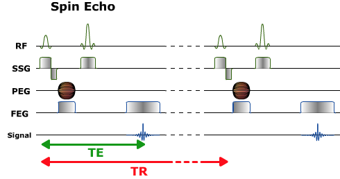{ width="490" }
> **Spin echo pulse sequence diagram**. Each row is plotted against time. **RF**: the 90˚ pulse followed by the 180˚ pulse. **SSG**: the slice selection gradient, applied during each RF pulse. **PEG**: the phase encoding gradient (the striped symbol means its strength changes with every repetition). **FEG**: the frequency encoding (readout) gradient. **Signal**: the echo, which peaks at TE. The whole sequence repeats every TR

### TR and TE: Weighting

By choosing TR and TE, the operator controls how much each tissue property contributes to image contrast. See [TR and TE Signal Weighting](https://www.imaios.com/en/e-Courses/e-MRI/MRI-signal-contrast/Signal-weighting).

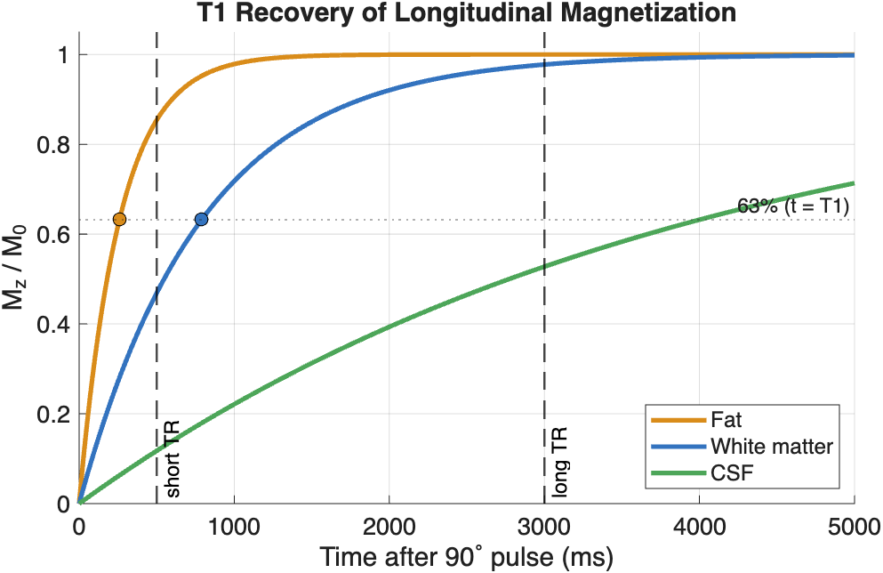{ width="600" }
> **T1 recovery** of fat, white matter, and CSF (approximate values at 1.5 T). Dots mark each tissue's T1, where M<sub>z</sub> reaches 63% of M<sub>0</sub>

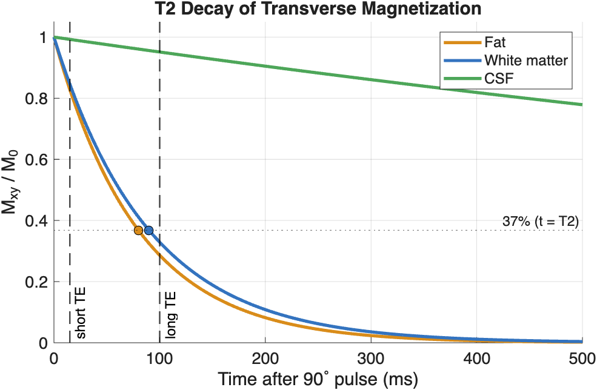{ width="600" }
> **T2 decay** of the same tissues. Dots mark each tissue's T2, where M<sub>xy</sub> falls to 37% of its initial value. CSF's T2 (about 2000 ms) is so long that it barely decays on this time scale

- **TR sets T1 contrast.** At a *short TR*, the next 90˚ pulse arrives before the tissues have fully recovered. Fat (short T1) has recovered most and gives a strong signal, while CSF (long T1) has recovered little and stays dark. At a *long TR*, all tissues have nearly fully recovered, so T1 differences disappear.
- **TE sets T2 contrast.** At a *short TE*, the echo is read before the tissues have decayed much, so T2 differences are small. At a *long TE*, short-T2 tissues have lost most of their signal while CSF (long T2) is still bright.

| Weighting | TR    | TE    | CSF looks |
| :-------- | :---: | :---: | :-------- |
| T1        | Short | Short | Dark |
| T2        | Long  | Long  | Bright |
| PD        | Long  | Short | Intermediate |

!!! note "How short is short?"

    There is no single cut-off between "short" and "long". These are typical values for a spin echo sequence at 1.5 T:

    |        | Short | Long |
    | :----- | :---- | :--- |
    | **TR** | Less than about 800 ms (often 400–600 ms) | More than about 2000 ms (often 2000–4000 ms) |
    | **TE** | Less than about 30 ms (often 10–20 ms) | More than about 80 ms (often 80–120 ms) |

    Values in between give mixed weighting. The ranges make sense when you compare them with the tissues' relaxation times (see [Tissues Relax at Different Rates](#tissues-relax-at-different-rates)):

    - A **short TR** is close to the T1 of soft tissue (about 250–1000 ms), so the next pulse catches each tissue partway through its recovery, and differences in T1 show
    - A **long TR** is several times longer than the T1 of most soft tissue, so nearly everything has recovered and T1 differences fade
    - A **short TE** is much shorter than the T2 of soft tissue (about 80–100 ms), so little decay has happened and T2 differences are small
    - A **long TE** is about as long as the T2 of soft tissue, which is where the differences in T2 decay are largest

    The exact values depend on the scanner and the sequence. T1 gets longer at higher field strength, so TRs are usually a bit longer at 3 T. Faster sequences, such as fast spin echo and gradient echo, use their own ranges.

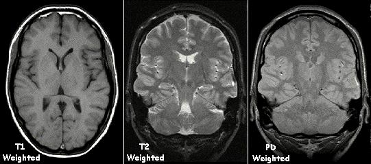{ width="541" }
> **The same brain with T1, T2 and PD weighting**. CSF in the ventricles is dark on T1, bright on T2, and intermediate on PD. Note that the white matter is brighter than the gray matter on T1 and darker on T2 (Image: [KieranMaher](https://commons.wikimedia.org/wiki/File:T1t2PD.jpg), public domain)

!!! tip "Quick check"

    Bright CSF usually means a T2-weighted image. Dark CSF usually means a T1-weighted image (or FLAIR, below).

### Common Pulse Sequences

| Sequence | How it works | Strength | Trade-off |
| :------- | :----------- | :------- | :-------- |
| Spin echo (SE) | 90˚ then 180˚ pulse | T1, T2, or PD contrast | Slow, especially T2 |
| Fast spin echo | A train of echoes in each TR | Much faster than SE | Fat stays bright on T2 |
| Inversion recovery (IR) | A 180˚ pulse first, wait an inversion time (TI), then image | Can null one tissue | Longer scan time |
| STIR | IR with a short TI (about 150 ms) | Suppresses fat | Longer scan time |
| FLAIR | IR with a long TI (about 2200 ms) | Suppresses CSF | Longer scan time |

## Image Formation

### Magnetic Gradients Encode Position

So far, every proton precesses at the same frequency, so the scanner can't tell *where* a signal came from. [Magnetic field gradients](https://www.imaios.com/en/e-Courses/e-MRI/Signal-spatial-encoding/Magnetic-field-gradients) fix that. A gradient makes the field slightly stronger on one side than the other. Because the Larmor frequency is proportional to field strength, **field varies with position, so frequency varies with position too**. It's like a piano keyboard, where each key plays its own note.

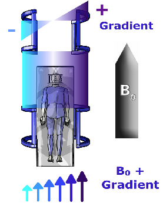{ width="280" }
> **An X gradient**. The gradient coils add to B<sub>0</sub> on one side of the patient and subtract from it on the other, so field strength (arrows) increases from left to right

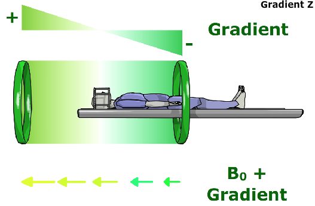{ width="500" }
> **A Z gradient**. Here the field strength changes along the bore, from head to foot. Protons at the head end precess faster than protons at the feet

For example, at 1.5 T, a typical gradient of 10 mT/m along the head-to-foot axis changes the precession frequency by about 4 kHz per centimeter: about 63.82 MHz 10 cm toward the feet, 63.86 MHz at the center, and 63.90 MHz 10 cm toward the head.

!!! note "Gradients are brief pulses"

    Unlike B<sub>0</sub>, which is always on, the gradients are switched on for only a few milliseconds at a time, many times during every TR. Their rapid switching makes the gradient coils vibrate, which is the loud knocking you hear during a scan.

Spatial encoding happens in three steps:

1. **Slice selection**: a gradient applied during the RF pulse means only one slice matches the pulse's frequencies, so only that slice is excited
2. **Phase encoding**: a brief gradient pulse before readout encodes position along one in-plane axis (rows). It is repeated with a different strength every TR
3. **Frequency encoding**: a gradient applied during readout encodes position along the other axis (columns)

### Fast Fourier Transform

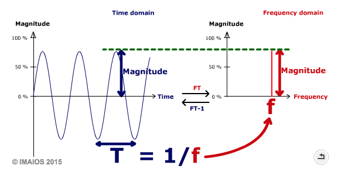{ width="577" }
> **Time domain and frequency domain**. A sine wave with period T (left) is represented in the frequency domain by a single spike at frequency f = 1/T (right). The Fourier Transform (FT) converts from time to frequency, and the inverse Fourier Transform (FT<sup>-1</sup>) converts back (© IMAIOS 2015)

The **Fourier Transform** breaks a complex wave into its sinusoidal components. The **Fast Fourier Transform (FFT)** is an efficient algorithm for computing it. See the [IMAIOS description of the FFT](https://www.imaios.com/en/e-Courses/e-MRI/The-Physics-behind-it-all/Fourier-transform), which includes the animations of 2D Fourier transforms shown in lecture.

### k-space

The scanner does not record an image directly. Each phase-encoding step fills one line of a frequency-domain data matrix called **k-space**. Once k-space is full, the *inverse* Fourier Transform converts it into the image. See the IMAIOS animations of [k-space filling](https://www.imaios.com/en/e-Courses/e-MRI/Signal-spatial-encoding) shown in lecture.

Because each TR fills one line, **scan time ≈ TR × number of phase-encoding lines × number of averages**. A T2-weighted spin echo with a TR of 3000 ms and 256 lines takes almost 13 minutes, which is why fast spin echo, which fills several lines in each TR, is so much faster.

Every point in k-space contributes to the whole image, not to a single pixel:

- The **center** of k-space holds the low spatial frequencies, which carry the overall brightness and contrast
- The **edges** of k-space hold the high spatial frequencies, which carry the fine details and edges

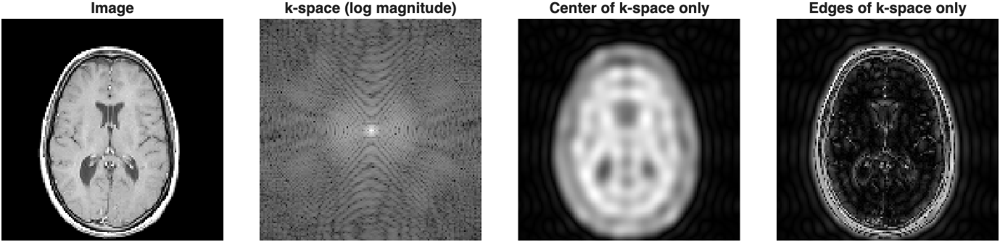
> **An MRI slice and its k-space**. Reconstructing from only the center of k-space gives a blurry image with the correct contrast. Reconstructing from only the edges gives just the outlines

You can reproduce this figure in MATLAB with the sample `mri` dataset that ships with MATLAB. Here, `fft2` plays the role of the scanner by creating k-space from the image, and `ifft2` reconstructs the image:

```matlab
load mri D                             % sample MRI volume
img = double(D(:,:,1,15));             % one axial slice

K = fftshift(fft2(img));               % k-space, with low frequencies centered

% circular mask for the center of k-space
[r,c] = size(K);
[X,Y] = meshgrid(1:c,1:r);
mask = hypot(X-c/2-1, Y-r/2-1) <= 12;

lowImg  = abs(ifft2(ifftshift(K.*mask)));   % center only
highImg = abs(ifft2(ifftshift(K.*~mask)));  % edges only

tiledlayout(1,4)
nexttile; imshow(img,[]);            title('Image')
nexttile; imshow(log(1+abs(K)),[]);  title('k-space (log magnitude)')
nexttile; imshow(lowImg,[]);         title('Center of k-space only')
nexttile; imshow(highImg,[]);        title('Edges of k-space only')
```

## Clinical MRI Techniques

By changing the pulse sequence, the same scanner can produce very different kinds of images.

### T1- and T2-weighted Imaging

The workhorse sequences of clinical MRI (see [TR and TE: Weighting](#tr-and-te-weighting) above).

- **T1-weighted** images show anatomy clearly: fat is bright, fluid is dark, and white matter is brighter than gray matter. With a gadolinium contrast agent, which shortens T1, T1-weighted images also highlight tumors and inflammation where the blood-brain barrier is disrupted.
- **T2-weighted** images make fluid bright. Because most disease processes (edema, inflammation, many tumors) increase tissue water, T2-weighted images are sensitive to pathology.

### FLAIR

**Fluid-Attenuated Inversion Recovery (FLAIR)** is a T2-weighted sequence that suppresses the signal from free fluid such as CSF. A 180˚ *inversion* pulse is applied first. The 90˚ pulse is then timed for the moment when CSF's recovering longitudinal magnetization passes through zero, so CSF gives no signal.

The result is a T2-weighted image in which CSF is dark. Lesions next to the ventricles and the brain surface, which would be hidden by bright CSF on a regular T2-weighted image, stand out clearly. FLAIR is widely used to detect multiple sclerosis plaques, edema, and stroke.

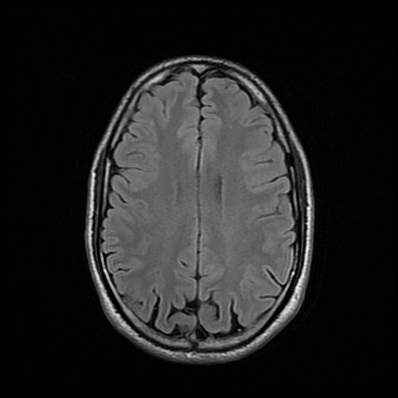{ width="350" }
> **Axial FLAIR image of a normal brain**. The image is T2-weighted, but the CSF in the sulci is dark (Image: [511KeV](https://commons.wikimedia.org/wiki/File:Mri_Brain_Flair_Axial_(14).jpg), CC BY-SA 4.0)

### Time-of-Flight Angiography

**Time-of-Flight (TOF) MR angiography** images blood vessels without a contrast agent. Rapid, repeated RF pulses (very short TR) *saturate* stationary tissue, which never has time to recover and stays dark. Blood flowing into the slice has not been exposed to those pulses yet, so it gives a strong signal. Moving blood is bright and everything else is dark.

The slices are usually combined into a **maximum intensity projection (MIP)** to show the vessels in 3D. TOF is used to look for aneurysms, narrowed arteries (stenosis), and vascular malformations, especially in the circle of Willis.

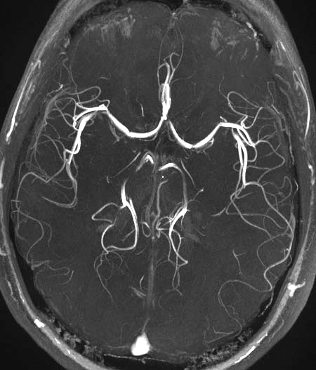{ width="350" }
> **Maximum intensity projection of a TOF MR angiogram** showing the arteries at the base of the brain, including the circle of Willis (Image: [SBarnes](https://commons.wikimedia.org/wiki/File:Mra-mip.jpg), CC BY-SA 3.0)

### Functional MRI (BOLD)

**Functional MRI (fMRI)** maps brain *activity* rather than anatomy. Most fMRI relies on the **Blood Oxygen Level Dependent (BOLD)** signal:

1. Active neurons trigger an increase in local blood flow that delivers more oxygen than they consume
2. The ratio of oxygenated to deoxygenated hemoglobin rises in the active region
3. Deoxyhemoglobin is paramagnetic: it distorts the local magnetic field and speeds up spin dephasing. With less of it, the MR signal in the region rises slightly (by a few percent)

fMRI acquires fast T2\*-weighted images of the whole brain every few seconds while the subject alternates between a task and rest. Statistical analysis then finds the voxels whose signal follows the task. Clinically, fMRI is used to map language and motor areas before brain surgery.

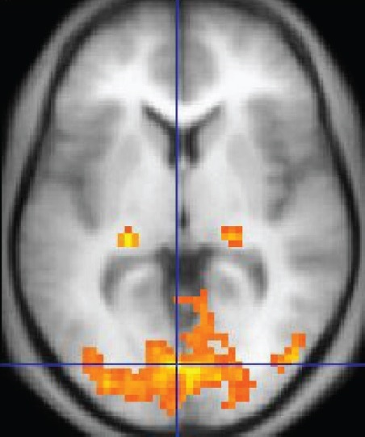{ width="350" }
> **fMRI activation map**. Colored voxels show regions where the BOLD signal changed with a visual task, overlaid on an anatomical image. The activity is concentrated in the visual cortex of the occipital lobe (Image: [OpenStax](https://commons.wikimedia.org/wiki/File:1206_FMRI.jpg), CC BY 4.0)

### Diffusion Tensor Imaging

**Diffusion-weighted imaging (DWI)** measures the random motion of water molecules. Strong *diffusion gradients* are added to the sequence, and water molecules that move along the gradient direction during the measurement lose signal. Tissue where diffusion is restricted stays bright. DWI is the most sensitive test for **acute stroke**, which appears within minutes because swollen cells restrict water diffusion.

In white matter, water diffuses easily *along* axons but poorly *across* them (this directional preference is called **anisotropy**). **Diffusion Tensor Imaging (DTI)** measures diffusion in at least six directions and fits a 3D *tensor* in every voxel, which gives the main direction of diffusion. Measures such as **fractional anisotropy (FA)** describe white matter integrity. **Tractography** follows the main direction from voxel to voxel to reconstruct white matter pathways, which helps neurosurgeons avoid critical tracts.

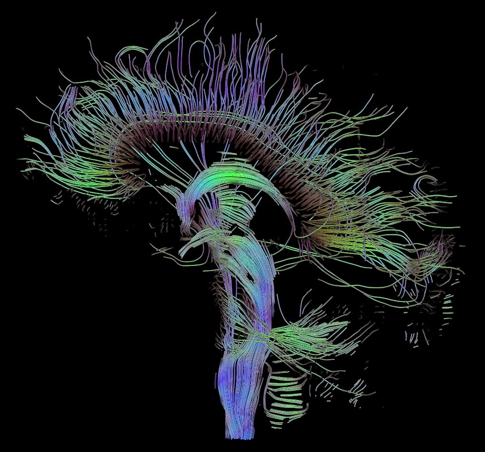{ width="450" }
> **DTI tractography of the brain (sagittal view)**. Each streamline traces a white matter pathway reconstructed from the direction of water diffusion (Image: [Thomas Schultz](https://commons.wikimedia.org/wiki/File:DTI-sagittal-fibers.jpg), CC BY-SA 3.0)

### BOLD vs Diffusion

|                       | BOLD fMRI | Diffusion (DWI / DTI) |
| :-------------------- | :-------- | :-------------------- |
| **Measures**          | Changes in blood oxygenation that follow neural activity | Random motion of water molecules |
| **Source of contrast**| Paramagnetic deoxyhemoglobin speeds up dephasing (T2\*) | Signal loss from water moving along the diffusion gradients |
| **Reveals**           | *Function*: which regions are active during a task | *Structure*: tissue microstructure and white matter pathways |
| **Acquisition**       | Many fast images over several minutes (a time series) | Images repeated for several gradient directions |
| **Clinical uses**     | Presurgical mapping of language and motor areas | Acute stroke diagnosis; tractography for surgical planning |

## MRI vs CT

### CT

CT is ideal for differentiating objects with different X-ray attenuation coefficients.

- Bones are relatively easy to segment
- Bones can sometimes obscure other details
- Intensities are standardized in [Hounsfield units](CTImaging.md#hounsfield-units), so the same tissue has similar values across scans

### MRI

MRI is ideal for distinguishing soft tissues, but objects must contain **hydrogen** (e.g., water or fat) to generate signal.

- There are some workarounds for dry materials, but they are not always feasible

!!! danger "Metal in the scanner"

    Ferromagnetic objects are extremely dangerous in an MRI: the magnet is always on and can turn them into projectiles. Even non-ferromagnetic metal implants can heat up and usually distort the image, producing signal voids and susceptibility artifacts.

MRI objects are often harder to threshold based on their grayscale values:

- MRI intensities are not standardized like Hounsfield units; they vary with the scanner, sequence, and settings, and can drift across a single image (intensity inhomogeneity)
- Tissues may look different in texture but have similar grayscale values
- Manual segmentation is often required
- Borders are not always crisp, due to partial volume effects and signal loss at tissue boundaries
