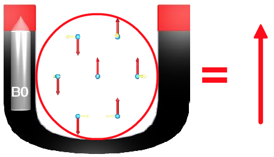

# Magnetic Resonance Imaging Overview

## Learning Objectives

- Explain how the excitation and relaxation of protons can be used to generate an RF signal
- Explain what magnetic field gradients are used for in MRI
- Explain the Fourier Transform and how its inverse is used to generate MRI images
- Explain how TR and TE control image contrast:
    - **TR controls T1-weighting**: the longer the TR, the *less* T1-weighted the image
    - **TE controls T2-weighting**: the shorter the TE, the *less* T2-weighted the image
    - A **short TR** and a **short TE** give a **T1-weighted** image
    - A **long TR** and a **long TE** give a **T2-weighted** image
    - A **long TR** and a **short TE** give a **proton density (PD)-weighted** image
- Describe the clinical applications of MRI techniques such as T1-weighting, T2-weighting, FLAIR, Time-of-Flight angiography, fMRI, and Diffusion Tensor Imaging
- Explain the difference between BOLD (fMRI) and diffusion imaging methods

## Important Terminology

| Term | Definition |
| ---- | ---------- |
| **Resonance** | The absorption of energy when a system is driven at its natural frequency. In MRI, protons absorb RF energy only at their precession (Larmor) frequency |
| **RF** | Radio frequency: the electromagnetic energy used to excite protons, and the signal they emit as they relax |
| **T1** | The time constant describing how the longitudinal magnetization (M<sub>z</sub>) recovers to its equilibrium value (M<sub>0</sub>) after excitation |
| **T2** | The time constant describing how the transverse magnetization (M<sub>xy</sub>) decays as spins dephase |
| **TR** | Repetition time: the time between successive excitation (90˚) pulses |
| **TE** | Echo time: the time between the excitation (90˚) pulse and the peak of the echo signal |

## Useful Resources

- [MRI Questions](http://mriquestions.com/index.html)
- [IMAIOS e-MRI](https://www.imaios.com/en/e-Courses/e-MRI) (requires a free account)
    - [Nuclear Magnetic Resonance](https://www.imaios.com/en/e-Courses/e-MRI/NMR)
    - [MR Signal](https://www.imaios.com/en/e-Courses/e-MRI/MRI-signal-contrast)
    - [Spatial Encoding](https://www.imaios.com/en/e-Courses/e-MRI/Signal-spatial-encoding)
    - [Image Formation](https://www.imaios.com/en/e-Courses/e-MRI/The-Physics-behind-it-all)
    - [Diffusion Tensor Imaging](https://www.imaios.com/en/e-Courses/e-MRI/Diffusion-Tensor-Imaging)
    - [Functional MRI](https://www.imaios.com/en/e-Courses/e-MRI/Functional-MRI)

## Important Concepts

### Electromagnetic Radiation

[Electromagnetic radiation](https://en.wikipedia.org/wiki/Electromagnetic_radiation) is a fundamental phenomenon of electromagnetism. It behaves both as waves and as particles (photons) that travel through space carrying radiant energy. See [Electromagnetic Radiation and Light](electromagneticRadiation.md) for more detail.

{ width="450" }

Electromagnetic waves are self-propagating, transverse oscillating waves of electric *and* **magnetic** fields.

{ width="550" }

The electromagnetic spectrum spans all possible frequencies of electromagnetic radiation. Different frequencies are associated with different physical phenomena, such as visible light.

**Radio waves** have wavelengths ranging from millimeters to kilometers. By contrast, visible light wavelengths are measured in hundreds of nanometers, and X-ray wavelengths in picometers.

### Magnetism

The concept of [magnetism](https://en.wikipedia.org/wiki/Magnetic_field) is intricately entwined with electric currents and magnetic materials.

A magnet is a material or object that produces an invisible magnetic field, which exerts a force on ferromagnetic materials (such as iron).

{ width="250" }
> **A permanent magnet** attracting iron filings

An **electromagnet** is a coil of wire that acts like a magnet when electric current runs through it. The main magnet of an MRI scanner is a very large (usually superconducting) electromagnet.

{ width="350" }
> **A simple electromagnet**. Current flowing through the coil generates a magnetic field

:material-youtube: MinutePhysics: [How Magnets Work](https://www.youtube.com/watch?v=hFAOXdXZ5TM)

### Right-Hand Rule

{ width="350" }
> **The right-hand rule**. With the thumb pointing along the current (I), the curled fingers show the direction of the magnetic field (B) circling the wire

The [right-hand rule](https://en.wikipedia.org/wiki/Right-hand_rule) predicts the direction of the magnetic field (B) around a wire: point your right thumb in the direction of the current (I), and your fingers curl in the direction of the field.

### Radio Frequency

[Radio frequency](https://en.wikipedia.org/wiki/Radio_frequency) (RF) describes electromagnetic wave frequencies in the range of roughly 3 kHz to 300 GHz. Clinical MRI operates in the tens to hundreds of megahertz (about 64 MHz at 1.5 T and 128 MHz at 3 T).

## Brief Overview of MRI

MRI uses a **strong static magnetic field**, **magnetic field gradients**, and **radio waves** to generate an image.

The technique relies on detecting radio frequency (RF) energy emitted by **hydrogen nuclei** (protons), which are abundant in any tissue containing water or fat. During an MRI scan, these protons are excited by an RF pulse. As they relax, they emit an RF signal, known as the NMR signal.

{ width="450" }
> **The NMR signal** (adapted from [Applied NMR spectroscopy](https://www.utu.fi/en/units/sci/units/chemistry/research/mcca/Pages/Sub-pages%20of%20Functional%20Materials/Applied-NMR.aspx))

Each tissue has a characteristic proton density and its own rates of recovery from excitation (described by the **T1** and **T2** time constants). Together, proton density, T1, and T2 produce the differences in NMR signal that are used to generate the image. Because tissues differ in all three properties, MRI produces much greater soft-tissue contrast than CT, even though its spatial resolution is generally lower.

Magnetic field gradients are used to encode spatial location in the MR signal.

### Precession

In a magnetic field, each proton's spin axis [wobbles like a spinning top](https://www.imaios.com/en/e-Courses/e-MRI/NMR/Precession-and-Larmor-frequency) (or a dreidel) around the direction of the main magnetic field (the longitudinal, or z, axis). This motion is called **precession**.

The rate of precession, called the **Larmor frequency**, is proportional to the strength of the magnetic field:

\(\omega_0 = \gamma B_0\)

Where:

- \(\omega_0\) is the Larmor (precession) frequency
- \(\gamma\) is the gyromagnetic ratio (42.58 MHz/T for hydrogen)
- \(B_0\) is the strength of the main magnetic field, in tesla

### Net Magnetization

{ width="450" }
> **Net magnetization**. Inside the magnet (B<sub>0</sub>), each proton has a longitudinal component (red) and a transverse component (yellow). Slightly more longitudinal components point with B<sub>0</sub> than against it, while the transverse components point in random directions and cancel out. The sum is a single net magnetization vector pointing along B<sub>0</sub> (right)

#### Longitudinal Component (Z)

Spins align either parallel or anti-parallel to the magnetic field. Slightly more align in parallel, producing a [net magnetization](https://www.imaios.com/en/e-Courses/e-MRI/NMR/Net-magnetization) in the direction of the magnetic field.

#### Transverse Component (XY)

All spins precess at the same frequency, but at rest they are **out of phase**: at any given moment, their transverse components point in random directions and cancel each other out.

Therefore, there is **no net transverse magnetization** at equilibrium.

### 90˚ Pulse

A [90˚ RF pulse](https://www.imaios.com/en/e-Courses/e-MRI/MRI-signal-contrast/90-RF-pulse) tips the net magnetization down into the transverse plane, so that:

- No longitudinal magnetization remains
- Transverse magnetization appears, because the spins now precess in phase

As this transverse magnetization precesses, it induces the MR signal in the receiver coil. The readout MR signal is a mix of RF waves with different amplitudes, frequencies, and phases. All of these properties can be used to reconstruct the signal into spatial information.

### 180˚ Pulse

After the 90˚ pulse, the spins quickly begin to dephase and the signal fades. A [180˚ RF pulse](https://www.imaios.com/en/e-Courses/e-MRI/MRI-signal-contrast/180-RF-pulse) flips the dephasing spins, causing them to rephase and generate another MR signal, called an **echo**.

### Spin Echo

A [spin echo](https://www.imaios.com/en/e-Courses/e-MRI/MRI-signal-contrast/Spin-echo-TR-TE) sequence uses a 90˚ pulse followed by a 180˚ pulse to generate an echo. The time from the 90˚ pulse to the echo is the **TE**; the time between successive 90˚ pulses is the **TR**.

{ width="490" }
> **Spin echo pulse sequence diagram**. Each row is plotted against time. **RF**: the 90˚ pulse followed by the 180˚ pulse. **SSG**: the slice selection gradient, applied during each RF pulse. **PEG**: the phase encoding gradient (the striped symbol means its strength changes with every repetition). **FEG**: the frequency encoding (readout) gradient. **Signal**: the echo, which peaks at TE. The whole sequence repeats every TR

### T1 and T2

**T1** defines the recovery rate of longitudinal magnetization: it is the time it takes for M<sub>z</sub> to recover to about 63% of its equilibrium value.

**T2** defines the decay rate of transverse magnetization: it is the time it takes for M<sub>xy</sub> to decay to about 37% of its initial value.

{ width="600" }
> **T1 recovery** of fat, white matter, and CSF (approximate values at 1.5 T). Dots mark each tissue's T1, where M<sub>z</sub> reaches 63% of M<sub>0</sub>

{ width="600" }
> **T2 decay** of the same tissues. Dots mark each tissue's T2, where M<sub>xy</sub> falls to 37% of its initial value. CSF's T2 (about 2000 ms) is so long that it barely decays on this time scale

By choosing TR and TE, the operator controls how much each of these properties contributes to image contrast. See [TR and TE Signal Weighting](https://www.imaios.com/en/e-Courses/e-MRI/MRI-signal-contrast/Signal-weighting).

- **TR sets T1 contrast.** At a *short TR*, the next 90˚ pulse arrives before the tissues have fully recovered. Fat (short T1) has recovered most and gives a strong signal, while CSF (long T1) has recovered little and stays dark. At a *long TR*, all tissues have nearly fully recovered, so T1 differences disappear.
- **TE sets T2 contrast.** At a *short TE*, the echo is read before the tissues have decayed much, so T2 differences are small. At a *long TE*, short-T2 tissues have lost most of their signal while CSF (long T2) is still bright.

| Weighting | TR    | TE    |
| :-------- | :---: | :---: |
| T1        | Short | Short |
| T2        | Long  | Long  |
| PD        | Long  | Short |

{ width="541" }
> **The same brain with T1, T2 and PD weighting**. CSF in the ventricles is dark on T1, bright on T2, and intermediate on PD. Note that the white matter is brighter than the gray matter on T1 and darker on T2 (Image: [KieranMaher](https://commons.wikimedia.org/wiki/File:T1t2PD.jpg), public domain)

### Spatial Encoding

Spatial encoding relies on successively applying [magnetic field gradients](https://www.imaios.com/en/e-Courses/e-MRI/Signal-spatial-encoding/Magnetic-field-gradients). A gradient makes the field strength vary with position, so nuclei precess at different frequencies depending on *where* they are along the gradient.

{ width="280" }
> **An X gradient**. The gradient coils add to B<sub>0</sub> on one side of the patient and subtract from it on the other, so field strength (arrows) increases from left to right

{ width="500" }
> **A Z gradient**. Here the field strength changes along the bore, from head to foot. Protons at the head end precess faster than protons at the feet

Spatial encoding happens in three steps:

1. **Slice selection**: a gradient applied during the RF pulse excites only one slice
2. **Phase encoding**: a gradient encodes position along one in-plane axis (rows)
3. **Frequency encoding**: a gradient applied during readout encodes position along the other axis (columns)

### Fast Fourier Transform

{ width="577" }
> **Time domain and frequency domain**. A sine wave with period T (left) is represented in the frequency domain by a single spike at frequency f = 1/T (right). The Fourier Transform (FT) converts from time to frequency, and the inverse Fourier Transform (FT<sup>-1</sup>) converts back (© IMAIOS 2015)

The **Fourier Transform** breaks a complex wave into its sinusoidal components. The **Fast Fourier Transform (FFT)** is an efficient algorithm for computing it.

See the [IMAIOS description of the FFT](https://www.imaios.com/en/e-Courses/e-MRI/The-Physics-behind-it-all/Fourier-transform).

### k-space

The scanner does not record an image directly. Each phase-encoding step fills one line of a frequency-domain data matrix called **k-space**. Once k-space is full, the *inverse* Fourier Transform converts it into the image.

Every point in k-space contributes to the whole image, not to a single pixel:

- The **center** of k-space holds the low spatial frequencies, which carry the overall brightness and contrast
- The **edges** of k-space hold the high spatial frequencies, which carry the fine details and edges


> **An MRI slice and its k-space**. Reconstructing from only the center of k-space gives a blurry image with the correct contrast. Reconstructing from only the edges gives just the outlines

You can reproduce this figure in MATLAB with the sample `mri` dataset that ships with MATLAB. Here, `fft2` plays the role of the scanner by creating k-space from the image, and `ifft2` reconstructs the image:

```matlab
load mri D                             % sample MRI volume
img = double(D(:,:,1,15));             % one axial slice

K = fftshift(fft2(img));               % k-space, with low frequencies centered

% circular mask for the center of k-space
[r,c] = size(K);
[X,Y] = meshgrid(1:c,1:r);
mask = hypot(X-c/2-1, Y-r/2-1) <= 12;

lowImg  = abs(ifft2(ifftshift(K.*mask)));   % center only
highImg = abs(ifft2(ifftshift(K.*~mask)));  % edges only

tiledlayout(1,4)
nexttile; imshow(img,[]);            title('Image')
nexttile; imshow(log(1+abs(K)),[]);  title('k-space (log magnitude)')
nexttile; imshow(lowImg,[]);         title('Center of k-space only')
nexttile; imshow(highImg,[]);        title('Edges of k-space only')
```

## Clinical MRI Techniques

By changing the pulse sequence, the same scanner can produce very different kinds of images.

### T1- and T2-weighted Imaging

The workhorse sequences of clinical MRI (see [T1 and T2](#t1-and-t2) above).

- **T1-weighted** images show anatomy clearly: fat is bright, fluid is dark, and white matter is brighter than gray matter. With a gadolinium contrast agent, which shortens T1, T1-weighted images also highlight tumors and inflammation where the blood-brain barrier is disrupted.
- **T2-weighted** images make fluid bright. Because most disease processes (edema, inflammation, many tumors) increase tissue water, T2-weighted images are sensitive to pathology.

### FLAIR

**Fluid-Attenuated Inversion Recovery (FLAIR)** is a T2-weighted sequence that suppresses the signal from free fluid such as CSF. A 180˚ *inversion* pulse is applied first. The 90˚ pulse is then timed for the moment when CSF's recovering longitudinal magnetization passes through zero, so CSF gives no signal.

The result is a T2-weighted image in which CSF is dark. Lesions next to the ventricles and the brain surface, which would be hidden by bright CSF on a regular T2-weighted image, stand out clearly. FLAIR is widely used to detect multiple sclerosis plaques, edema, and stroke.

{ width="350" }
> **Axial FLAIR image of a normal brain**. The image is T2-weighted, but the CSF in the sulci is dark (Image: [511KeV](https://commons.wikimedia.org/wiki/File:Mri_Brain_Flair_Axial_(14).jpg), CC BY-SA 4.0)

### Time-of-Flight Angiography

**Time-of-Flight (TOF) MR angiography** images blood vessels without a contrast agent. Rapid, repeated RF pulses (very short TR) *saturate* stationary tissue, which never has time to recover and stays dark. Blood flowing into the slice has not been exposed to those pulses yet, so it gives a strong signal. Moving blood is bright and everything else is dark.

The slices are usually combined into a **maximum intensity projection (MIP)** to show the vessels in 3D. TOF is used to look for aneurysms, narrowed arteries (stenosis), and vascular malformations, especially in the circle of Willis.

{ width="350" }
> **Maximum intensity projection of a TOF MR angiogram** showing the arteries at the base of the brain, including the circle of Willis (Image: [SBarnes](https://commons.wikimedia.org/wiki/File:Mra-mip.jpg), CC BY-SA 3.0)

### Functional MRI (BOLD)

**Functional MRI (fMRI)** maps brain *activity* rather than anatomy. Most fMRI relies on the **Blood Oxygen Level Dependent (BOLD)** signal:

1. Active neurons trigger an increase in local blood flow that delivers more oxygen than they consume
2. The ratio of oxygenated to deoxygenated hemoglobin rises in the active region
3. Deoxyhemoglobin is paramagnetic: it distorts the local magnetic field and speeds up spin dephasing. With less of it, the MR signal in the region rises slightly (by a few percent)

fMRI acquires fast T2\*-weighted images of the whole brain every few seconds while the subject alternates between a task and rest. Statistical analysis then finds the voxels whose signal follows the task. Clinically, fMRI is used to map language and motor areas before brain surgery.

{ width="350" }
> **fMRI activation map**. Colored voxels show regions where the BOLD signal changed with a visual task, overlaid on an anatomical image. The activity is concentrated in the visual cortex of the occipital lobe (Image: [OpenStax](https://commons.wikimedia.org/wiki/File:1206_FMRI.jpg), CC BY 4.0)

### Diffusion Tensor Imaging

**Diffusion-weighted imaging (DWI)** measures the random motion of water molecules. Strong *diffusion gradients* are added to the sequence, and water molecules that move along the gradient direction during the measurement lose signal. Tissue where diffusion is restricted stays bright. DWI is the most sensitive test for **acute stroke**, which appears within minutes because swollen cells restrict water diffusion.

In white matter, water diffuses easily *along* axons but poorly *across* them (this directional preference is called **anisotropy**). **Diffusion Tensor Imaging (DTI)** measures diffusion in at least six directions and fits a 3D *tensor* in every voxel, which gives the main direction of diffusion. Measures such as **fractional anisotropy (FA)** describe white matter integrity. **Tractography** follows the main direction from voxel to voxel to reconstruct white matter pathways, which helps neurosurgeons avoid critical tracts.

{ width="450" }
> **DTI tractography of the brain (sagittal view)**. Each streamline traces a white matter pathway reconstructed from the direction of water diffusion (Image: [Thomas Schultz](https://commons.wikimedia.org/wiki/File:DTI-sagittal-fibers.jpg), CC BY-SA 3.0)

### BOLD vs Diffusion

|                       | BOLD fMRI | Diffusion (DWI / DTI) |
| :-------------------- | :-------- | :-------------------- |
| **Measures**          | Changes in blood oxygenation that follow neural activity | Random motion of water molecules |
| **Source of contrast**| Paramagnetic deoxyhemoglobin speeds up dephasing (T2\*) | Signal loss from water moving along the diffusion gradients |
| **Reveals**           | *Function*: which regions are active during a task | *Structure*: tissue microstructure and white matter pathways |
| **Acquisition**       | Many fast images over several minutes (a time series) | Images repeated for several gradient directions |
| **Clinical uses**     | Presurgical mapping of language and motor areas | Acute stroke diagnosis; tractography for surgical planning |

## MRI vs CT

### CT

CT is ideal for differentiating objects with different X-ray attenuation coefficients.

- Bones are relatively easy to segment
- Bones can sometimes obscure other details
- Intensities are standardized in [Hounsfield units](CTImaging.md#hounsfield-units), so the same tissue has similar values across scans

### MRI

MRI is ideal for distinguishing soft tissues, but objects must contain **hydrogen** (e.g., water or fat) to generate signal.

- There are some workarounds for dry materials, but they are not always feasible

!!! danger "Metal in the scanner"

    Ferromagnetic objects are extremely dangerous in an MRI: the magnet can turn them into projectiles. Even non-ferromagnetic metal implants can heat up and usually distort the image, producing signal voids and susceptibility artifacts.

MRI objects are often harder to threshold based on their grayscale values:

- MRI intensities are not standardized like Hounsfield units; they vary with the scanner, sequence, and settings, and can drift across a single image (intensity inhomogeneity)
- Tissues may look different in texture but have similar grayscale values
- Manual segmentation is often required
- Borders are not always crisp, due to partial volume effects and signal loss at tissue boundaries
