# Ultrasound Imaging Overview

Ultrasound imaging uses echoes of high-frequency sound to see inside the body. It works like sonar: a probe sends a short pulse of sound into the body, then listens for the echoes that bounce back from tissue boundaries.

## Learning Objectives

- Describe sound as a longitudinal pressure wave, and define wavelength, frequency, amplitude, and speed
- Explain how a piezoelectric transducer both sends ultrasound pulses and detects echoes
- Explain how the timing of an echo sets its depth, and how the strength of an echo sets its brightness
- Explain how acoustic impedance, reflection, refraction, and attenuation shape an ultrasound image
- Explain the trade-off between resolution and depth when choosing a transducer frequency
- Describe how the Doppler effect is used to image blood flow
- Describe the main clinical applications, advantages, and limitations of ultrasound

## Important Terminology

| Term | Definition |
| ---- | ---------- |
| **Ultrasound** | Sound with a frequency above the range of human hearing (above 20 kHz). Medical imaging uses about 2–15 MHz |
| **Transducer** | The probe. It sends ultrasound pulses and converts the returning echoes into electrical signals |
| **Piezoelectric crystal** | A material that vibrates when a voltage is applied, and produces a voltage when it is vibrated |
| **Echo** | The part of a sound pulse that is reflected back to the transducer |
| **Acoustic impedance (Z)** | How strongly a tissue resists the passage of sound: density × speed of sound |
| **Attenuation** | The loss of sound energy as it travels through tissue |
| **Echogenicity** | How many echoes a tissue sends back, which determines how bright it looks |
| **Doppler effect** | The change in frequency of a wave reflected from a moving object |

## Useful Resources

- [Ultrasound in Medical Diagnosis](https://www.genesis.net.au/~ajs/projects/medical_physics/ultrasound/)
- [Longitudinal and transverse wave animations](https://www.acs.psu.edu/drussell/Demos/waves/wavemotion.html) (Dan Russell, Penn State)

## Modality Comparison

Every imaging modality turns a different physical property into brightness:

| Modality | What sets the brightness of each pixel |
| :------- | :------------------------------------- |
| **Visible light** | The amount of light reaching the image sensor |
| **X-ray and CT** | How strongly tissues attenuate the X-rays passing through them |
| **MRI** | Proton density and the T1 and T2 relaxation properties of the tissue |
| **Ultrasound** | The **strength of the echoes** reflected back from tissue boundaries |

## Sound Waves

### Sound is a Pressure Wave

Sound is a mechanical wave: a wave of pressure that travels through a medium such as air, water, or tissue. A vibrating source (a speaker, a tuning fork, or a crystal in an ultrasound probe) pushes on the molecules next to it, and they push on their neighbors.

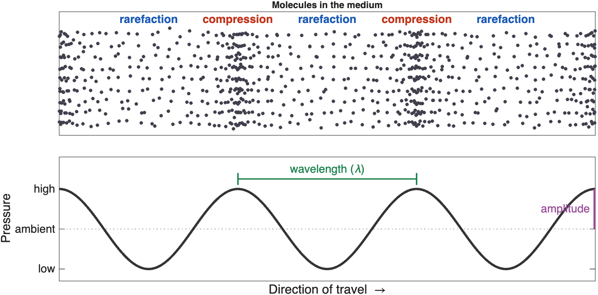{ width="650" }
> **A sound wave**. Molecules bunch together in zones of high pressure (**compression**) and spread apart in zones of low pressure (**rarefaction**). The pressure curve below shows the same wave as a graph

{ width="450" }
> **A longitudinal wave in motion**. The wave travels from left to right, but each molecule only moves back and forth around its starting point. Keep your eye on one red dot (Animation: [Dan Russell, Penn State](https://www.acs.psu.edu/drussell/Demos/waves/wavemotion.html))

!!! note "Key ideas"

    - The *wave* travels, but the molecules only move back and forth
    - Sound needs a medium. It cannot travel through a vacuum

### Transverse vs Longitudinal Waves

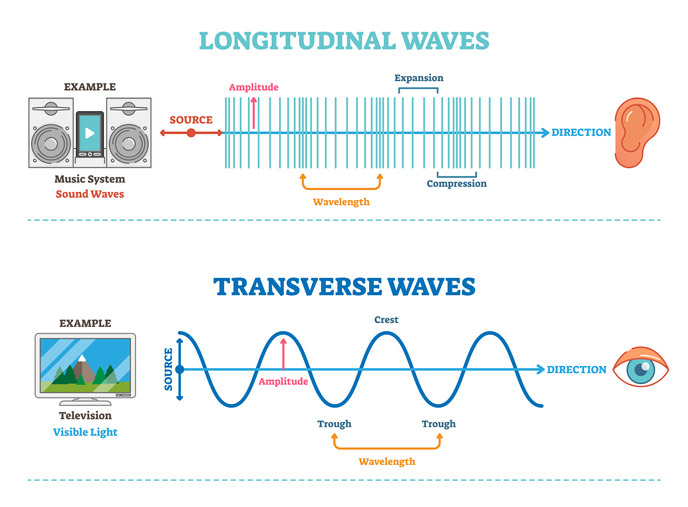{ width="550" }
> **Longitudinal and transverse waves**. In a longitudinal wave, like sound, the medium moves back and forth along the direction of travel, forming compressions and expansions (rarefactions). In a transverse wave, like light, the wave oscillates at right angles to the direction of travel

- Electromagnetic waves (light, X-rays, radio waves) are **transverse** waves
- Sound waves in air and soft tissue are **longitudinal** waves

### Properties of Waves

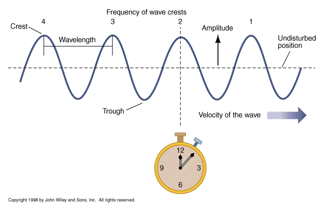{ width="550" }
> **Properties of a wave**

| Property | Definition |
| :------- | :--------- |
| **Wavelength (λ)** | The distance between two neighboring peaks (or two compressions) |
| **Frequency (f)** | The number of complete cycles that pass a fixed point each second, measured in hertz (Hz). We hear frequency as pitch |
| **Amplitude** | The height of the pressure peaks. We hear amplitude as loudness |
| **Phase** | Where in its cycle the wave is at a given point in time |
| **Speed (c)** | How fast the wave travels through the medium |

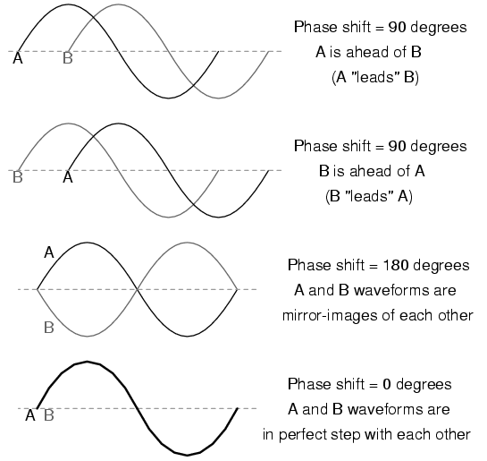{ width="350" }
> **Phase**. Two waves with the same frequency and amplitude can be shifted relative to each other: they are *out of phase*

Speed, frequency, and wavelength are linked by a simple equation:

\(c = f \lambda\)

Where:

- \(c\) is the speed of sound, in meters per second (m/s)
- \(f\) is the frequency, in hertz (Hz)
- \(\lambda\) is the wavelength, in meters (m)

!!! tip "The medium sets the speed"

    The speed of sound depends on the medium, not on the frequency: about 343 m/s in air and about **1,540 m/s in soft tissue**. So in a given tissue, raising the frequency *shortens* the wavelength. At 5 MHz in soft tissue, the wavelength is about 0.3 mm.

## Ultrasound

### Frequencies Above Our Hearing

Humans hear sounds from about 20 Hz to 20 kHz (20,000 Hz), and the upper limit drops with age. Sound below 20 Hz is called **infrasound**. Sound above 20 kHz is called **ultrasound**.

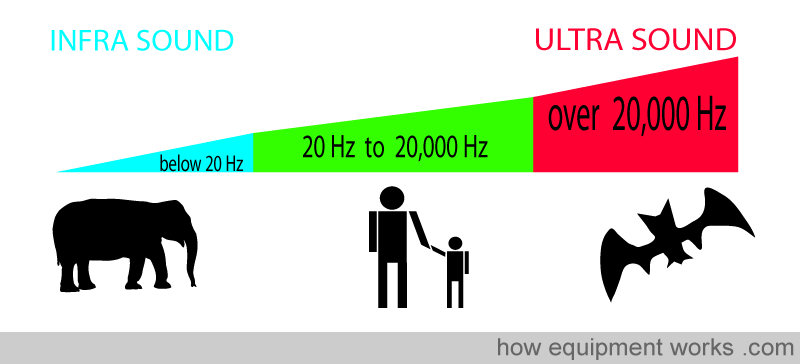{ width="550" }
> **The sound spectrum**. Elephants communicate with infrasound, humans hear from 20 Hz to 20,000 Hz, and bats use ultrasound. Medical imaging uses frequencies in the megahertz (MHz) range, far above our hearing (Image: howequipmentworks.com)

Many animals use ultrasound. Bats find prey by **echolocation**, with calls of about 20–120 kHz, and dolphins echolocate with clicks up to about 150 kHz. Medical ultrasound uses the same idea: send out a sound and listen for the echo.

### Advantages and Disadvantages

Diagnostic imaging uses frequencies of about **2–15 MHz**.

| Advantages | Disadvantages |
| :--------- | :------------ |
| Painless and non-invasive | Blocked by air (lungs, bowel gas) and by bone |
| No ionizing radiation | Higher frequencies cannot image as deep |
| Real-time imaging | Lower resolution than CT or MRI at depth |
| Inexpensive, portable, and widely available | Small field of view |
| The beam can be steered and focused | Image quality depends on the operator's skill and on the patient |

## The Transducer

The **transducer** (or probe) is both the speaker and the microphone. It sends short pulses of ultrasound into the body, then listens for the echoes. It spends far more time listening than sending.

### Piezoelectric Crystals

The key component of a transducer is an array of **piezoelectric crystals**. These materials have a special property:

- When a **voltage is applied**, the crystal changes shape. An alternating voltage makes it vibrate and send out sound
- When an **echo squeezes the crystal**, it produces a small voltage, which becomes the signal

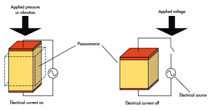{ width="400" }
> **The piezoelectric effect works in both directions**. Left: pressure or vibration on the crystal produces an electrical current (receiving an echo). Right: an applied voltage changes the crystal's shape (sending a pulse) ([Source](https://www.electronicdesign.com/technologies/components/article/21798247/whats-the-difference-between-piezoelectric-and-piezoresistive-components))

The same crystal both sends and receives, so the cycle runs like this: **send a pulse, listen for echoes, repeat**.

!!! example "Piezoelectricity in everyday life"

    A push-button gas lighter uses the same effect: pressing the button strikes a piezoelectric crystal, which produces a high-voltage spark.

### Types of Transducers

Different jobs need different transducers, with different frequencies and footprint shapes.

| Probe | Typical frequency | Image shape | Used for |
| :---- | :---------------: | :---------- | :------- |
| **Linear** | High, ~5–15 MHz | Rectangle | Shallow structures: vessels, thyroid, muscles, needle guidance |
| **Curvilinear** (convex) | Low, ~2–5 MHz | Wide fan | Deep structures: abdomen, obstetrics, trauma (FAST) exams |
| **Phased array** | Low, ~1–5 MHz | Narrow fan from a small point | The heart: the small footprint fits between the ribs |
| **Endocavitary** | ~5–10 MHz | Varies | Imaging from inside the body: transesophageal, endoscopic, transvaginal |

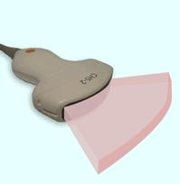{ width="250" }
> **The imaging field**. Each image is a thin slice through the body. Its shape depends on the probe: a fan (like a slice of pizza) for curvilinear and phased-array probes, or a rectangle for linear probes

## Making an Image from Echoes

### Pulse-Echo Imaging

The machine sends a pulse and starts a clock. Every echo that comes back tells it two things:

!!! abstract "The two rules of pulse-echo imaging"

    1. **Echo time → depth.** The longer an echo takes to return, the deeper its source
    2. **Echo strength → brightness.** Stronger echoes are drawn as brighter pixels

To turn time into depth, the machine assumes that sound always travels through soft tissue at **1,540 m/s** (1.54 mm per microsecond). The pulse makes a round trip, down and back, so:

\(\text{depth} = \frac{c \times t}{2}\)

Where:

- \(c\) is the speed of sound in soft tissue (1.54 mm/µs)
- \(t\) is the time between sending the pulse and receiving the echo

**Example:** an echo that returns after 130 µs came from 1.54 × 130 ÷ 2 ≈ 100 mm (10 cm) deep.

Only a tiny fraction of the sound comes back: about 1/10,000 of the transmitted power returns to the transducer.

### A-mode and B-mode

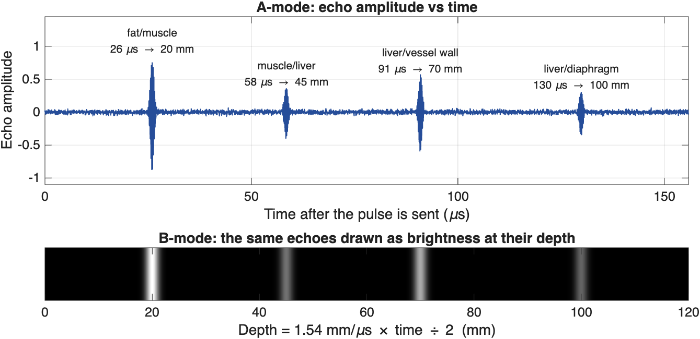{ width="700" }
> **From echoes to an image**. Top: an *A-mode* trace plots echo amplitude against time. Each echo's arrival time gives the depth of a tissue boundary. Bottom: in *B-mode*, the same echoes are drawn as bright dots at their depths. Deeper echoes tend to be weaker, because the sound loses energy on the way down and back

- **A-mode (Amplitude mode)** is a one-dimensional plot of echo strength against time (or depth). It measures distances but does not form an image, and today it is used mainly to measure the length of the eye.

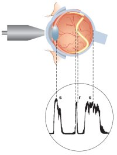{ width="250" }
> **An A-scan of the eye**. The probe sends pulses along a single line through the eye. Each spike in the trace is an echo from a boundary, such as the lens or the retina, and its position along the trace shows how deep that boundary is

- **B-mode (Brightness mode)** turns each echo into a dot whose brightness matches the echo's strength. The transducer sweeps the beam across many lines side by side, building up a two-dimensional, cross-sectional image. This is the standard grayscale ultrasound image.

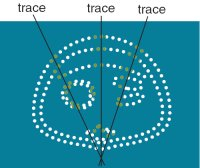{ width="250" }
> **Building a B-scan**. Each trace (scan line) records a row of dots at the depths of its echoes. Many traces fanned out side by side outline the structures in a cross-sectional image

### Describing Brightness

Radiologists and sonographers use a special vocabulary to describe how bright a structure looks:

| Term | Appearance | Examples |
| :--- | :--------- | :------- |
| **Anechoic** | Black: no echoes | Simple fluid: bladder, gallbladder, cysts, blood in vessels |
| **Hypoechoic** | Darker than the surrounding tissue | Many masses and lymph nodes |
| **Isoechoic** | The same brightness as the surrounding tissue | |
| **Hyperechoic** | Brighter than the surrounding tissue | Bone surfaces, stones, fat, tendons |

## How Tissues Interact with Sound

How a tissue interacts with sound determines what the image looks like: where echoes come from, how bright they are, and what gets lost along the way.

### Acoustic Impedance

**Acoustic impedance (Z)** is a physical property of a tissue that describes how strongly it resists the passage of sound:

\(Z = \rho \times c\)

Where \(\rho\) is the density of the tissue and \(c\) is the speed of sound in it. Impedance is measured in rayls (the values below are in megarayls, MRayl).

**Echoes form wherever impedance changes**, at the boundary between two tissues. The bigger the change, the stronger the echo. The fraction of the sound reflected at a boundary is:

\(R = \left(\frac{Z_2 - Z_1}{Z_2 + Z_1}\right)^2\)

| Tissue | Z (MRayl) |
| :----- | :-------: |
| Air | 0.0004 |
| Lung | ~0.18 |
| Fat | ~1.38 |
| Blood, liver, muscle | ~1.6–1.7 |
| Bone | ~7.8 |

| Boundary | Sound reflected | What you see |
| :------- | :-------------: | :----------- |
| Liver / muscle | ~0.03% | A subtle boundary |
| Fat / muscle | ~1% | A clear boundary; most sound passes through |
| Soft tissue / bone | ~43% | A bright surface with a shadow behind it |
| Soft tissue / air | ~99.9% | A bright line, and nothing beyond it |

!!! tip "Why we use gel"

    Almost all sound is reflected at a tissue–air boundary. Even a thin layer of air between the probe and the skin would block the sound, so we spread **coupling gel** on the skin to push the air out. For the same reason, ultrasound cannot see through the lungs or gas in the bowel.

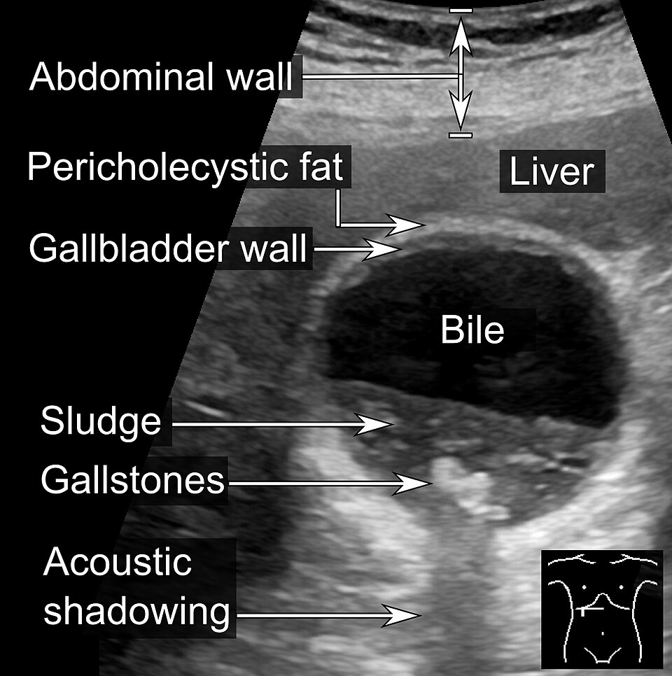{ width="400" }
> **Strong reflectors cast acoustic shadows**. The bile inside the gallbladder is anechoic (black). The gallstones are bright, and because they block the sound, they leave a dark *acoustic shadow* below them. Notice also the layers of the abdominal wall at the top and the grainy texture of the liver (Image: [Mikael Häggström](https://commons.wikimedia.org/wiki/File:Ultrasonography_of_sludge_and_gallstones,_annotated.jpg), CC0)

### Reflection and Scattering

Sound has to come back to the transducer to be seen. Tissues return sound in two ways:

- **Specular reflection** happens at large, smooth boundaries, such as the surface of an organ or a bone. These boundaries act like mirrors: sound leaves at the same angle it arrived, like a bank shot in pool. A boundary that faces the probe sends a strong echo straight back. A boundary tilted at an angle sends the sound away, so the echo never returns and that region looks dark
- **Scattering** happens at structures smaller than the wavelength, such as cells and small blood vessels inside an organ. They send weak echoes in all directions, which give organs their grainy, speckled *texture*

Strong reflectors also leave little sound to continue deeper, so the tissue behind them is dark. This is called **acoustic shadowing**.

!!! warning "Why is blood dark?"

    Blood looks black (anechoic) *not* because its impedance is low (it is close to that of soft tissue) but because it is uniform and contains few structures large enough to scatter sound at these frequencies.

Disease can change how a tissue scatters sound. For example, a **fatty liver** is brighter than a normal liver, and the sound fades faster with depth.

### Partial Reflection and Refraction

At every boundary, part of the sound is **reflected** back toward the probe and part is **transmitted** deeper. In practice, there are many boundaries, so each pulse produces a series of echoes.

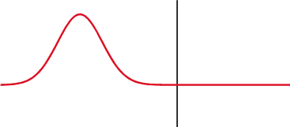{ width="400" }
> **Partial reflection**. At a boundary, part of the wave is transmitted and part is reflected. The reflected wave (traveling to the left) is the echo detected by the transducer

**[Refraction](https://en.wikipedia.org/wiki/Refraction)** is the bending of a wave when it crosses, at an angle, into a medium where it travels at a different speed. Sound, like light, can refract. The bigger the change in speed, the more it bends. A wave that hits a boundary straight on (at 90˚) does not bend.

Refraction matters because the machine assumes every echo traveled in a straight line. Refraction can therefore put structures in the wrong place, duplicate them, or cast thin dark *edge shadows* at the sides of round, fluid-filled structures.

### Attenuation

**Attenuation** is the loss of signal strength as sound travels through tissue. It has three causes:

1. **Absorption**: sound energy is converted to heat. This is the largest contributor
2. **Reflection**: energy sent back at boundaries does not continue deeper
3. **Scattering**: energy sent off in other directions

Attenuation is measured in **decibels (dB)**. A useful rule of thumb is that soft tissue attenuates about **0.5 dB per cm per MHz** (one way). Because attenuation grows with frequency, a high-frequency beam fades much sooner than a low-frequency beam.

| Tissue | Attenuation (dB/cm at 1 MHz) |
| :----- | :--------------------------: |
| Water | 0.002 |
| Blood | 0.18 |
| Fat | 0.63 |
| Liver | 0.5–0.94 |
| Kidney | 1.0 |
| Muscle | 1.3–3.3 |
| Bone | 5.0 or more |

Fluid barely attenuates sound, so tissue *behind* a fluid-filled structure (like the bladder or a cyst) receives more sound than its neighbors and looks brighter. This is called **posterior acoustic enhancement**, and it helps identify cysts.

### Decibels

Decibels are a relative, **logarithmic** measure. Every 10 dB is a factor of 10 in intensity:

| Change | Intensity ratio |
| :----- | :-------------- |
| 3 dB | About 2× |
| 10 dB | 10× |
| 20 dB | 100× |
| 60 dB | 1,000,000× |

A logarithmic scale is useful because ultrasound echoes span an enormous range of strengths, from strong bone echoes to the faint scatter inside an organ.

### Compensating for Attenuation: Gain and TGC

Echoes from deep tissue are weaker simply because they traveled farther. The machine compensates with **gain** (amplification):

- **Overall gain** amplifies all echoes equally, making the whole image brighter or darker
- **Time gain compensation (TGC)** adds more amplification to echoes that arrive later, because they came from deeper and lost more energy. TGC is adjusted with a set of sliders on the console, one for each depth, so that deep tissue isn't too dark

### Choosing a Frequency: Resolution vs Depth

Choosing a transducer frequency is a trade-off:

- **Higher frequency** → shorter wavelength → **better resolution**, but more attenuation, so it **cannot image as deep**
- **Lower frequency** → **deeper penetration**, but **lower resolution**

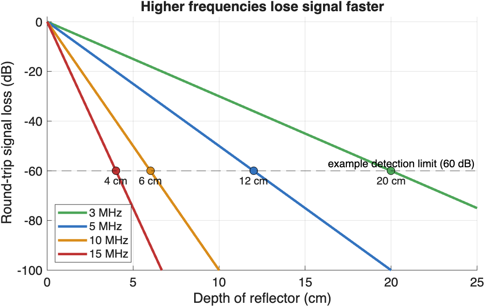{ width="600" }
> **Higher frequencies lose signal faster**. Round-trip loss at 0.5 dB/cm/MHz. If the machine can detect echoes that are up to 60 dB weaker than the transmitted pulse, a 3 MHz probe can image about 20 cm deep, but a 15 MHz probe only about 4 cm

So we choose the **highest frequency that still reaches the depth we need**: high frequencies for the thyroid, tendons, or vessels near the skin, and low frequencies for the abdomen or the heart.

## Doppler Ultrasound

The **Doppler effect** is the change in frequency of a wave when its source or reflector is moving. When a source moves toward you, the waves bunch up and you hear a higher pitch. When it moves away, the waves spread out and you hear a lower pitch. Think of the siren of a passing ambulance.

<iframe width="560" height="315" src="https://www.youtube.com/embed/h4OnBYrbCjY" title="The Doppler Effect: what does motion do to waves?" frameborder="0" allow="accelerometer; autoplay; clipboard-write; encrypted-media; gyroscope; picture-in-picture; web-share" referrerpolicy="strict-origin-when-cross-origin" allowfullscreen></iframe>

Ultrasound uses the Doppler effect to detect motion, most often **blood flow**. Echoes from blood moving *toward* the probe return at a slightly higher frequency, and echoes from blood moving *away* return at a slightly lower frequency.

**Color Doppler** paints this frequency shift in color, inside a box (the color window) on top of the grayscale image:

- By convention, **red = toward** the transducer and **blue = away**. Remember it as **BART**: **B**lue **A**way, **R**ed **T**oward
- Always check the color bar on the screen, because the color map can be inverted

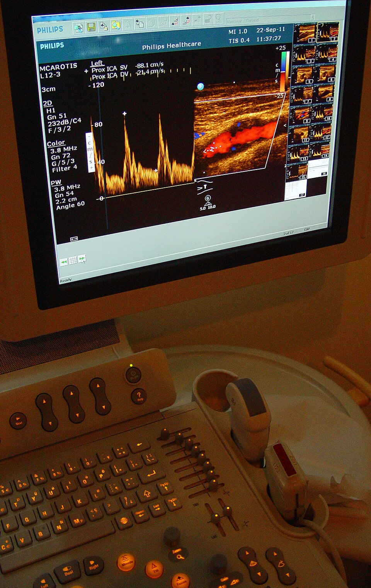{ width="450" }
> **A carotid artery Doppler exam**. On the screen, *color Doppler* (right) paints the blood flowing through the internal carotid artery, and *spectral Doppler* (left) plots blood velocity over time, with a peak at each heartbeat. On the console below, the column of small sliders is the **TGC** control (Image: [Etan J. Tal](https://commons.wikimedia.org/wiki/File:CarotidDoppler1.jpg), CC BY 3.0)

!!! warning "Common misconceptions"

    - **Color does not mean artery or vein.** It only shows the direction of flow *relative to the probe*
    - **Doppler only detects motion along the beam.** Flow at 90˚ to the beam shows little or no color, so the angle of the probe matters

## Reading Ultrasound Images

You really need to know your anatomy to read ultrasound. Unlike CT and MRI, ultrasound images are not limited to axial, sagittal, and coronal planes: the probe can be angled in any direction. This is a strength, because you can line up with any structure, and a challenge, because you have to work out the orientation of every image. Each clinical exam has its own set of standard views (for example, the parasternal long-axis view of the heart).

Ultrasound is a **tomographic** modality, like CT and MRI: each image is a slice through the body, rather than a projection like an X-ray. Unlike CT and MRI, ultrasound slices are acquired in real time, by hand.

## Clinical Applications

### Obstetrics

Because it uses no ionizing radiation, ultrasound is the imaging method of choice during pregnancy. It is used to date the pregnancy, check fetal growth and anatomy, and locate the placenta.

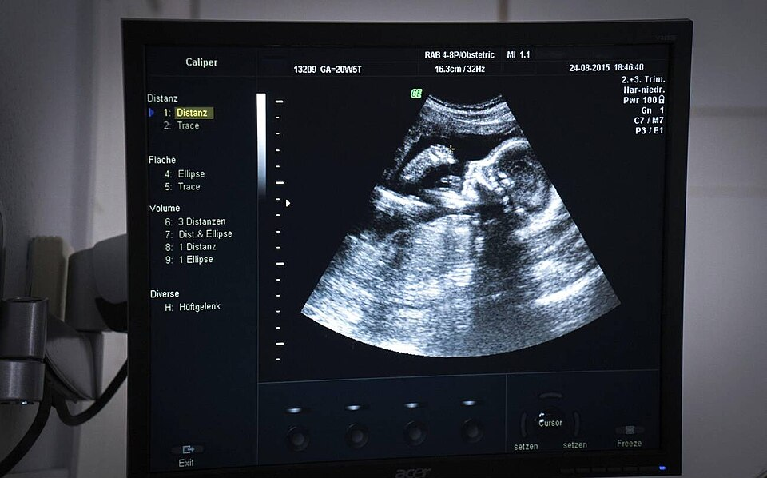{ width="500" }
> **Obstetric ultrasound** showing the profile of a 20-week fetus (Image: [Goleisureintl](https://commons.wikimedia.org/wiki/File:Obstetric_ultrasound_scan_monitor_showing_20-week_human_fetus_profile_in_Navi_Mumbai_2015.jpg), CC BY 4.0)

### Emergency Medicine (FAST)

The **Focused Assessment with Sonography in Trauma (FAST)** exam is a quick bedside scan that checks for free fluid (usually blood) around the heart and in the abdomen of an injured patient. Free fluid is anechoic, so it appears as a black stripe between organs.

### Guided Procedures

Ultrasound lets a clinician watch a needle in real time, making injections, biopsies, and catheter placement safer and more accurate.

### Endoscopic Ultrasound

**Endoscopic ultrasound (EUS)** puts a small, high-frequency probe on the tip of an endoscope. From inside the stomach or duodenum, it can image nearby structures, such as the pancreas and bile duct, without bowel gas in the way. A thin needle passed through the endoscope can sample a lymph node or mass under direct ultrasound view (**fine needle aspiration**).

### Echocardiography

**Echocardiography** images the beating heart in real time, along with blood flow through its chambers and valves.

- **Transthoracic echo (TTE)** uses a probe on the chest, imaging through the gaps between the ribs
- **Transesophageal echo (TEE)** passes a probe down the esophagus, right behind the heart, for a clearer view of structures such as the valves and left atrium

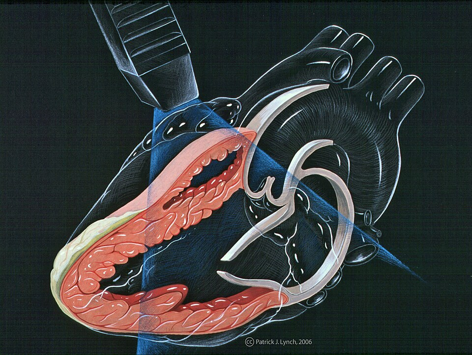{ width="500" }
> **The parasternal long-axis view**, a standard echocardiography view. The probe sits on the chest beside the sternum, and its imaging plane (blue) slices lengthwise through the left ventricle, the mitral valve, and the aortic valve (Illustration: Patrick J. Lynch, via [CardioNetworks ECHOpedia](https://commons.wikimedia.org/wiki/File:Echo_heart_parasternal_long_axis_(CardioNetworks_ECHOpedia).jpg), CC BY-SA 3.0)

### 3D Ultrasound

A conventional probe sweeps a flat, 2D fan. A **3D (matrix-array) probe** steers the beam in two directions to fill a pyramid-shaped volume, which can be rendered in 3D, for example to view a fetus or the heart valves.

## Summary

| Strengths | Limitations |
| :-------- | :---------- |
| Non-invasive and non-ionizing | Cannot see through air or bone |
| Real-time and portable | Trade-off between resolution and depth |
| Shows anatomy *and* function, such as blood flow and heart motion | Depends on the operator's skill |
