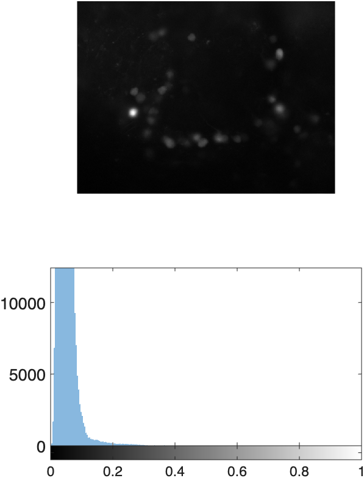
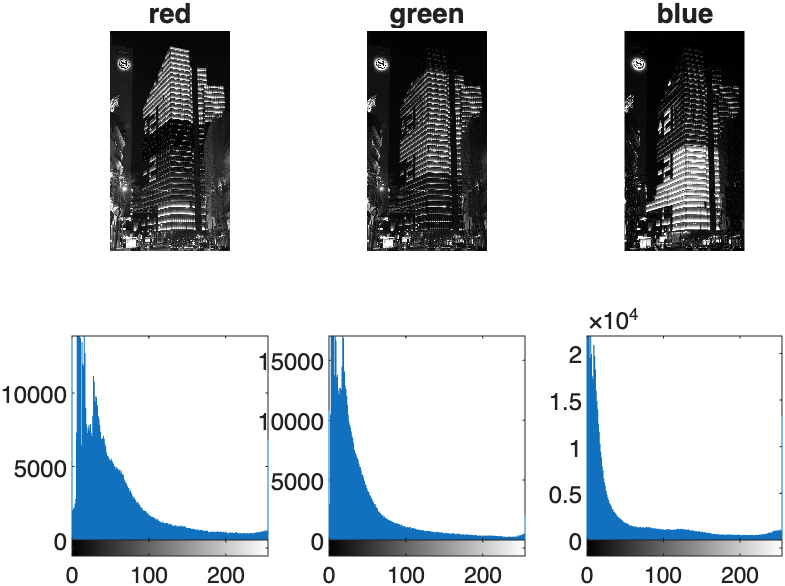
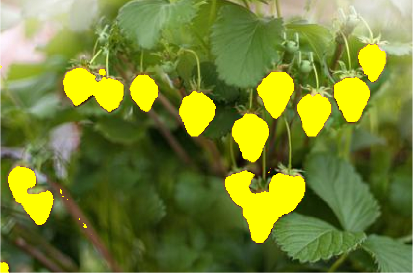
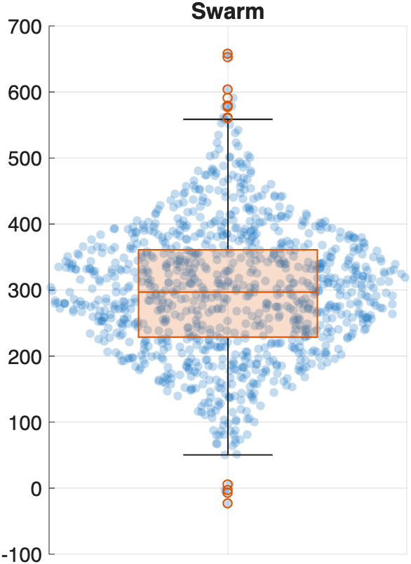
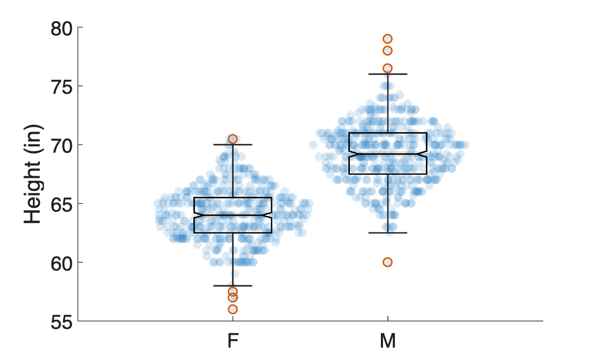
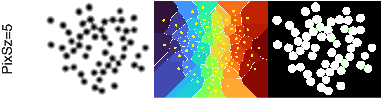
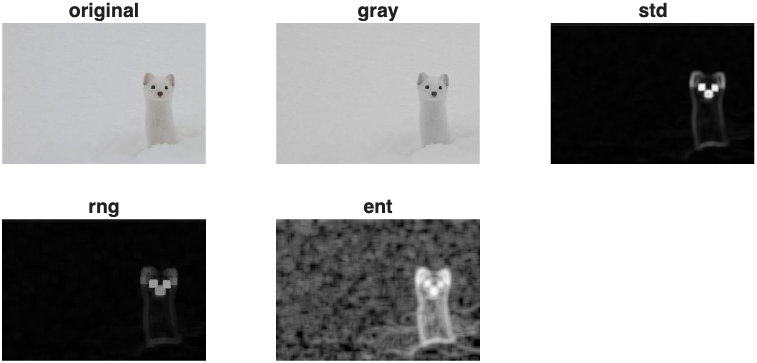

# MtM Toolbox

The MtM toolbox is a collection of functions designed to simplify Plotting, Image Processing, Processing 3D Slicer segmentation volumes, working with Surface Meshes, and several other utility actions. These functions can be found in the `MtMresources/toolbox` folder.

!!! warning "The MtM toolbox folder must be added to search path for these functions to work"

    Add the `MtMresources/toolbox` folder to the MATLAB search path as described on the [setup page](../setup/matlabInstallation.md#add-toolboxes-to-the-matlab-search-path).

!!! note "Most MtM toolbox functions are prefaced with `mm`"
    You can get a quick summary of the available course functions in the MtMtoolbox by entering `help MtMtoolbox` in the command window.

!!! tip "Get the full help for any function"
    Enter `help` and the function name in the command window (for example, `help mmSurfaceDistance`) to see all of its inputs, options, and examples. The help text in MATLAB is always the most up to date.

## Which function do I need?

| I want to... | Function | Used in |
| --- | --- | --- |
| Read the segment names and colors of a Slicer file | [mmGetSlicerSegmentInfo](#mmgetslicersegmentinfo) | SLCR1–7 |
| Read every Slicer file in a folder (a whole class) | [mmGetSlicerSegmentInfoAll](#mmgetslicersegmentinfoall) | SLCR5, SLCR6 |
| Get the mask of one segment (e.g., the aorta) | [mmGetMedicalVolumeSegment](#mmgetmedicalvolumesegment) | SLCR2–7 |
| Fix a segmentation that is one slice off from its CT | [mmMatchVolumeGeometry](#mmmatchvolumegeometry) | SLCR2, SLCR4 |
| Fix a segmentation that has layers (4-D voxels) | [mmCollapseSegmentLayers](#mmcollapsesegmentlayers) | SLCR4, SLCR5 |
| Fix volumes whose voxels are not isotropic | [mmResampleIsotropic](#mmresampleisotropic) | SLCR4, SLCR5 |
| Save isotropic copies of your Slicer files | [mmResampleSlicerFiles](#mmresampleslicerfiles) | SLCR5 |
| Plot every segment as a 3D surface | [mmPlotAllSeg](#mmplotallseg) | SLCR1, SLCR4 |
| Plot one mask as a 3D surface | [mmPlotMask2Surface](#mmplotmask2surface) | SLCR1–5 |
| Show where two segmentations of the same structure differ | [mmSurfaceDistance](#mmsurfacedistance) | SLCR2, SLCR3, SLCR5 |
| Compare a left organ to the right one | [mmMirrorAlign](#mmmirroralign) | SLCR5 |
| Measure the diameter of a bone or vessel along its length | [mmCrossSectionProfile](#mmcrosssectionprofile) | SLCR4, SLCR6 |
| Segment a CT scan automatically | [mmTotalSegmentator](#mmtotalsegmentator) | SLCR7 |
| Segment a brain MRI automatically | [mmSynthSeg2](#mmsynthseg2) | SynthSeg_Brain_Segmentation |
| Remove the skull from a brain MRI | [mmSkullStrip](#mmskullstrip) | SynthSeg_Tumor_MATLAB |
| Save a volume or segmentation that Slicer can open | [mmWriteNRRD](#mmwritenrrd) | |
| Plot data as a box chart with the points on top | [mmBoxSwarm](#mmboxswarm) | SLCR5–7 |

## Plotting Functions

### mmShowHist

Tiles an image with its histogram in one figure. Image is display above the histogram (two row tiles per image). Corrects MATLAB inexplicable inability to pair `nexttile` with `imhist` by using `subplot` for tiling.

{ width="150"}

If you input an RGB image, this function will automatically index out the channels and display the histogram for each channel.

{ width="250"}

**INPUTS**

**Required:**

- **img**: an image matrix

**Optional:**

- **col** (default = 1): current column position 
- **num_cols** (default = 1): total number of columns in the figure.
- **title_str** (default = empty): a string to title the image
- **add_color** (logical = false): if true add color

```matlab linenums="1" title="Examples"
mmShowHist(img) — displays image above its histogram
mmShowHist(img, 2, 6) - displays the image and the histogram in the 2nd
column of a six-column figure
```

### mmShowBurnImage

Burns a mask onto an image. Wrapper for `imoverlay` but with syntax similar to `imshowpair`.

{ width="250"}

**INPUTS**

- **img**: a grayscale or rgb image
- **mask**: a binary mask

**OPTIONAL INPUTS**

- **color**: the color of the burned image (default = yellow)

```matlab linenums="1" title="Examples"
mmShowBurnImage(rgb,mask)
mmShowBurnImage(rgb,mask,color='white')
```

### mmShowStruct

Displays any images packaged in a structure as a tiled figure. Useful for reviewing image processing steps.

**INPUTS**

- **S**: a structure contain fields with image variables
- **fn2display**: cell array or string array specifying the structure field names to display
- **titles** (optional): string array of titles for plots

```matlab linenums="1" title="Examples"
mmShowStruct(p)
mmShowStruct(p,fn2display={'rgb','gray'})
mmShowStruct(p,fn2display={'rgb','gray'},titles={'Original','Grayscale'})
```

### mmBoxSwarm

A wrapper for `swarmchart` and `boxchart` that overlays a swarm chart on a box chart.

{ width="150"} { width="350"}

**INPUTS**

- **x**: (*Optional*) Enter empty brackets to generate a series of ones
- **y**: Vector of numeric data

**OPTIONAL INPUTS**

- **PlotType**: enter 'violin' for a violin plot (default is 'swarm')
- **XAxVisible**: display x-axis (default = 'off')
- **MarkerFaceColor**: set marker face color
- **MarkerFaceAlpha**: set marker face alpha (default =0.25)
- **doBoxPlot**: overlay boxplot (default is true)
- **BoxFaceColor**: set boxplot face color
- **BoxFaceAlpha**: set boxplot face alpha (default = 0.1)
- **Notch**: Turn on box plot notch (default =  'off')
- **XJitterWidth**: set jitter width of swarm chart (default = 1)

```matlab linenums="1" title="Examples"
mmBoxSwarm([],nD.data); % y-data only
mmBoxSwarm(x,y,'BoxFaceColor','k','Notch','on','MarkerFaceAlpha',0.15) % grouping data and y-data
```

### mmAddScaleBar

Adds a scalebar to current image

**INPUTS**

- **ax**: the handle to the axis where you want to add your scale bar
- **width**: the length of the scalebar
- **widthPERpixel**: the dimensions of a pixel side (e.g. um per pixel)

**OPTIONAL INPUTS**

- **Color**: the color of the scale bar
- **LineThickness**: thickness of the scale bar (in points)
- **pos**: a row vector containing the X and Y coordinates where
        you want the scale bar. You can enter empty brackets to skip
- **unit**: a character array indicating the unit of measure. If
        inputted, the width of the scalebar will be printed above the bar

```matlab linenums="1" title="Examples"
mmAddScaleBar(gca,100, 2.3);
mmAddScaleBar(gca,50,0.23,'white', 4, [],'µm');
```

NOTE: the measurements don't have to be in microns. They just have
be consistent between `width` and `widthPERpixel`

### mmHistColor

Overlays the RGB channel histograms of a color image, as either an area plot or a stem plot.

**INPUTS**

- **RGB**: an RGB image

**OPTIONAL INPUTS**

- Pass `'stem'` as the second argument to plot the histograms as stem plots instead of the default area plot
- Pass a numeric value below 1 as the second argument to set the fill transparency (alpha) of the area plot (default = 0.75)

```matlab linenums="1" title="Examples"
mmHistColor(RGB) % area plot of each channel's histogram (default)
mmHistColor(RGB,'stem') % stem plot of each channel's histogram
mmHistColor(RGB,0.4) % area plot with alpha set to 0.4
```

### mmTightTiledLayout

Creates a new figure with a horizontal tiled layout that has no tile spacing or padding.

```matlab linenums="1" title="Example"
mmTightTiledLayout
nexttile; imshow(img1)
nexttile; imshow(img2)
```

## Image Processing

### mmGetWatershed

Separates touching objects in a 2D or 3D mask using the watershed transform. The function inverts the distance transform of the mask so that each object's center becomes a basin, keeps only the basins that are deep enough, and then floods them with the watershed transform. The dividing lines between basins are cut out of the mask. See [Distance Transform and the Watershed](../imageProcessing/ImageDistanceTransform.md#distance-transform-and-the-watershed) for a full explanation. Based on this [MATLAB blog](https://blogs.mathworks.com/steve/2013/11/19/watershed-transform-question-from-tech-support/).

{ width="450"}

**INPUTS**

- **BW**: logical array (2D or 3D), the mask to separate
- **PixSz**: minimum basin depth, in pixels (2D) or voxels (3D) of distance. An object is split from its neighbor only if its center is at least `PixSz` pixels farther from the background than the narrowest point of the neck joining them. Larger values split fewer objects (conservative); smaller values split more (aggressive). A vector, e.g. `[5 3 1]`, runs one pass per value. Passed to `imextendedmin` as `H`. Default: `3`

**OPTIONAL INPUTS (name-value)**

- **conn**: connectivity passed to `imextendedmin` and `watershed` (e.g. 4 or 8 in 2D; 6, 18, or 26 in 3D). Default: `0`, which uses the MATLAB defaults (8 in 2D, 26 in 3D)
- **ShowSteps**: logical. If `true`, displays each pass (2D only): the inverted distance transform, the watershed regions with the chosen basins overlaid, and the mask before vs. after. Default: `false`

**OUTPUTS**

- **BW**: the mask with touching objects separated
- **pLd1**: (optional) watershed label matrix from the last pass, before it is masked to `BW`

```matlab linenums="1" title="Examples" 
BW = mmGetWatershed(BW,5);                 % one pass, basin depth 5
BW = mmGetWatershed(BW,5,ShowSteps=true);  % display the steps
BW = mmGetWatershed(BW,5,conn=4);          % basin depth 5, 4-connectivity
BW = mmGetWatershed(BW,[5 3 1]);           % three passes, depths 5, 3, then 1
```

### mmGetTextureFilters

Applies multiple texture filters to input image. Texture filters include standard deviation, range, and entropy.

{ width="450"}
> Text Filters applied to an image of a Ferret and displayed using mmShowStruct

**INPUTS**

- **p**: a structure that must contain a field called either 'rgb' or 'img'. `rgb` should be an rgb image. `img` should be a grayscale image.
  
- **nhood**: (optional) a neighborhood matrix (typically logical or array of ones).

**OUTPUT**

- **p**: updated structure containing four new fields: gray, std, rng, and ent

```matlab linenums="1" title="Examples"
p = mmGetTextureFilters(p) % get filtered images with default neighborhood

% Apply a 7x7 neighborhood and display all filtered images
p = mmGetTextureFilters(p,true(7)) % get filtered images with a neighborhood of 7x7
mmShowStruct(p) % display filtered images
```

### mmReadImgND

This function uses the [MATLAB Bio-formats toolbox](https://www.openmicroscopy.org/bio-formats/downloads/) to read in multidimensional image stacks.

**REQUIREMENTS**

The Bio-formats toolbox, `bfmatlab`, must be downloaded and added to the search path.

**INPUTS** (optional)

- **file_path** is a path to an image file. If you don't input a file path, you will be prompted for a path.

**OUTPUTS**

- **IMGND**: an XYZCT multidimensional array
- **metadata**: the metadata from the array in XML format

```matlab linenums="1" title="Example"
[IMGND, metadata] = mmReadImgND(file_path)
```

### mmReadRAWimage

Reads a RAW image (`.dng`) captured with a Sony DSLR camera.

**INPUTS** (optional)

- **im_file**: path to a `.dng` raw image file. If omitted, you will be prompted to select a file.

**OUTPUTS**

- **RAW**: the raw image
- **metadata**: image metadata (from `imfinfo`)

```matlab linenums="1" title="Example"
[RAW, metadata] = mmReadRAWimage(im_file)
```

## 3D Slicer Functions

Functions to process segmentation volumes created in 3D Slicer. Requires the [Mathworks Medical Toolbox](../setup/matlabInstallation.md).

All Slicer volumes should be loaded as `medicalVolumes`.

### mmGetSlicerSegmentInfo

Returns a table containing the properties (e.g. name, color, etc.) of the segmentations found in a `seg.nrrd` file

**INPUTS**

- file path to a segmentation file

**OPTIONAL INPUTS**

- **addVolInfo** (logical, default = false): include additional volume metadata in the output table

**OUTPUT**

- a table with segmentation names, layer, label, and color values

```matlab linenums="1" title="Example"
segT = mmGetSlicerSegmentInfo(seg_file_path)
```

### mmGetSlicerSegmentInfoAll

Reads the segment names, colors, and label values from every Slicer segmentation file (`*.seg.nrrd`) in a folder, and stacks them into one table. Use it to load a whole class's segmentations at once. A file that can't be read is reported in the command window and skipped.

The **ID** of each file is the start of its file name, before the first space (for example, `Salcedo` in `Salcedo CTACardio.seg.nrrd`). So start each file name with your name or another ID.

**INPUTS**

- **folderPath**: the folder that contains the segmentation files

**OPTIONAL INPUTS (name-value)**

- **idDelimiter**: the text that ends the ID in each file name (default = `" "`, a space). Use `"_"` for file names like `Salcedo_CTACardio.seg.nrrd`
- **subFolders** (logical, default = false): also search every subfolder (for example, one folder per student)

**OUTPUTS**

- **allSegT**: one row per segment per file, with the file number (`Num`), `ID`, `Filename`, and the columns of `mmGetSlicerSegmentInfo`
- **contentT**: one row per file, with the file name, folder, date, ID, volume size, and pixel spacing

```matlab linenums="1" title="Examples"
[allSegT, contentT] = mmGetSlicerSegmentInfoAll(paths.classFolder);
[allSegT, contentT] = mmGetSlicerSegmentInfoAll(paths.classFolder, subFolders=true, idDelimiter="_");
```

### mmGetMedicalVolumeSegment

Indexes out a segment from a Slicer Segmentation volume loaded as a `medicalVolume`. The function returns a structure that contains the mask of the indicated segment, color, and transformation matrix of the selected segmentation. First load a Slicer Segmentation file using `medicalVolume` and the Slicer segmentation table using `mmGetSlicerSegmentInfo`.

**INPUTS**

- **mV**   (required):    medicalVolume of a Slicer Segmentation dataset
- **segT** (required):    table - table created by mmGetSlicerSegmentInfo
- **segName** (optional): string - Name of Segment to return.

If segName not provided, you will be prompted to select one segmentation from the inputted segT table.

**OUTPUTS**

**S**: The function returns a structure with the following fields

- **segName**: Name of selected segment
- **mask**: binary mask of the selected segment
- **color**: color of the segmentation as set in Slicer
- **tform**: transformation matrix to properly orient segmentation
- **spacing**: Voxel spacing
- **volume**: calculated using `regionprops3`.

```matlab linenums="1" title="Example"
S = mmGetMedicalVolumeSegment(mv,segT,segName="right kidney")
```

### mmMatchVolumeGeometry

Puts a segmentation on the same voxel grid as the CT or MRI it was made from, by adding or removing slices at the edges. Use it when a Slicer segmentation is a slightly different size than its volume (for example, TotalSegmentator in Slicer 5.13 can add one extra empty slice). The function only pads or crops, so the two volumes must already have the same voxel spacing and orientation. If they don't, resample the segmentation in Slicer instead.

**INPUTS**

- **mV**: `medicalVolume` to fix (usually a segmentation)
- **refMV**: `medicalVolume` with the size and position to match (usually the CT)

**OPTIONAL INPUTS (name-value)**

- **Tolerance**: allowed mismatch, as a fraction of a voxel (default = 0.01)

**OUTPUT**

- **mVout**: a `medicalVolume` with the same size and geometry as `refMV`. Added slices are zeros. You get a warning if any removed slices contained segmented voxels.

```matlab linenums="1" title="Example"
ctMV = medicalVolume(paths.ct);
segMV = medicalVolume(paths.seg);
segMV = mmMatchVolumeGeometry(segMV, ctMV);
```

### mmCollapseSegmentLayers

Combines the layers of a Slicer segmentation into one label volume, with the same result as collapsing the layers in Slicer, but without changing your file. Slicer saves a segmentation in more than one layer when its segments overlap. MATLAB then loads the voxels as a 4-D array (one label volume per layer), and functions that expect one 3-D label volume, like `regionprops3`, `categorical`, and `labeloverlay`, fail. If the segmentation has only one layer, the function returns your inputs unchanged. See [Check your segmentation file](../slicer/SlicerMATLABWorkflow.md#check-your-segmentation-file) for when to use it.

**INPUTS**

- **segMV**: `medicalVolume` of a Slicer segmentation
- **segT**: the segment table of that file, from `mmGetSlicerSegmentInfo`

**OPTIONAL INPUTS (name-value)**

- **OutputFile**: also save the collapsed segmentation as a new `.seg.nrrd` file that Slicer can open (default = don't save)

**OUTPUTS**

- **segMV**: a `medicalVolume` with one 3-D label volume, and the same geometry
- **segT**: the updated segment table. Each segment's `LabelValue` is now its row number, and every `Layer` is 1. The names and colors don't change.
- **overlapT**: a table of the voxels that were overwritten (empty if the segments don't overlap)

```matlab linenums="1" title="Example"
segMV = medicalVolume(paths.segment);
segT = mmGetSlicerSegmentInfo(paths.segment);
size(segMV.Voxels)     % four numbers: the segmentation has layers
[segMV, segT] = mmCollapseSegmentLayers(segMV, segT);
```

```text title="Command Window"
mmCollapseSegmentLayers: collapsed 2 layers into 1 (6 segments).
  Some segments overlap. Where they do, the segment in the higher layer won (as in Slicer):
  - Implant lost 7363 voxels (9.13 mL) to right tibia
```

!!! warning "Overlapping segments"
    One voxel can hold only one label. Where two segments overlap, the segment in the **higher layer** (the `Layer` column of the segment table) keeps the voxels, as in Slicer, and the function tells you which segments lost voxels and how many. If the overlap is what you want to study (for example, two segmentations of the same tumor in SLCR3), don't collapse: `mmGetMedicalVolumeSegment` reads each segment from its own layer.

### mmResampleIsotropic

Resamples an intensity volume and its segmentation to isotropic voxels (the same size in all three directions), on exactly the same voxel grid, without changing your files. Many scans have voxels that are longer in one direction (for example 0.9 × 0.9 × 3 mm), and functions that measure in voxels, like `regionprops3` and `volshow`, then give distorted results. Use this function if you forgot to resample the volume in Slicer. If the voxels are already isotropic, the function returns your inputs unchanged. See [Check your segmentation file](../slicer/SlicerMATLABWorkflow.md#check-your-segmentation-file) for when to use it.

**INPUTS**

- **mV**: `medicalVolume` of the intensity volume (CT or MRI)
- **segMV** (optional): `medicalVolume` of the segmentation of that volume. It can have layers.

**OPTIONAL INPUTS (name-value)**

- **VoxelSize**: the size of the new voxels in mm (default = the smallest voxel dimension of the volume, so no detail is lost)
- **Segments**: the segment table from `mmGetSlicerSegmentInfo`. Only used to show the segment names in the report.
- **Method**: interpolation of the intensity volume: `"linear"` (default), `"cubic"`, or `"nearest"`

**OUTPUTS**

- **mV**: a `medicalVolume` with isotropic voxels, which covers the same space as before
- **segMV**: the segmentation on the same voxel grid as `mV`. The label values don't change, so your segment table is still valid.

```matlab linenums="1" title="Example"
ctMV = medicalVolume(paths.intensity);
segMV = medicalVolume(paths.segment);
segT = mmGetSlicerSegmentInfo(paths.segment);
ctMV.VoxelSpacing     % three different numbers: not isotropic
[ctMV, segMV] = mmResampleIsotropic(ctMV, segMV, Segments=segT);
```

```text title="Command Window"
mmResampleIsotropic: resampled the intensity volume
  voxel size: 0.9336 x 0.9336 x 1.25 mm  ->  0.9336 mm isotropic
  size:       512 x 512 x 321  ->  512 x 512 x 430 voxels
  Resampled the segmentation to the same voxel grid (nearest neighbor). Segment volumes:
  - right lung: 1263.46 mL  ->  1263.35 mL (-0.0%)
  - left lung: 1224.69 mL  ->  1224.71 mL (+0.0%)
  - other: 37.63 mL  ->  37.41 mL (-0.6%)
```

!!! warning "The segmentation is not averaged"
    Label values are names, not amounts, so they can't be averaged: each new voxel takes the label of the nearest old voxel, as in Slicer. Large segments barely change. Small or thin segments can change by a few percent, and their surfaces can look stepped along the direction of the long voxels. Check the report: if a segment that matters to you changed a lot, resample the volume in Slicer and segment again.

### mmResampleSlicerFiles

Saves isotropic copies of a Slicer volume and its segmentation. Use it if you forgot to resample your volume in Slicer before you segmented it, and you need corrected **files** (for example, to upload to the class folder). The function loads both files, resamples them to the same isotropic voxel grid with [mmResampleIsotropic](#mmresampleisotropic), and saves two new files next to the originals, with " isotropic" added to the names. Your original files are never changed. Slicer can open the new files: the segment names, colors, and layers are kept. If the files are already isotropic, no files are written. See [Check your segmentation file](../slicer/SlicerMATLABWorkflow.md#check-your-segmentation-file) for when to use it.

**INPUTS**

- **intensityFile**: the intensity volume (CT or MRI) saved from Slicer (`.nrrd`)
- **segmentFile**: the segmentation of that volume (`.seg.nrrd`)

**OPTIONAL INPUTS (name-value)**

- **VoxelSize**: the size of the new voxels in mm (default = the smallest voxel dimension of the intensity volume)
- **OutputFolder**: where to save the new files (default = the folder of each original file)
- **Overwrite**: `true` replaces " isotropic" files from an earlier run (default = `false`). The original files are never replaced.

**OUTPUTS**

- **newIntensityFile**, **newSegmentFile**: the full paths of the files to use from now on (your original files, if nothing had to change)

```matlab linenums="1" title="Example"
paths.intensity = fullfile(paths.project, "CTACardio.nrrd");
paths.segment = fullfile(paths.project, "Salcedo Segmentation.seg.nrrd");
[paths.intensity, paths.segment] = mmResampleSlicerFiles(paths.intensity, paths.segment);
```

```text title="Command Window"
mmResampleIsotropic: resampled the intensity volume
  voxel size: 0.9336 x 0.9336 x 1.25 mm  ->  0.9336 mm isotropic
  size:       512 x 512 x 321  ->  512 x 512 x 430 voxels
  Resampled the segmentation to the same voxel grid (nearest neighbor). Segment volumes:
  - right lung: 1263.46 mL  ->  1263.35 mL (-0.0%)
  - left lung: 1224.69 mL  ->  1224.71 mL (+0.0%)
  - other: 37.63 mL  ->  37.41 mL (-0.6%)
mmResampleSlicerFiles:
  saved .../CTACardio isotropic.nrrd
  saved .../Salcedo Segmentation isotropic.seg.nrrd
  Your original files were not changed.
```

### mmWriteNRRD

Saves a `medicalVolume` as a file that 3D Slicer can open. MATLAB can read NRRD files, but it can't write them. Save an image volume as `.nrrd`, or a segmentation as `.seg.nrrd` with named and colored segments. The voxel spacing, orientation, and position are kept, so the file lines up with the original volume in Slicer.

**INPUTS**

- **filename**: the file to write (`.nrrd`, or `.seg.nrrd` for a segmentation)
- **mv**: a `medicalVolume`. For a segmentation, each voxel holds a label value (0 = background). A segmentation with layers (4-D voxels) is saved with its layers: `Segments` is then required, with its `Layer` column.

**OPTIONAL INPUTS (name-value)**

- **Segments**: a table with the variables `SegName`, `LabelValue`, and `Color` (like the output of `mmGetSlicerSegmentInfo`). Include it to save a Slicer segmentation.
- **Compress** (logical, default = true): compress the voxels with gzip

```matlab linenums="1" title="Examples"
mmWriteNRRD("MRBT1stripped.nrrd", strippedMV)   % an image volume

segT = table("brain", 1, [0.9 0.7 0.6], VariableNames=["SegName" "LabelValue" "Color"]);
mmWriteNRRD("brain.seg.nrrd", brainMV, Segments=segT)   % a segmentation
```

## Measure and Compare Segmentations

Functions to measure segmentations and to compare two segmentations of the same structure. They all take the structures returned by `mmGetMedicalVolumeSegment`, and they all work in millimeters.

### mmSurfaceDistance

Compares two segmentations of the same structure (for example, your aorta and TotalSegmentator's aorta) by the distance between their surfaces, like the CloudCompare program. For every point on the surface of A, it measures the distance to the surface of B: negative if the point is inside B, positive if it is outside. The figure shows the surface colored by this distance (blue = inside, red = outside) next to a histogram of the distances.

**INPUTS**

- **A**, **B**: the two segmentations. Either structures from `mmGetMedicalVolumeSegment`, or 3D logical masks of the same size (then also give `Tform` or `VoxelSpacing`)

**OPTIONAL INPUTS (name-value)**

- **Names**: names of A and B, for the figure and table (default = `["A" "B"]`)
- **Direction**: `"AtoB"` (default) measures from A to B. `"both"` also measures from B to A. Use `"both"` when neither segmentation is the reference.
- **Tolerance**: distance (mm) at which the surfaces count as agreeing (default = 2)
- **Limit**: color limit (mm). Default: the 95th percentile of the distances
- **Smooth** (logical, default = false): smooth both masks first (useful for blocky segmentations)
- **ReduceFactor**: fraction of the surface triangles to keep (default = 0.3)
- **BinWidth**: histogram bin width in mm (default = 0.5)
- **Title**: title of the figure window
- **Plot** (logical, default = true): false skips the figure
- **UsePatch** (logical, default = false): plot with `patch` instead of `surfaceMeshShow`
- **Tform**, **VoxelSpacing**: voxel-to-mm conversion, for mask inputs

**OUTPUTS**

- **T**: a table with one row per direction: the mean, median, 95th percentile (HD95), and largest (Hausdorff) distance in mm, the percent of the surface within the tolerance, the mean signed distance, and the Dice coefficient
- **S**: the surfaces (`fv`) and the distance at each vertex

```matlab linenums="1" title="Examples"
T = mmSurfaceDistance(mySeg, totSeg, Names=["Ours" "TotalSegmentator"]);
T = mmSurfaceDistance(t1Seg, t2Seg, Names=["Tumor1" "Tumor2"], Direction="both");
```

!!! note "Requirements"
    Image Processing Toolbox. The surfaces are shown with `surfaceMeshShow` (Lidar Toolbox, or Point Cloud Toolbox in newer releases) if you have it; otherwise `patch` is used.

### mmMirrorAlign

Mirrors one segmentation across the patient's midline (left ↔ right) and aligns it to another, so you can compare paired structures like the left and right kidneys or femurs. After mirroring, it lines the two up with ICP (a rigid registration: rotation and translation only), and puts the result on the voxel grid of the first segmentation. Then you can compare the two with `dice` or `mmSurfaceDistance`.

**INPUTS**

- **fixedSeg**, **movingSeg**: structures from `mmGetMedicalVolumeSegment`. The moving segmentation is mirrored and moved onto the fixed one.

**OPTIONAL INPUTS (name-value)**

- **Mirror** (logical, default = true): false aligns without mirroring
- **MaxIterations**: maximum number of ICP iterations (default = 100)
- **GridSize**: the surfaces are downsampled to this grid (mm) for ICP (default = 1)

**OUTPUTS**

- **alignedSeg**: a structure like `fixedSeg`, holding the mirrored and aligned moving segmentation
- **rmse**: root-mean-square distance (mm) between the two surfaces after alignment. Lower means a better fit
- **worldTform**: the `affinetform3d` that maps the moving segmentation onto the fixed one, mirror included

```matlab linenums="1" title="Example"
rk = mmGetMedicalVolumeSegment(segMV, segT, segName="right kidney");
lk = mmGetMedicalVolumeSegment(segMV, segT, segName="left kidney");
lkOnRk = mmMirrorAlign(rk, lk);
mmSurfaceDistance(rk, lkOnRk, Names=["Right kidney" "Left kidney (mirrored)"], Direction="both")
```

!!! note "Requirements"
    Computer Vision Toolbox (for `pcregistericp`).

### mmCrossSectionProfile

Measures the cross-sections of a long structure, like a femur or the aorta, along its whole length. The function finds the long axis of the structure (or traces a curved centerline), cuts the structure into thin slabs perpendicular to it, and measures each slab:

- **Area** and **equivalent diameter**: the diameter of a circle with the same area
- **Inscribed diameter**: the diameter of the largest sphere that fits inside the slab
- **Narrowest** and **widest** widths of the cross-section (the minimum and maximum Feret diameters)

The figure shows the structure colored by its diameter, the cross-section at the chosen position, and the diameter profile along the length.

**INPUTS**

- **seg**: a structure from `mmGetMedicalVolumeSegment`, or a 3D logical mask (then also give `Tform`). The voxels must be cubes.

**OPTIONAL INPUTS (name-value)**

- **Centerline**: `"straight"` (default) uses a straight long axis. Use it for long bones. `"curved"` traces a smooth centerline through the middle of the structure. Use it for curved vessels, like the aorta. You can also give an N-by-3 array of [x y z] points (mm).
- **SlabWidth**: thickness of each slab in mm (default = two voxels)
- **At**: position (% of the length, from the inferior end) of the cross-section shown in the figure and returned in `S.At` (default = 50, the middle)
- **Smoothing**: length (mm) of the window used to smooth a curved centerline (default = 30)
- **Plot** (logical, default = true): false skips the figure
- **Title**: title of the figure
- **Tform**: voxel-to-mm conversion, for mask inputs

**OUTPUTS**

- **T**: a table with one row per slab, from the inferior end: position (mm and %), area, equivalent diameter, inscribed diameter, and narrowest and widest widths
- **S**: the length of the structure, its centerline, and the cross-section at the `At` position (`S.At`), including its left-right (`WidthLR_mm`) and front-back (`WidthAP_mm`) widths. For a femur, these are the mediolateral and anteroposterior widths.

```matlab linenums="1" title="Examples"
[T, S] = mmCrossSectionProfile(femurSeg);                       % femur
[T, S] = mmCrossSectionProfile(aortaSeg, Centerline="curved");  % aorta
S.At                                                            % the cross-section at midshaft
```

!!! note "Requirements"
    Image Processing Toolbox.

## Automatic Segmentation

Functions that segment a CT or MRI with an AI model, without opening Slicer. Use them to segment many scans in a loop, or to get a reference segmentation to compare yours to.

### mmTotalSegmentator

Segments a CT scan with [TotalSegmentator](../slicer/TotalSegmentator.md) from MATLAB, using the copy of TotalSegmentator that the extension installed in 3D Slicer. It gives the same result as the TotalSegmentator module in Slicer, with the same segment names and colors, and it uses the GPU when Slicer can (for example, on a Mac with Apple silicon). Use it to segment many scans in a loop.

!!! warning "Set up Slicer first"
    Install 3D Slicer and its TotalSegmentator extension, and run TotalSegmentator once in Slicer. This installs everything it needs and downloads the AI models. You don't need to install Python.

**INPUTS**

- **input**: a CT as a `medicalVolume`, or the name of a file that `medicalVolume` can read (`.nrrd`, `.nii`, `.nii.gz`, or a DICOM folder)

**OPTIONAL INPUTS (name-value)**

- **OutputFile**: a `.seg.nrrd` file for the segmentation
- **VolumesFile**: a `.csv` file with the volume of each structure
- **Quality**: `"normal"`, `"fast"` (3 mm), or `"fastest"` (6 mm). Default `"auto"`: normal with a GPU, fast without one
- **Structures**: segment only these structures, for example `["aorta" "left kidney"]`. Faster, but the result can differ slightly from a full run
- **Task**: the TotalSegmentator task (default = `"total"`)
- **Device**: `"auto"` (default), `"gpu"`, `"mps"` (Mac GPU), or `"cpu"`
- **SlicerPath**: the Slicer to use. Default: the newest Slicer that has TotalSegmentator
- **Verbose** (logical, default = true): show progress messages

**OUTPUTS**

- **segMV**: a `medicalVolume` with the label of each voxel, on the same voxel grid as the CT. The label values are TotalSegmentator's (for example, 52 = aorta), so they are the same in every scan
- **segT**: a table with one row per structure found: its Slicer name, label value, color, TotalSegmentator name, and volume (mL)

```matlab linenums="1" title="Examples"
ctMV = medicalVolume("CTACardio Crop.nrrd");
[segMV, segT] = mmTotalSegmentator(ctMV, OutputFile="CTACardio Crop segmentation.seg.nrrd");
aortaMask = segMV.Voxels == segT.LabelValue(segT.SegName == "aorta");

% only the kidneys and the aorta
[segMV, segT] = mmTotalSegmentator(ctMV, Structures=["left kidney" "right kidney" "aorta"]);
```

!!! quote "Citation"
    Wasserthal J et al. TotalSegmentator: robust segmentation of 104 anatomic structures in CT images. *Radiology: Artificial Intelligence*, 2023.

### mmSynthSeg2

Segments a brain MRI into 32 structures with SynthSeg 2.0, entirely in MATLAB. SynthSeg works on MRIs of any contrast (T1, T2, FLAIR) and resolution. You don't need Python or the SynthSeg extension for Slicer, and you get the same structure names and label values as the Slicer extension. The first time you run it, it downloads the model (about 50 MB).

**INPUTS**

- **input**: a brain MRI as a `medicalVolume`, or the name of a file that `medicalVolume` can read (`.nrrd`, `.nii`, `.nii.gz`, or a DICOM folder)

**OPTIONAL INPUTS (name-value)**

- **OutputFile**: a `.seg.nrrd` file for the segmentation. You can drag it into 3D Slicer
- **VolumesFile**: a `.csv` file of the volumes, with the same columns as the Slicer extension's file
- **ModelFile**: the SynthSeg 2.0 model file (default: downloaded automatically)
- **Verbose** (logical, default = true): show progress messages

**OUTPUTS**

- **segMV**: a `medicalVolume` with the label of each voxel, on the 1 mm grid that SynthSeg uses. To put the labels on the voxels of your MRI, use `resample(segMV, mriMV.VolumeGeometry, Method="nearest")`
- **segT**: a table with the name, label value, and color of each structure (like `mmGetSlicerSegmentInfo`)
- **volumes**: a table of the volume of each structure (mm³) and the total intracranial volume

```matlab linenums="1" title="Example"
mriMV = medicalVolume("MRBT1stripped.nrrd");
[segMV, segT, volumes] = mmSynthSeg2(mriMV, OutputFile="MRBT1stripped_synthseg.seg.nrrd");
```

!!! note "Requirements"
    Deep Learning Toolbox, Image Processing Toolbox, and Medical Imaging Toolbox, and about 8 GB of memory.

!!! quote "Citation"
    Billot B et al. SynthSeg. *Medical Image Analysis*, 2023. Billot B et al. SynthSeg 2.0. *PNAS*, 2023.

### mmSkullStrip

Removes the skull from a brain MRI. It finds the brain with SynthSeg 2.0 (`mmSynthSeg2`) and sets every voxel outside the brain to 0. A tumor inside the brain is kept, even though SynthSeg doesn't label it. This replaces the HD Brain Extraction extension of 3D Slicer.

**INPUTS**

- **input**: a brain MRI as a `medicalVolume`, or the name of a file that `medicalVolume` can read

**OPTIONAL INPUTS (name-value)**

- **OutputFile**: a `.nrrd` file for the skull-stripped MRI
- **MaskFile**: a `.seg.nrrd` file for the brain mask, as a Slicer segmentation
- **SynthSeg**: the first output of `mmSynthSeg2`, if you already have it. Then SynthSeg doesn't run again
- **Verbose** (logical, default = true): show progress messages

**OUTPUTS**

- **strippedMV**: the MRI, with 0 outside the brain
- **brainMV**: the brain mask (1 = brain, 0 = outside)

```matlab linenums="1" title="Examples"
mriMV = medicalVolume("MRBrainTumor1.nrrd");
strippedMV = mmSkullStrip(mriMV, OutputFile="MRBT1stripped.nrrd", MaskFile="MRBT1SkullStrip.seg.nrrd");

% segment the brain and remove the skull with one run of SynthSeg
synthMV = mmSynthSeg2(mriMV);
strippedMV = mmSkullStrip(mriMV, SynthSeg=synthMV);
```

## Display Segmentations

### mmPlotAllSeg

Wrapper function that plots all segmentations from a 3D Slicer segmentation volume. Options include Smoothing and decimation, and lighting.

**INPUTS**

- **mV**: `medicalVolume` of a Slicer Segmentation dataset
- **segT**: Table containing the following slicer info — Name, Layer, LabelValue, Color

**OPTIONAL INPUTS (name-value)**

- **new_figure**: logical (default = false). Create a new figure if true
- **falpha**: scalar (0-1, default = 0.5) - transparency of the faces
- **smooth**: boolean (default=false). True means Smooth volume
- **dec_factor**: scalar (0-1, default = 0.15) - fraction of the surface triangles to keep

**OUTPUT**

- **hp**: array of patch handles to surface plots

```matlab linenums="1" title="Examples"
segT = mmGetSlicerSegmentInfo(seg_file);
hp = mmPlotAllSeg(mV,segT);
hp = mmPlotAllSeg(mV,segT, falpha=0.25);
```

### mmVolShowPair

Displays two `volshow` viewers side-by-side in a tiled layout, for comparing two segmentations. Designed to work with structures returned by `mmGetMedicalVolumeSegment`.

**INPUTS**

- **seg1**, **seg2**: structures (from `mmGetMedicalVolumeSegment`) each containing a `mask` and `tform` field

**OPTIONAL INPUTS**

- **segTitle**: title for the display window (default = `"My Seg Comparison"`)

```matlab linenums="1" title="Example"
S1 = mmGetMedicalVolumeSegment(mV,segT,segName="right kidney");
S2 = mmGetMedicalVolumeSegment(mV,segT,segName="left kidney");
mmVolShowPair(S1,S2,"Kidney Comparison")
```

### mmSetVolShowColors

Applies a Medical Colormap and alphamap to a `volshow` render, and optionally sets the viewer's background color. If no `MapName` is provided, a selection dialog pops up.

**INPUTS**

- **hVolShow**: handle to a `volshow` object

**OPTIONAL INPUTS**

- **MapName**: name of the Medical Colormap to apply. Options: `CTBone`, `CTBoneShift`, `CTCoronary`, `CTLung`, `CTSoftTissue`, `MRI`, `PET`
- **BackgroundColor**: background color of the viewer (default = `'white'`). Set to `'default'` to leave the background unchanged.
- **BackgroundGradient**: turn on a background gradient (default = `'off'`)
- **GradientColor**: color of the background gradient (only applies if `BackgroundGradient` is on)

**OUTPUT**

- **MapName**: name of the colormap that was applied

```matlab linenums="1" title="Examples"
MapName = mmSetVolShowColors(hVolShow)
MapName = mmSetVolShowColors(hVolShow,MapName="CTLung")
```

### mmSaveViewer3D

Saves a `viewer3d` figure (e.g. from `volshow`) to an image file.

**INPUTS** (optional)

- **FigHandle**: the `uifigure` that contains the `viewer3d` (e.g. `hVolShow.Parent`)
- **Fullpath**: file path to save the image to. If omitted, you will be prompted to choose a location.

```matlab linenums="1" title="Example"
mmSaveViewer3D(hVolShow.Parent)
```

## Surface Functions

Functions to process and manipulate surface meshes. Many of these functions work well with the vertices field in a patch handle, allowing for real-time update of the surface plot.

### mmPlotMask2Surface

Wrapper function that creates an isosurface from an input volume. Options include smoothing of the volume, decimation, and lighting.  Default plots surface as a patch in one simple function call.
  
**INPUTS**

- **BW**: logical 3D array

**OPTIONAL INPUTS** (in this order). Enter empty brackets if skipping.

- **fcolor**: character array (default = 'cyan') - facecolor of the
          isosurface.
- **falpha**: scalar (0-1, default = 0.5) - transparency of the faces
- **lightEMup**: boolean (default = true) - add lights to the scene. For multiple function calls, set to false for all calls, except the last one.  Then set to true on the final call. Otherwise you'll add too many lights to the scene.
- **report**: boolean (default=false) - print a report of settings to command window
- **smooth**: boolean (default=false). True means Smooth volume
- **decimator**: decimation factor (0-1, default=0.15) of the generated surface
- **transform**: `affinetform3d` 3D affine transformation (default = no transformation). Used to transform the vertices to match the orientation and size of the original volume.

**OUTPUT**

- **hp**: handle to patch

```matlab
hp = mmPlotMask2Surface(BW);
hp = mmPlotMask2Surface(BW,fcolor='cyan');
hp = mmPlotMask2Surface(BW,fcolor='magenta',falpha=0.25, lightEMup=true, decimator=0.2);

tform = createScaling3d(Sseg.xyz)
hp = mmPlotMask2Surface(BW,'magenta',transform=tform); 
```

### mmGetSurface

Generate a surface mesh of the inputted 3D volume.  Returns a face-vertices structure. 

**INPUTS**

- **Vol**: a 3D volume
- **iv** (numeric): isovalue from which to generate the surface
- **decimator** (0-1): amount by which to decimate the generated surface.
- **use_fast_march** (logical): Use the function `extractIsosurface` to more quickly generate an isosurface. Default = true.
- **centerSurface** (logical): Center the vertices to 0,0,0. Default = false
- **transform**: `affinetform3d` 3D affine transformation (default = no transformation)

**OUTPUT**

- **fv**: a faces-vertices structure
- **s**: string reporting the decimation

```matlab linenums="1" title="Examples"
fv = mmGetSurface(Vol);
fv = mmGetSurface(Vol,0.5,0.1) 
```

**REQUIREMENTS**

Medical toolbox required for fast marching isosurface

### mmPlotSurface

Wrapper function to `patch`. plots the input fv structure as a patch. Lights not added. Use
`mmSetSurfacePlotProps` to add lighting and correct aspect ratios

**INPUTS**

- **fv**: a faces-vertices structure (output from isosurface)
- **fcolor**: face color
- **falpha**: face alpha

**OUTPUT**

- **hp**: handle to the patch

```matlab linenums="1" title="Example"
hp = mmPlotSurface(fv,'cyan',0.5);
mmSetSurfacePlotProps % add lighting to plot
```

### mmSetSurfacePlotProps

Sets the light position, aspect ratio, and axis labels for a surface plot. Call after `mmPlotSurface` — or, if plotting multiple surfaces in a loop, call once after the last plot.

No inputs or outputs.

```matlab linenums="1" title="Example"
hp = mmPlotSurface(fv,'cyan',0.5);
mmSetSurfacePlotProps
```

### mmAlignSurface2Axes

Transforms the vertices so that the direction of most variance is aligned to the x-axis. Based on this [discussion](https://www.mathworks.com/matlabcentral/answers/66051-how-do-i-move-a-cloud-of-points-in-3d-so-that-they-are-centered-along-the-x-axis).

**INPUTS**

- **Vert**:  NX3 array of Vertices to be transformed

**OUTPUT**

- **Vert**: Transformed vertices
- **Vd**: Variance
  
```matlab linenums="1" title="Example"
hp.vertices = mmAlignSurface2Axes(hp.vertices)
```

### mmRotateSurfaceVertices

Rotate the vertices of a surface around the specified axis by the specified angle (in degrees).

**INPUTS**

- **vertices**: (matrix): Nx3 vertices
- **ax** (character array): axis around which to rotate — x, y, or z
- **angl** (scalar): angle (in degrees) to rotate
- **centerVerts** (logical): optional. Center Vertices around 0,0,0 prior to rotation

```matlab linenums="1" title="Example"
vertices = mmRotateSurfaceVertices(vertices, 'x',45)
```

### mmCreateRotationMat

Creates an affine rotation matrix (`affinetform3d`) for rotating about the x, y, or z axis. Useful for building a `transform` to pass into functions like `mmPlotMask2Surface` or `mmGetSurface`.

**INPUTS**

- **angl**: amount of rotation, in degrees
- **ax**: axis to rotate around — `'x'`, `'y'`, or `'z'`

**OPTIONAL INPUTS**

- **origin**: 1x3 vector — origin to rotate around (default = `[0 0 0]`)

**OUTPUT**

- **tform**: `affinetform3d` affine rotation transformation

```matlab linenums="1" title="Example"
tform = mmCreateRotationMat(45,'x')
```

### mmAlignSurfaces

Registers two point clouds using an iterative closest point algorithm. This function requires the **Computer Vision Toolbox**. The inputs and outputs of this function are a matrix of 3D coordinate points (xyz)

**INPUTS**

- **vertFixed**: NX3 vertices matrix of Fixed Surface
- **vertMoving**: NX3 vertices matrix of Surface to be moved (registered to fixed surface)

**OUTPUT**

- **vertMoving**: NX3 vertices matrix of registered surface
- **rmse**: root-mean-square error of the final registration

```matlab linenums="1" title="Example"
 [vertMoving,rmse] = mmAlignSurfaces(vertFixed, vertMoving,options)
```

### mmCalcSurfaceAreaFromMesh

This function will calculate the sum of all triangles in the mesh to calculate Surface area.

If P1, P2, and P3 are 3D coordinate vectors of the three respective vertices of some particular triangle, then its area is given by:

```matlab linenums="1"
AreaP1P2P3 = 1/2*norm(cross(P2-P1,P3-P1));
```

> Adapted from [this discussion](https://www.mathworks.com/matlabcentral/answers/271797-surface-area-of-a-3d-surface)

```matlab
[SurfaceArea] = mmCalcSurfaceAreaFromMesh(Vertices,Faces)
```

## Apps

### mmSliceView

A custom image stack viewer app. Can handle 3D and 4D image stacks. Can load Image Stacks and accompanying binary Masks

#### Benefits

- Relatively Responsive
- Quickly scrub through image using the mouse scroll wheel
- Turn on image contrast for each slice
- Simultaneously load an image stack and a mask — overlay the mask on each slice view

```matlab
mmSliceView(STACK)
```

<!-- { width="450"} -->

## Utility Functions

### mmSetFigPublication

Sets the default axes font to 16 and figure color to white

```matlab linenums="1" title="Example"
mmSetFigPublication(14) % Set Font size to 14
```

### mmSetUnitDataFolder

Sets the current folder to the indicated unit data folder from the [MtMdata Shared Folder](https://drive.mathworks.com/sharing/36f2e302-384d-4c4e-aa98-8e853c1051c0) (Must be at root level of MATLAB drive)

```matlab
mmSetUnitDataFolder(3) % sets folder to unit 3 
```

### mmGetChannelMap

This function returns a color map (with 256 shades) of the indicated color 

**INPUT**: a channel name, letter, or index
**OUTPUT**: a colormap of the shade indicated by the input

```matlab linenums="1" title="Example"
red_cm = mmGetChannelMap('red')
green_cm = mmGetChannelMap('g')
```
