# CT vs MRI

In this exercise, we load a dataset from the same patient that contains a series of CT and MRI registered volumes (all aligned with each other).

## Sample Data

Load the "CT-MR Brain" dataset

## Review the Data

Use the Data module to review the loaded datasets: 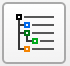{ width="30"}

!!! note "Data Module"

    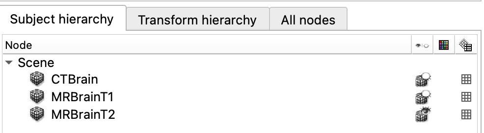{ width="450"}

    >**Screen grab from Data Module**. Notice the first two volumes are hidden (eye icons closed) Only MRBrainT2 is being shown (only row with an open eye icon)

## Volume Information Exploration

Open the `Volumes` module and review the Information. At the top of the module is the node list, which displays any loaded volumes

!!! note "Node List"

    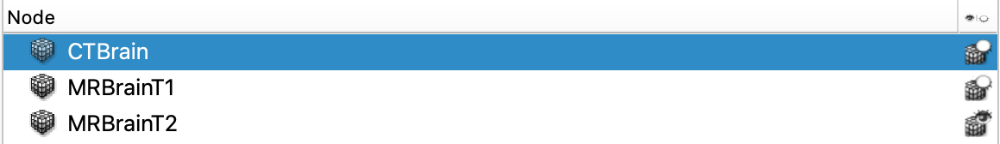{ width="450"}

Select each volume in the Node Tab and then examine in the Volume Information the following:

- Image Dimensions and Image Spacing
- Scalar Type
- Scalar Range

 The following are three separate screen grabs from the Volume Information tab in the Volumes Module. Notice how the information changes when you select a different volume in the Nodes tab

- 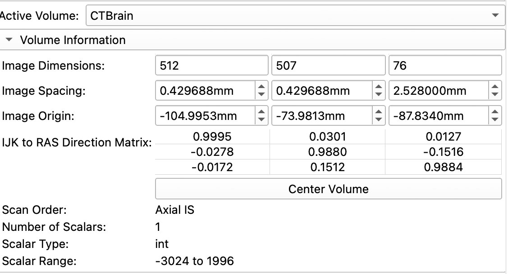{ width="450"}
- 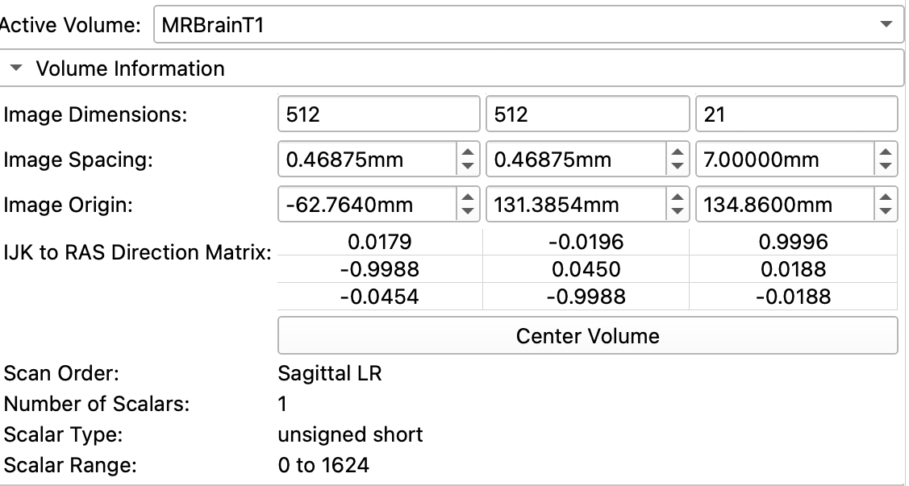{ width="450"}
- 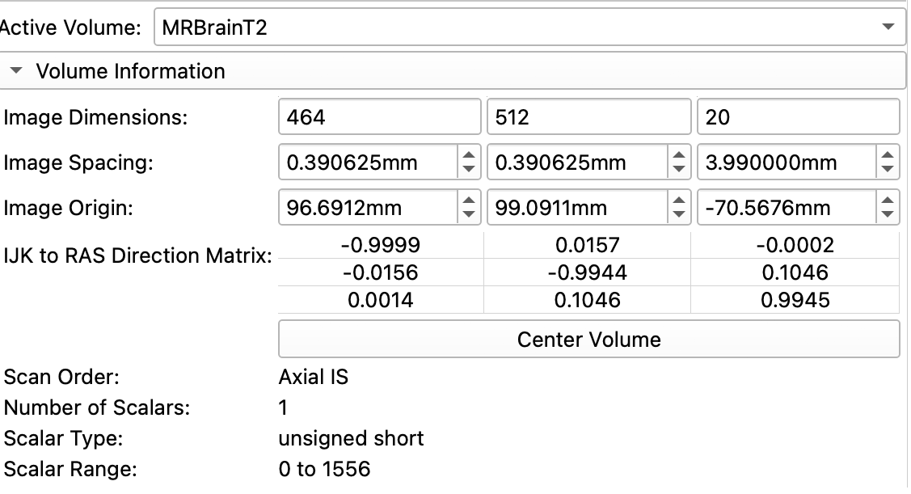{ width="450"}

??? question "Which volume is the largest (has the largest dimensions)?"

    - The CT volume has the most Z-slices and the most voxels: nearly 20 million voxels (512 X 507 X 76).
    - The MR volumes only have roughly 5 million voxels.

??? question "Which volume has the smallest voxels?"

    - CT voxels have the smallest XY and Z dimensions in the Image Spacing Row
    - The size of the CT voxels are: $0.43 * 0.43 * 2.5 = 0.46 mm^3$
    - The size of MR1 voxels are: $0.47 * 0.47 * 7 = 1.55 mm^3$
    - The size of MR2 voxels are: $0.39 * 0.39 * 4 = 0.61 mm^3$

??? question "Which volume has the widest dynamic range?"

    The CT volume ranges from -3024 to 1996, so that's the widest range. Notice how CT volumes have negative values, which MR volumes do not

### Change CT Window

1. Make sure CT is showing in the Red Viewer
2. Select `CTBrain` in the Node view
3. Under display, select the CT-brain preset
4. CT display should change to emphasize tissue. Air around Skull should be completely black.

## Display Volumes in the viewers

1. Display each volume in the Viewers and scrub through the slices
2. Change the displayed volume by:
   1. Clicking on the push-pin icon in one of the viewers
   2. Clicking on the Chain icon to close the chain link
   3. Changing the listed volume

!!! note "Red Slice Viewer"

    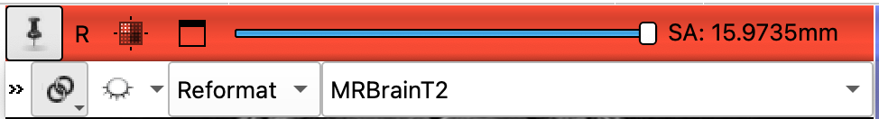{ width="450"}

    >Link the Chains icon in the red slice viewer and then select a volume to display (e.g. MRBRainT2)

As you scrub through each volume, what differences do you notice right away?

- Which volume has an obvious cylindrical dataset?
- Which volume has the highest resolution in the Sagittal Plane?
- Which volume(s) has the highest resolution in the Axial Plane?
- Which Volume was captured at an angle oblique to the Inferior-Superior Axis?

!!! note "Maximize viewer"

    Remember, for each viewer, you can expand the view by clicking on the "Maximize View" icon (![expand icon][icon-expand]{ width="25"}) or double-clicking on the image itself. To restore the full-layout view, click on the "Restore Layout" icon (![restore icon][icon-full-layout]{width="25"}).
        
    [icon-expand]: images/button-viewer-expand-icon-green.png

    [icon-full-layout]: images/button-viewer-de-expand-icon-green.png

### Compare Slice Views

We have only one high resolution view for each of the MR volumes, so let's display those volumes in separate viewers.  Click on the push-pin icon and set the Chain-Link icon to unlinked (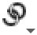{ width="18"}) so the viewers are not synchronized. Set the viewers as follows:

- **Red Viewer**: MRBrainT2.
- **Green Viewer**: CTBrain.
- **Yellow Viewer**: MRBrainT1.

Be sure to fit all the volumes to the Window: { width="25"}. You should see the following in the viewers:

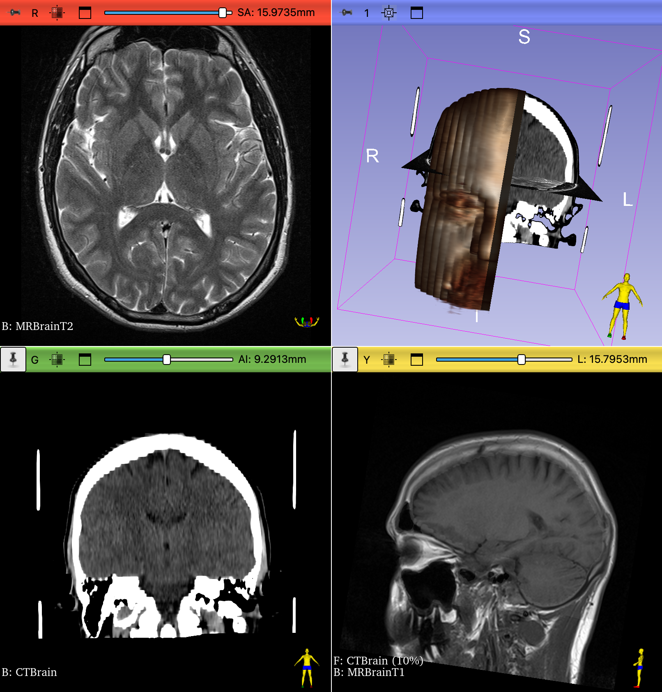{ width="450"}

>Notice how the bottom of the T1 volume is at an angle. This is because the volume has been aligned (registered) to the CT volume

- In which volume(s) can you see the white and gray matter most clearly?
- In which volume is the skull the brightest?

- :fontawesome-solid-brain:  **MR Volumes**

    ---

    - Compare the colors of the white vs gray matter
    - Compare the MR volumes to the CT volumes
    - What Structures can you identify?

-  :fontawesome-solid-brain: **CT Volume**

    ---

    - The **pineal gland.** The pineal gland is often calcified. Look for a small white dot.
    - A **putative meningioma** (calcified falcine tumor) in the forebrain?

    Sync the CTBrain and T1 slices to the tumor location.

    - Can you see evidence of the tumor in the T1 scan?
     
- :fontawesome-solid-brain:  **T2 Volume**

    ---

    - The uncus
    - The basal ganglia.
    - The thalamus
    - The Cochlea? (Look for the Shrek ears on slice -23.9265mm)

-  :fontawesome-solid-brain: **T1 Volume**

    ---

    - Corpus Callosum
    - Fornix
    - Cerebral Aqueduct
    - Thalamus
    - 4th ventricle
    - Pituitary Gland

### Overlay volumes

We can compare the CT to MR scans by overlaying the volumes. Switch to the `View Controllers` module and set up the viewer volumes as follows:

!!! note "Overlay settings in Slice Viewers"

    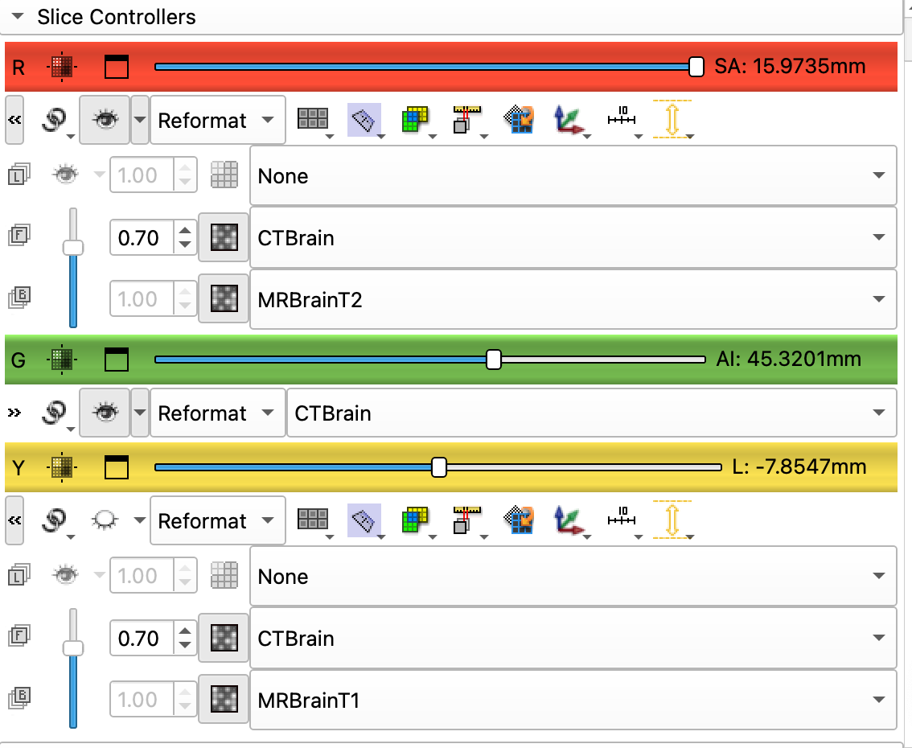{ width="450"}
    
    - Notice that the chain icon is unlinked.
    - Only the Red and Yellow slice controllers overlay two different volumes.
    - Set the overlay transparency to 0.70 for both.

You should now see the following in the viewers:

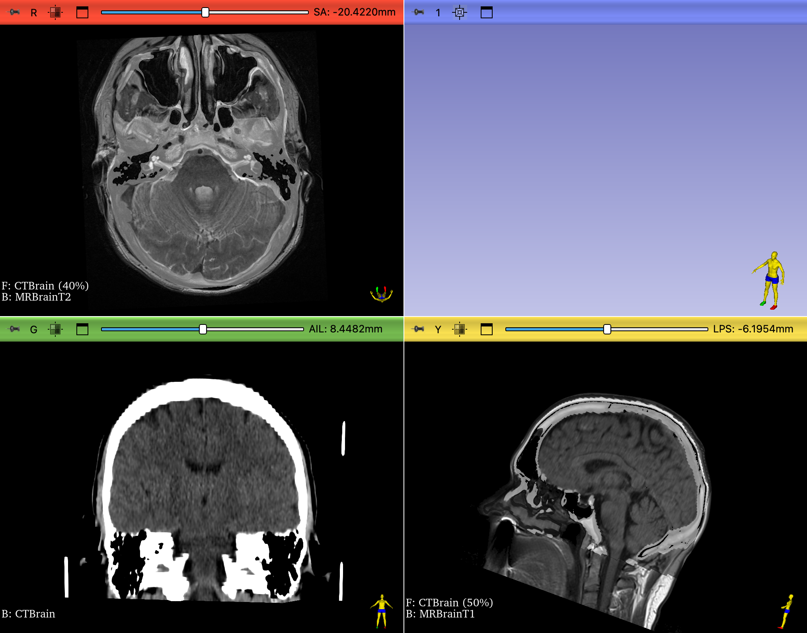{ width="450"}

Adjust the transparencies of the overlays as you review the slices

- Review the CT to determine the extent of the skull. Notice the Dura mater is difficult to see in the CT scan, but is clearly visible in the MR scans.
- For the CT/T2 overlay notice the intensity of the ventricles and the skull as you change the transparencies from CT to MR
- For the CT/T1 overlay, scrub to the location of the falcine tumor and observe the transition between CT to MR

## Add Slices to the 3D view

Add the T1 and T2 slices to the 3D view by clicking on the respective slice viewer pushpins and toggling on the eye icon.

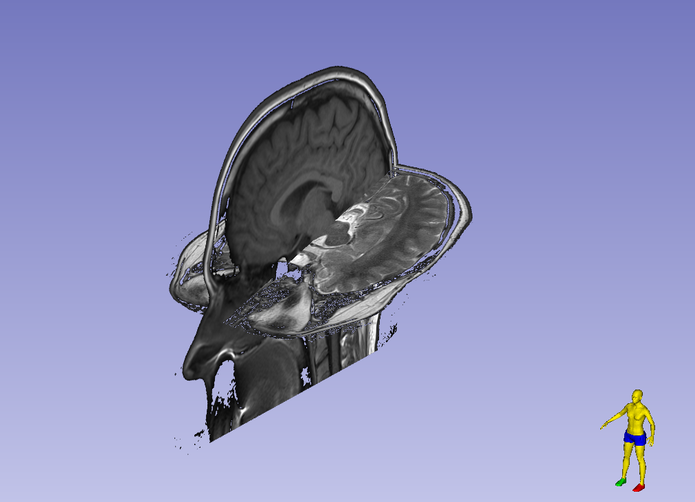{ width="250"}

>**3D view of the MR volumes.** Notice how the volumes were captured at angles to each other.

To remove the edges of the slices in the 3D view, switch to the **Volume Module** and:

1. Select each MR Volume in the `Volume` pop-up menu
2. Under the Display tab, set the `Threshold` as indicated in the table below:

| Volume | Lower Threshold |
| ------ | --------------- |
| MRT1   | 70              |
| MRT2   | 30              |

## Volume Render the Skull

Switch to the `Volume Rendering` module. Render and review each volume by selecting the volume in the `Volume` pop-up menu and toggling the eye icon. Create the following three renders (sequentially, not at the same time).

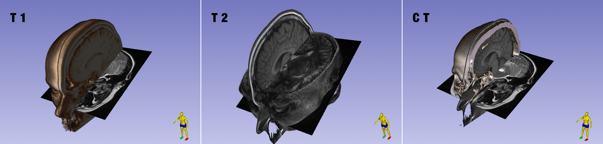{ width="650"}
>**3D renders of the CT-MR volumes.** Each 3D render displays the Volume indicated in the top right corner, cropped sagittally, the Axial MR T2 slice and the sagittal T1 Slice.

2D Slices

In each image show:

- Red Slice Viewer: Axial MR T2 slice
- Yellow Slice Viewer: the sagittal T1 Slice
- Be sure to threshold the T1 slice

3D Volume

For, each image, only render one 3D volume.  Be sure to crop the render to remove the left half of the volume.

For the T1 render:

- Select the MR-default preset
- Notice how thick the slices are in T1 render in the 3D viewer
- This gives you an indication of the resolution of the volume.

For the T2 render:

- There is only half a head (the lower half of the head)
- The top half seen in the image is the sagittal T1 Slice

For the CT render:

- Slide the "Shift" slider back and forth to reveal the head restraint. Does the patient have straight or curly hair?
- Select the CT-AAA preset to reveal the skull
- Find the Intracranial sinus
- Find the falcine tumor. If not visible, adjust the crop ROI.