# Uploading Models to Sketchfab

[Sketchfab](https://sketchfab.com) is a website for sharing and displaying 3D models. Once your model is on Sketchfab, anyone with the link can rotate, zoom, and explore it in a web browser. You can also embed the model in another web page.

In this exercise, you will upload the OBJ and MTL files that you [exported from Slicer](ExportModels.md), fill in the model settings, adjust the 3D settings, and then share the model.

!!! note "You need a Sketchfab account"

    Create a free account at [sketchfab.com](https://sketchfab.com) before you start, and make sure you are logged in.

## Upload a New Model

You need **both** the `.obj` and the `.mtl` file. The OBJ file holds the surfaces; the MTL file holds the colors of each segment. The two files should have the same name, just different extensions.

1. Click the orange **Upload** button at the top right of any Sketchfab page.
2. In the **Upload a new model** window, drag both the `.obj` and the `.mtl` file into the dashed box, or click **browse** and select both files.
>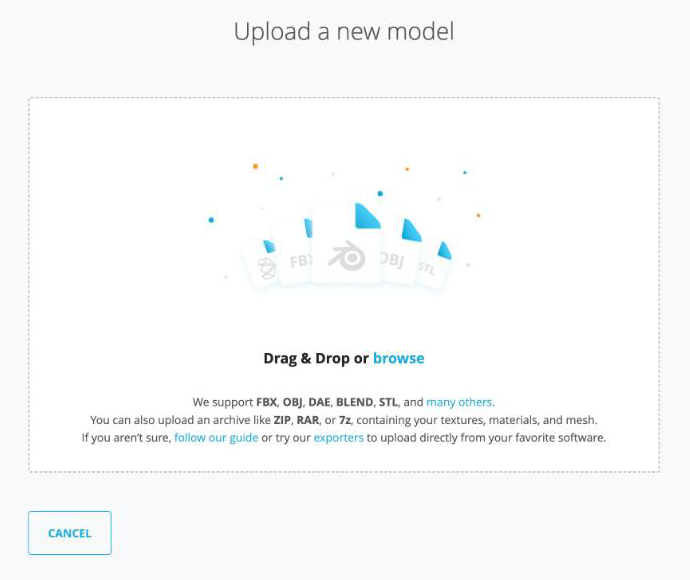{ width="450"}
3. Check that both files are listed in the box.
>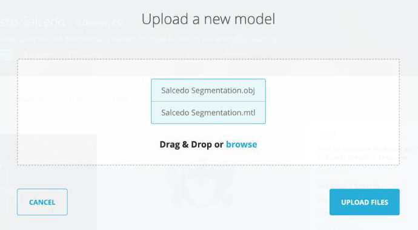{ width="450"}
4. Click **Upload Files**.

!!! note "Large OBJ files"

    You can also compress the OBJ and MTL files into a single ZIP file and upload that instead. Sketchfab unpacks the ZIP and lists the files inside. ZIP files from the Mac Finder include extra `__MACOSX` entries; these are harmless, but they also show up in the file list.

## Model Settings

As soon as the upload starts, Sketchfab opens the **Edit model** page. The left panel shows the upload progress (**Upload**, **Processing**, **Ready to publish**). You can fill in the settings while the model processes.

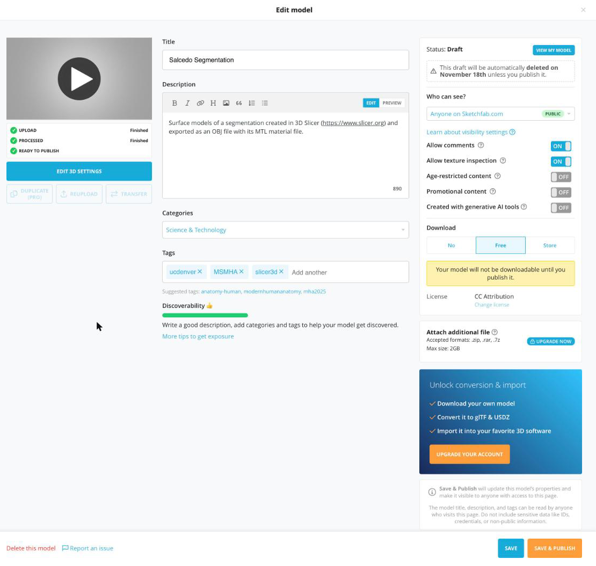{ width="450"}

1. **Title**: Sketchfab fills this in from the file name. Change it if needed.
2. **Description**: Add a short description of the model, e.g. which structures were segmented and that the model was made in [3D Slicer](https://www.slicer.org).
3. **Categories**: Select **Science & Technology** from the dropdown.
4. **Tags**: Type a tag and press **Return** after each one. Be sure to add the **ucdenver** and **MSMHA** tags.
5. **Download**: Select **Free**.
6. Click **Save** at the bottom right.
>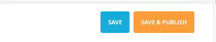{ width="250"}

!!! warning "Select Free download"

    Be sure to set **Download** to **Free**. Other download options may give you a warning that you have run out of credits.

!!! note "Your model is a draft until you publish it"

    **Save** keeps your model as a **Draft**: only you can see it. The model becomes visible to others only after you click **Save & Publish** (or **Publish**). Notice the warning in the right panel: Sketchfab automatically **deletes a draft about one month** after upload unless you publish it (the panel shows the exact date).

## Edit 3D Settings

Once the model has finished processing, click the **Edit 3D Settings** button (below the model preview on the left) to open the 3D editor.

The editor has a row of tabs across the top of the left panel: **General** (gear), **Lighting** (light bulb), **Materials**, **Post Processing Filters** (magic wand), **Annotations** (pin), **Animation**, and **AR/VR**.

!!! warning "Save your 3D settings"

    Changes in the 3D editor are not saved automatically. Click **Save Settings** at the top right before you leave the editor. Do not click **Publish** unless you are ready to make your model public.

    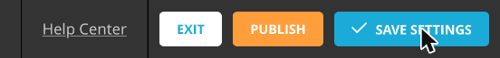{ width="300"}

### General

Models exported from Slicer usually do not load in the right orientation. Use the **Straighten model** controls to rotate the model.

1. Under **Straighten model**, click the arrows next to **X**, **Y**, or **Z**. Each click rotates the model 90° around that axis.
    - For this model, one click on the right arrow next to **X** turns the model so that the lungs are on top and the aorta runs vertically.
2. Check **Show advanced rotation** to show a rotation gizmo in the viewer. Drag the colored rings to fine-tune the orientation.

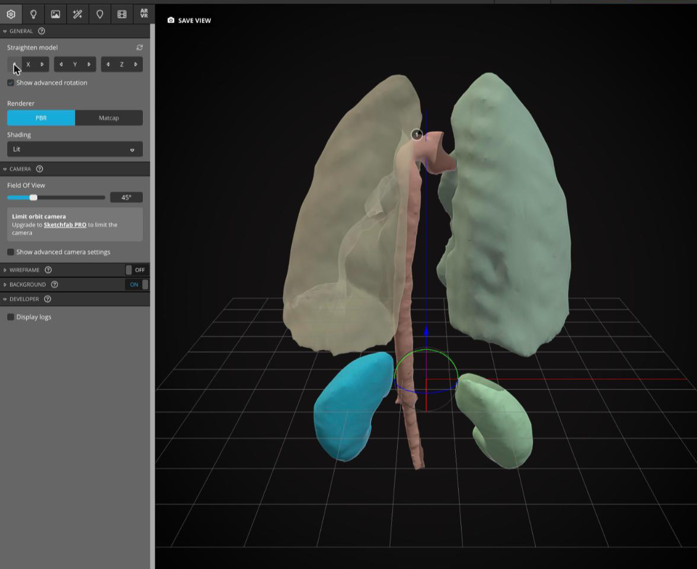{ width="450"}

### Background

Expand the **Background** section (still on the General tab). There are three **Background type** options: **Environment**, **Image**, and **Color**.

#### Environment

The **Environment** option places your model in a 3D scene.

1. Click **Environment**.
2. To pick a different scene, click the **change** link next to "Current environment". This takes you to the Lighting tab, where you can pick a scene from the **Environment** dropdown. Then switch back to the General tab.
3. Uncheck **Ambient environment** to show the scene clearly.
4. Set **Blur** to `0`.
5. Increase the **Brightness**.

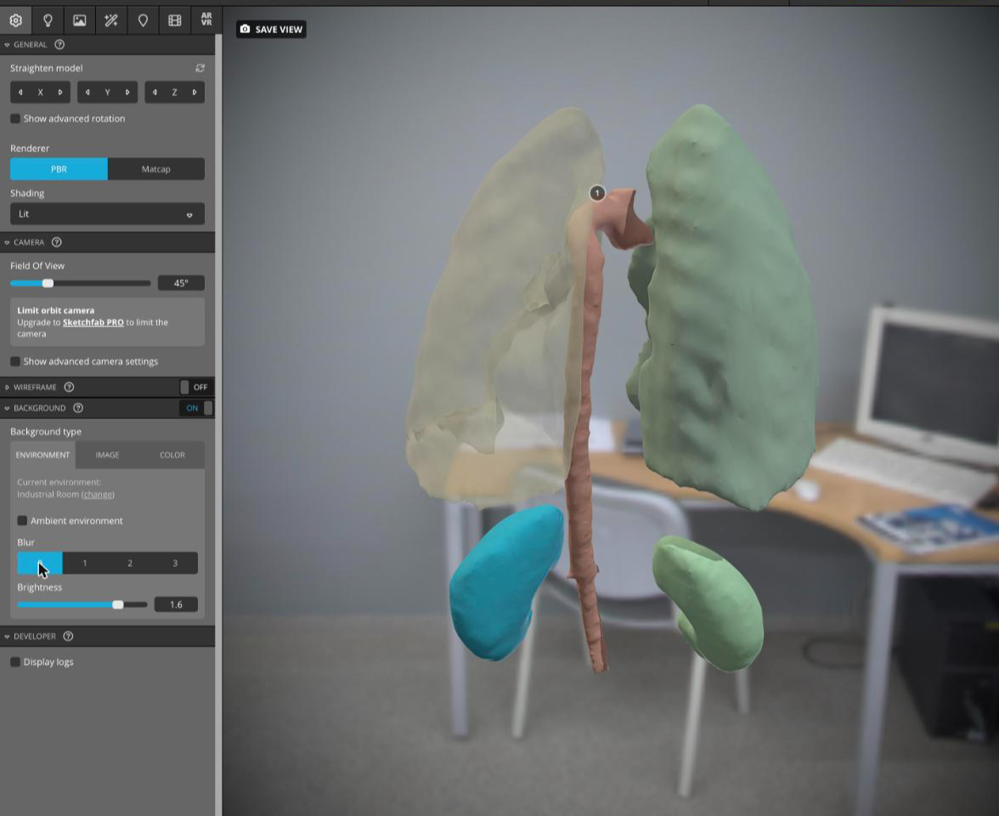{ width="450"}

#### Color

Or you can set the background to a solid color.

1. Click **Color**.
2. Click in the color picker, or type a hex value (e.g. `#131111` for near black) in the box below it.

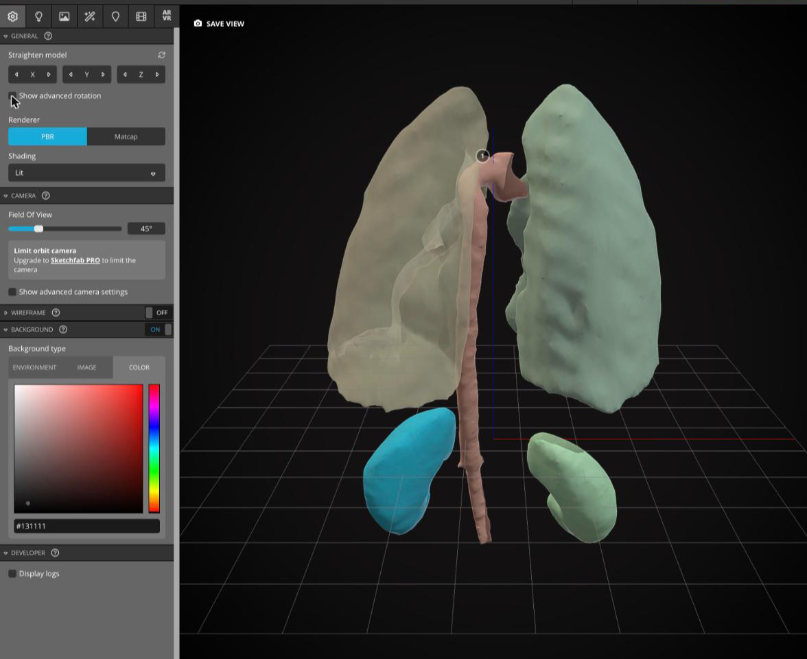{ width="450"}

### Lighting

1. Click the **Lighting** tab (light bulb icon).
2. Turn the **Lights** toggle **ON** so you can control the lights.
3. Click **Load Lighting Preset**, then select a preset (e.g. **Three-point Lighting**).

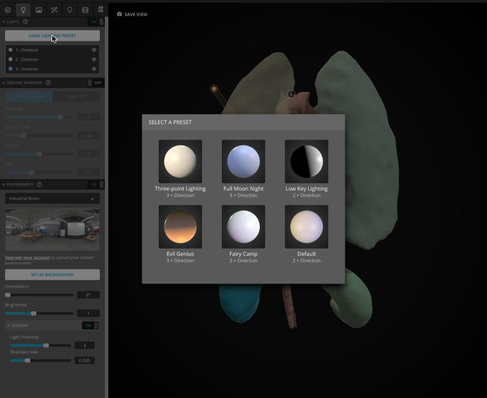{ width="450"}

### Materials

The Materials tab changes the appearance of each segment (material) in your model.

1. Click the **Materials** tab.
2. Select a material from the dropdown at the top of the panel. The selected segment is highlighted in the viewer.
    - The material names come from the MTL file that Slicer wrote (e.g. `mtl60716`), not from your segment names. Click through the list to find the segment you want.
3. Scroll down to **Opacity** and make sure it is **ON**. Expand the section and lower the value (e.g. `0.4`) to make the segment see-through.

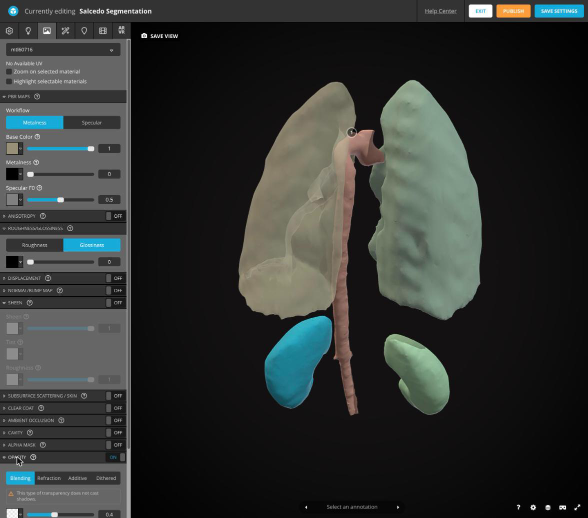{ width="450"}

### Post Processing Filters

Many settings here change the overall appearance of your model.

1. Click the **Post Processing Filters** tab (magic wand icon).
2. Try turning on **Sharpness** and **Vignette**.
3. Expand a filter (click its name) to adjust its settings.

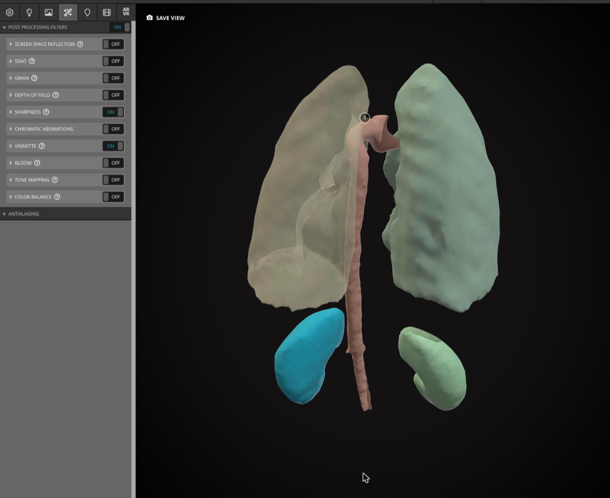{ width="450"}

### Annotations

Annotations are numbered labels attached to points on your model.

1. Click the **Annotations** tab (pin icon).
2. Double-click on a structure in the viewer to place an annotation.
3. Type a **Title** and a **Description**, then click **OK**.
4. To change an annotation later, click **Edit** next to it in the left panel. Click the camera icon to save the current view for that annotation.

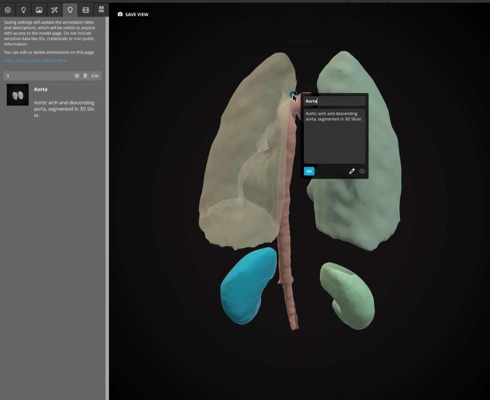{ width="450"}

!!! note

    Annotation titles and descriptions are visible to anyone who can see your model page.

### Save the View

1. Rotate and zoom the model in the viewer until it looks the way you want people to first see it.
2. Click **Save View** (top left of the viewer). This sets the model's thumbnail and initial camera view.
3. Click **Save Settings**, then click **Exit**.

## Model Page

After you exit the editor, you see your model's page. While the model is a draft, the page shows a yellow **This model is a Draft** box with a **Publish** button, and the title has a **Draft** label.

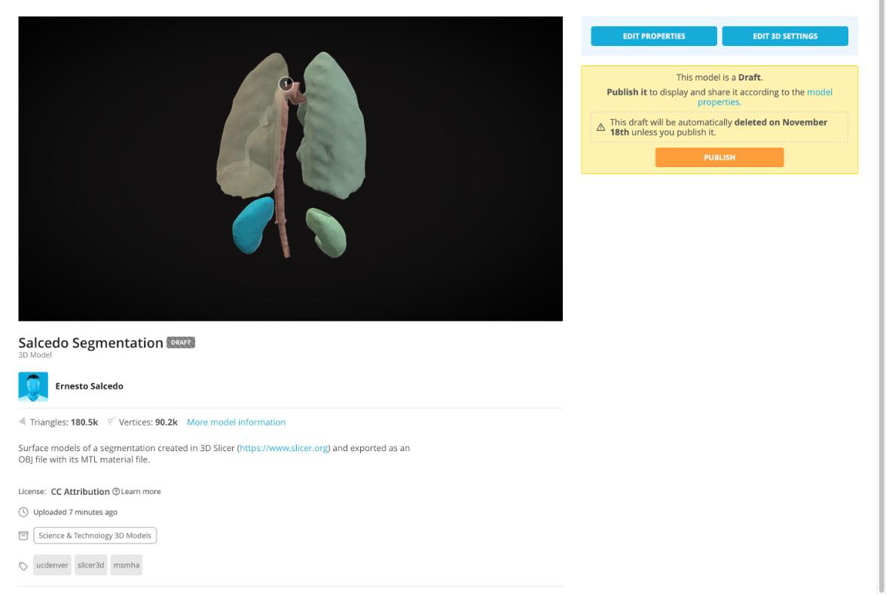{ width="450"}

### Publish

When you are ready to share your model, click **Publish**. Sketchfab confirms that the model has been published and shows a short link you can copy right away. Click **Got it! See my model** to return to the model page.

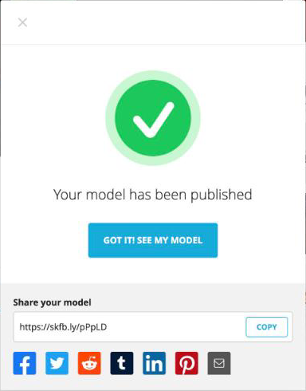{ width="300"}

### Share and Embed

Once your model is published, the model page shows **Download 3D Model**, **Add To**, **Embed**, and **Share** links below the model. You can interact with the model by dragging on it.

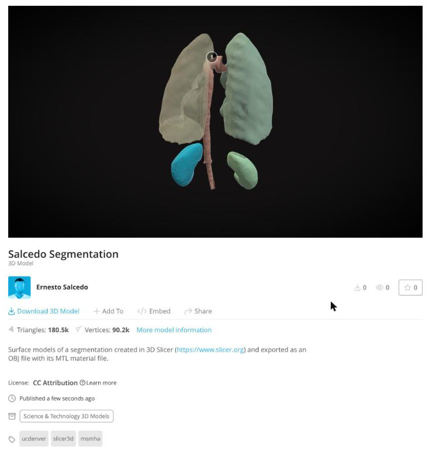{ width="450"}

1. Click **Share** to get a short **Direct link** to your model. Click **Copy** to copy it.
>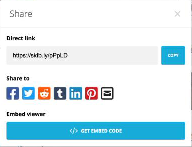{ width="300"}
2. To place the model in another web page, click **Get Embed Code** in the Share dialog (or click **Embed** on the model page). The **Embed viewer** window shows a preview, options for the embedded viewer, and the embed code. Click **Copy to Clipboard** to copy the code.
>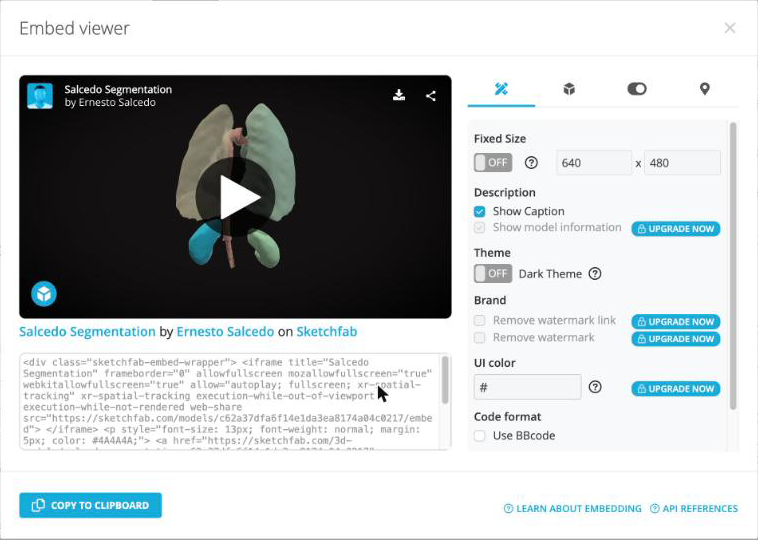{ width="450"}

### Example: Embedded Model

This is the embed code for the model uploaded in this exercise, pasted into this page. Drag on the model to rotate it, and click the numbered annotation to read it.

 <iframe title="Salcedo Segmentation" frameborder="0" allowfullscreen mozallowfullscreen="true" webkitallowfullscreen="true" allow="autoplay; fullscreen; xr-spatial-tracking" xr-spatial-tracking execution-while-out-of-viewport execution-while-not-rendered web-share src="https://sketchfab.com/models/c62a37dfa6f14e1da3ea8174a04c0217/embed" width="640" height="480"> </iframe> 
 <a href="https://sketchfab.com/3d-models/salcedo-segmentation-c62a37dfa6f14e1da3ea8174a04c0217" target="_blank" rel="nofollow" style="font-weight: bold; color: #1CAAD9;"> Salcedo Segmentation </a> by <a href="https://sketchfab.com/salcedoe" target="_blank" rel="nofollow" style="font-weight: bold; color: #1CAAD9;"> Ernesto Salcedo </a> on <a href="https://sketchfab.com" target="_blank" rel="nofollow" style="font-weight: bold; color: #1CAAD9;">Sketchfab</a>

