# From Slicer to MATLAB: a Segmentation Workflow

You have segmented some anatomy in 3D Slicer. Now what? This page walks through the whole path from a Slicer segmentation to measurements, comparisons, and class statistics in MATLAB. It follows the SLCR live scripts in Unit 3, and each step tells you which script covers it in detail.

Each step has a picture of the result, the few lines of code that make it, and a link to the [MtM Toolbox](../reference/courseFunctions.md) page for the full details of each function.

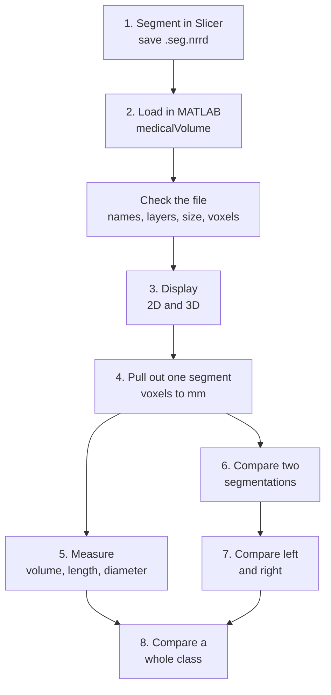

| Step | What you do | Main functions | Live script |
| --- | --- | --- | --- |
| [1](#1-segment-and-save-in-slicer) | Segment and save in Slicer | Segment Editor | [CTACardio](CTACardioSegment.md), [CT Femur](CTFemurSegment_9553F.md) |
| [2](#2-load-the-volumes-in-matlab) | Load the CT and the segmentation | `medicalVolume`, `mmGetSlicerSegmentInfo` | SLCR1, SLCR2 |
| [✓](#check-your-segmentation-file) | Check your segmentation file | `mmCollapseSegmentLayers`, `mmMatchVolumeGeometry`, `mmResampleIsotropic`, `mmResampleSlicerFiles` | SLCR4, SLCR5 |
| [3](#3-display-the-segmentation) | Display in 2D and 3D | `labeloverlay`, `volshow`, `mmPlotAllSeg` | SLCR1 |
| [4](#4-pull-out-one-segment) | Pull out one segment, in mm | `mmGetMedicalVolumeSegment`, `mmPlotMask2Surface` | SLCR1, SLCR2 |
| [5](#5-measure) | Measure volume, length, and diameter | `regionprops3`, `mmAlignSurface2Axes`, `mmCrossSectionProfile` | SLCR4 |
| [6](#6-compare-two-segmentations) | Compare two segmentations | `dice`, `mmSurfaceDistance` | SLCR2, SLCR3 |
| [7](#7-compare-left-and-right) | Compare left and right | `mmMirrorAlign`, `mmSurfaceDistance` | SLCR5 |
| [8](#8-compare-a-whole-class) | Compare the whole class | `mmGetSlicerSegmentInfoAll`, `mmBoxSwarm` | SLCR5, SLCR6 |

!!! warning "Before you start"
    - Add the MtM toolbox to your MATLAB path (see the [setup page](../setup/matlabInstallation.md#add-toolboxes-to-the-matlab-search-path))
    - You need the **Medical Imaging Toolbox** and the **Image Processing Toolbox**
    - Get the SLCR live scripts with `mmGetScript(3)`

## 1. Segment and save in Slicer

Segment your structures in the Segment Editor, following the [CTACardio](CTACardioSegment.md) or [CT Femur](CTFemurSegment_9553F.md) tutorial. Then save your work (**File → Save Data**). Slicer saves two files that MATLAB needs:

- the **intensity volume** (the CT or MRI), as a `.nrrd` file. For example, `CTACardio Crop.nrrd`
- the **segmentation**, as a `.seg.nrrd` file. For example, `Salcedo Segmentation.seg.nrrd`

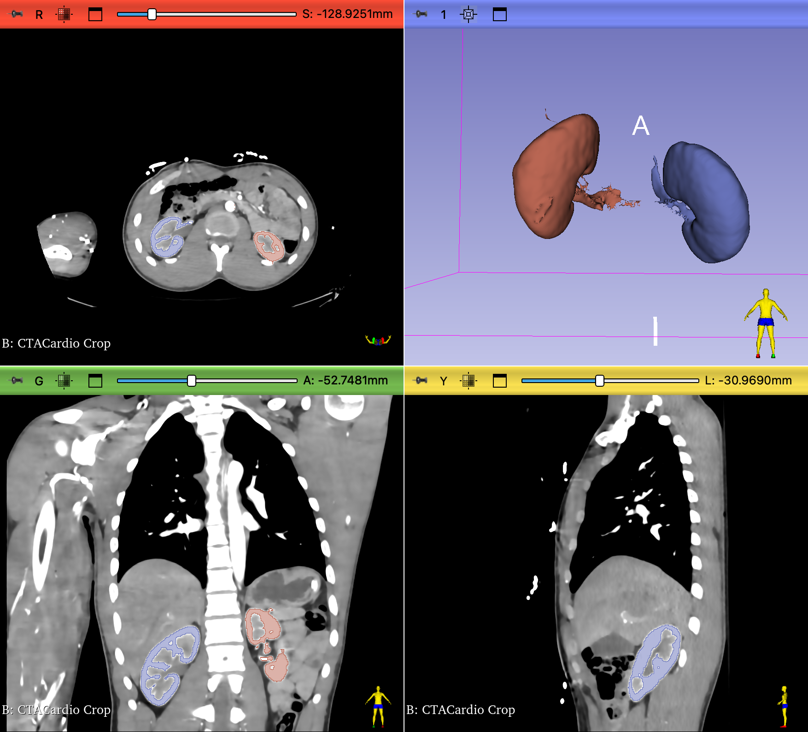{ width="450"}

> The kidneys segmented in Slicer. Each segment has a name and a color, and Slicer stores both in the `.seg.nrrd` file.

!!! tip "Name your segments and files carefully"
    MATLAB finds segments by name, so use the names in the tutorial ("right kidney", "left femur"). Start the file name with your last name and a space (`Salcedo Segmentation.seg.nrrd`): in step 8, the part before the space becomes your ID.

## 2. Load the volumes in MATLAB

Load both files as `medicalVolume` objects. A `medicalVolume` holds the voxels and the geometry of the volume: its voxel size, orientation, and position in the patient. Then read the segment names, label values, and colors with `mmGetSlicerSegmentInfo`.

```matlab linenums="1" title="Load the volumes (SLCR1)"
folder = fullfile(mmSetUnitDataFolder(3), "CTACardio");
ctMV = medicalVolume(fullfile(folder, "CTACardio Crop.nrrd"));                  % CT
segMV = medicalVolume(fullfile(folder, "Salcedo Segmentation.seg.nrrd"));       % segmentation
segT = mmGetSlicerSegmentInfo(fullfile(folder, "Salcedo Segmentation.seg.nrrd"))
```

```text title="segT"
       SegName        Layer    LabelValue                Color
    ______________    _____    __________    _____________________________
    "right kidney"      1          1         0.56471    0.93333    0.56471
    "left kidney"       1          2               0    0.59216    0.80784
    "aorta"             1          3         0.84706    0.39608     0.3098
```

Every voxel of `segMV.Voxels` holds a label value: 0 for background, 1 for the right kidney, 2 for the left kidney, and 3 for the aorta.

Before you go on, [check your segmentation file](#check-your-segmentation-file): four quick checks catch the problems that stop the later steps.

## Check your segmentation file

A segmentation can look fine in Slicer and still stop your MATLAB script, or give wrong measurements. Run these four checks right after you load the volumes. Each one takes one line, and each problem can be fixed in MATLAB with a course function, without going back to Slicer.

| Check | Look at | Problem if | Fix in MATLAB | Or fix in Slicer |
| --- | --- | --- | --- | --- |
| [Names](#are-the-names-right) | the file name and `segT.SegName` | the file doesn't end in `.seg.nrrd`, or a segment has the wrong name | rename the file; use the name you see in `segT` | rename the segment and save again |
| [Layers](#does-the-segmentation-have-layers) | `size(segMV.Voxels)` | four numbers instead of three | `mmCollapseSegmentLayers` | [collapse the layers](CTACardioSegment.md#review-segmentation-module) |
| [Size](#is-the-segmentation-the-same-size-as-the-ct) | `size(segMV.Voxels)` and `size(ctMV.Voxels)` | the sizes are different | `mmMatchVolumeGeometry` | |
| [Voxel size](#are-the-voxels-isotropic) | `ctMV.VoxelSpacing` | the three numbers are not equal | `mmResampleIsotropic` (in your script), `mmResampleSlicerFiles` (new files) | [resample](CTACardioSegment.md#crop-module), then segment again |

```matlab linenums="1" title="The four checks"
segT                      % names: are the segment names what your script expects?
size(segMV.Voxels)        % layers: three numbers (four = layers)
size(ctMV.Voxels)         % size: the same three numbers as the segmentation
ctMV.VoxelSpacing         % voxel size: three equal numbers (isotropic)
```

```text title="A file that passes"
ans =
   465   276   390
ans =
   465   276   390
ans =
    1.0270    1.0270    1.0270
```

If all four pass, go on to [step 3](#3-display-the-segmentation). If not, apply the fixes below **in this order**:

```matlab linenums="1" title="All the fixes, in order (use only the ones you need)"
[segMV, segT] = mmCollapseSegmentLayers(segMV, segT);              % layers
segMV = mmMatchVolumeGeometry(segMV, ctMV);                        % size
[ctMV, segMV] = mmResampleIsotropic(ctMV, segMV, Segments=segT);   % voxel size
```

Each function leaves a file that has no problem unchanged, and none of them changes the files on your computer.

### Are the names right?

MATLAB finds your files and your segments by name:

- **The file** must end in `.seg.nrrd`. `mmGetSlicerSegmentInfo` stops with "Slicer *.seg.nrrd files only" for a file like `SalcedoSegmentation.nrrd`. For a class folder, start the name with your last name and a space (`Salcedo Segmentation.seg.nrrd`): the part before the space becomes your ID in [step 8](#8-compare-a-whole-class).
- **The segments** must have the names that your script asks for. `mmGetMedicalVolumeSegment(segMV, segT, segName="aorta")` can't find a segment called "Aorta 1" or "Segment_3". Look at `segT.SegName`, and either use that name in your script, or rename the segment in Slicer and save again.

### Does the segmentation have layers?

When segments overlap (like MRTumor1 and MRTumor2), Slicer saves them in more than one layer. In MATLAB, `segMV.Voxels` is then 4-D instead of 3-D: you get four numbers for `size(segMV.Voxels)` (the fourth is the number of layers), and the `Layer` column of `segT` has values above 1. Steps that need one label volume, like `regionprops3`, `categorical`, and `volshow`, then fail.

`mmCollapseSegmentLayers` combines the layers into one label volume, with the same result as [collapsing the layers in Slicer](CTACardioSegment.md#review-segmentation-module):

```matlab
[segMV, segT] = mmCollapseSegmentLayers(segMV, segT);
```

```text title="Command Window"
mmCollapseSegmentLayers: collapsed 2 layers into 1 (6 segments).
  Some segments overlap. Where they do, the segment in the higher layer won (as in Slicer):
  - Implant lost 7363 voxels (9.13 mL) to right tibia
```

!!! warning "Read the report"
    One voxel can hold only one label, so where two segments overlap, one of them loses those voxels. Check that the numbers are small. If the overlap is what you want to study (two segmentations of the same tumor in SLCR3), don't collapse: `mmGetMedicalVolumeSegment` reads each segment from its own layer.

### Is the segmentation the same size as the CT?

Some versions of Slicer add an empty slice to a segmentation. Then MATLAB can't compare it voxel by voxel with the CT. `mmMatchVolumeGeometry` adds or removes the extra slices, so that the two line up:

```matlab
segMV = mmMatchVolumeGeometry(segMV, ctMV);
```

It only adds or removes slices at the edges. If the two volumes have a different **voxel size**, it stops and tells you: that is the next check.

### Are the voxels isotropic?

**Isotropic** voxels have the same size in all three directions. Many scans don't: the original CTACardio volume has voxels of 0.93 × 0.93 × 1.25 mm. Steps that measure in voxels (`regionprops3`, `bwdist`, the aorta diameter in SLCR5) then give distorted results. The Slicer tutorials resample the volume to isotropic voxels [when you crop it](CTACardioSegment.md#crop-module). If the three numbers of `ctMV.VoxelSpacing` are not equal, you skipped that step, or you segmented the original volume instead of the cropped one.

`mmResampleIsotropic` resamples the volume and the segmentation to the same isotropic voxel grid:

```matlab
[ctMV, segMV] = mmResampleIsotropic(ctMV, segMV, Segments=segT);
```

```text title="Command Window"
mmResampleIsotropic: resampled the intensity volume
  voxel size: 0.9336 x 0.9336 x 1.25 mm  ->  0.9336 mm isotropic
  size:       512 x 512 x 321  ->  512 x 512 x 430 voxels
  Resampled the segmentation to the same voxel grid (nearest neighbor). Segment volumes:
  - right lung: 1263.46 mL  ->  1263.35 mL (-0.0%)
  - left lung: 1224.69 mL  ->  1224.71 mL (+0.0%)
  - other: 37.63 mL  ->  37.41 mL (-0.6%)
```

!!! note "Why the two volumes are resampled differently"
    CT values are amounts, so a new voxel can be the average of its neighbors (linear interpolation). Label values are names: the average of label 1 (right kidney) and label 3 (aorta) is not label 2 (left kidney). So each new voxel of the segmentation takes the label of the nearest old voxel, as in Slicer. Large segments barely change. Small or thin segments can change by a few percent: check the report.

### Save a corrected file

The fixes above change the variables in MATLAB, not your files. That is enough for your own script. You need a corrected **file** when someone else reads it, for example when you upload your segmentation to a class folder ([step 8](#8-compare-a-whole-class)): the class script loads every file the same way, and it can't fix yours.

| To save | Use |
| --- | --- |
| Isotropic copies of the volume and the segmentation | `mmResampleSlicerFiles` |
| A segmentation with its layers collapsed | `mmCollapseSegmentLayers` with `OutputFile` |
| Any `medicalVolume` that you changed | `mmWriteNRRD` |

```matlab linenums="1" title="Save isotropic copies of your Slicer files"
myIntensity = "/path/to/your/folder/CTACardio.nrrd";                    % the volume that you segmented
mySegment = "/path/to/your/folder/Salcedo Segmentation.seg.nrrd";       % your segmentation
[newIntensity, newSegment] = mmResampleSlicerFiles(myIntensity, mySegment)
```

`mmResampleSlicerFiles` needs **both** files, from the Slicer folder on your computer, so that the segmentation lands on the grid of the resampled volume. It saves two new files next to the originals, `CTACardio isotropic.nrrd` and `Salcedo Segmentation isotropic.seg.nrrd`, and never changes the originals. Slicer can open the new files: the segment names, colors, and layers are kept.

```matlab linenums="1" title="Save a collapsed segmentation"
[segMV, segT] = mmCollapseSegmentLayers(segMV, segT, OutputFile="Salcedo Segmentation collapsed.seg.nrrd");
```

## 3. Display the segmentation

Check your segmentation before you measure it. First, overlay one slice of the segmentation on the CT, in the segment colors from Slicer:

```matlab linenums="1" title="One slice (SLCR1)"
ctSlice = extractSlice(ctMV, 90, "transverse");
labelSlice = extractSlice(segMV, 90, "transverse");
imshow(labeloverlay(mat2gray(ctSlice, [-160 240]), labelSlice, Colormap=segT.Color, Transparency=0.3))
```

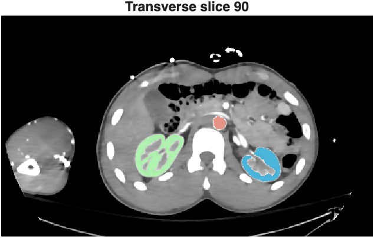{ width="450"}

> A transverse slice through both kidneys, with the segmentation in the Slicer colors.

Then look at it in 3D. `volshow` renders the CT and the segmentation together. `mmPlotAllSeg` turns every segment into a surface:

```matlab linenums="1" title="3D (SLCR1)"
viewer = viewer3d(BackgroundColor="white", BackgroundGradient="off");
volshow(ctMV, Parent=viewer, RenderingStyle="GradientOpacity", OverlayData=segMV.Voxels);

figure
mmPlotAllSeg(segMV, segT);
```

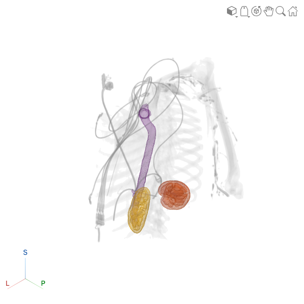{ width="300"} 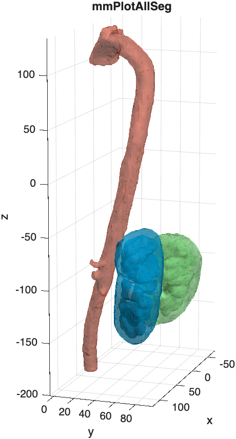{ width="190"}

> Left: `volshow` with the segmentation as an overlay. Right: `mmPlotAllSeg` plots each segment as a surface, in its Slicer color.

## 4. Pull out one segment

Most analyses work on one structure at a time. `mmGetMedicalVolumeSegment` returns a structure with the mask of one segment, its color, and `tform`: the transformation that converts voxel positions to millimeters in the patient. Use `tform` whenever you make a surface, so that your measurements are in mm, not voxels.

```matlab linenums="1" title="One segment (SLCR1, SLCR2)"
rk = mmGetMedicalVolumeSegment(segMV, segT, segName="right kidney")
mmPlotMask2Surface(rk.mask, fcolor=rk.color, transform=rk.tform);
```

```text title="rk"
    segName: "right kidney"
       mask: [465×276×390 logical]
      color: [0.5647 0.9333 0.5647]
      tform: [1×1 affinetform3d]
    spacing: [1.027 1.027 1.027]
     volume: 99574
```

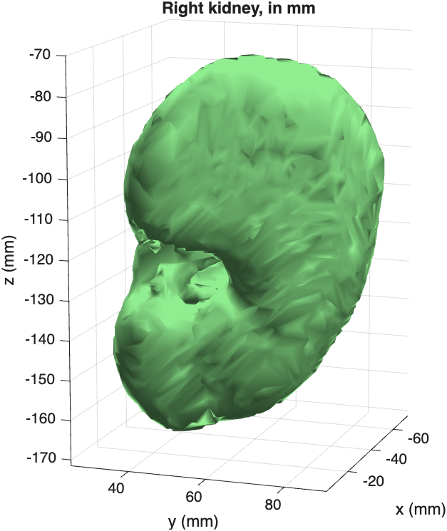{ width="300"}

> The right kidney as a surface. The axes are in mm, because the surface was transformed with `rk.tform`.

!!! note "`volume` is in voxels"
    Multiply by the volume of one voxel to get mm³: `rk.volume * prod(segMV.VoxelSpacing)`. Divide by 1000 for mL. For this kidney, that's 108 mL.

## 5. Measure

### Volume and mean intensity

`regionprops3` measures every segment at once. Turn the label volume into a `categorical` array first, so the rows are named after the segments:

```matlab linenums="1" title="Volume and mean HU (SLCR1, SLCR4)"
segCat = categorical(segMV.Voxels, segT.LabelValue, segT.SegName);
rp = regionprops3(segCat, ctMV.Voxels, "Volume", "MeanIntensity");
rp.Volume_mL = rp.Volume * prod(segMV.VoxelSpacing) / 1000
```

### Length

SLCR4 measures the femurs of donor 9553F. To measure the length of a bone, center its surface, turn its long axis upright with `mmAlignSurface2Axes`, and measure its range along z:

```matlab linenums="1" title="Femur length (SLCR4)"
rSeg = mmGetMedicalVolumeSegment(segMV, segT, segName="right femur");
hp = mmPlotMask2Surface(rSeg.mask, fcolor=rSeg.color, smooth=true, transform=rSeg.tform);
v = mmAlignSurface2Axes(hp.Vertices - mean(hp.Vertices));   % long axis along x
hp.Vertices = mmRotateSurfaceVertices(v, 'y', 90);           % long axis along z
femurLength = range(hp.Vertices(:,3))                        % mm
```

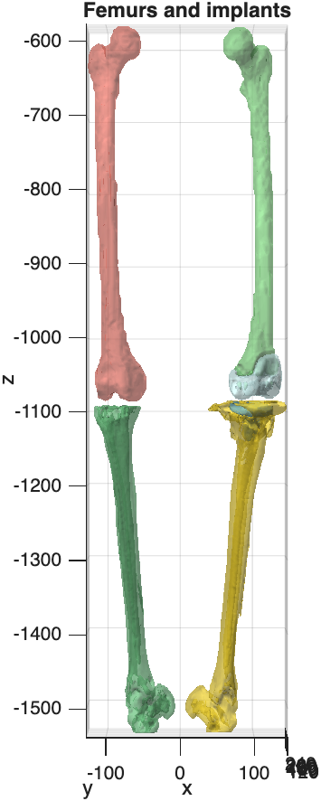{ width="150"} 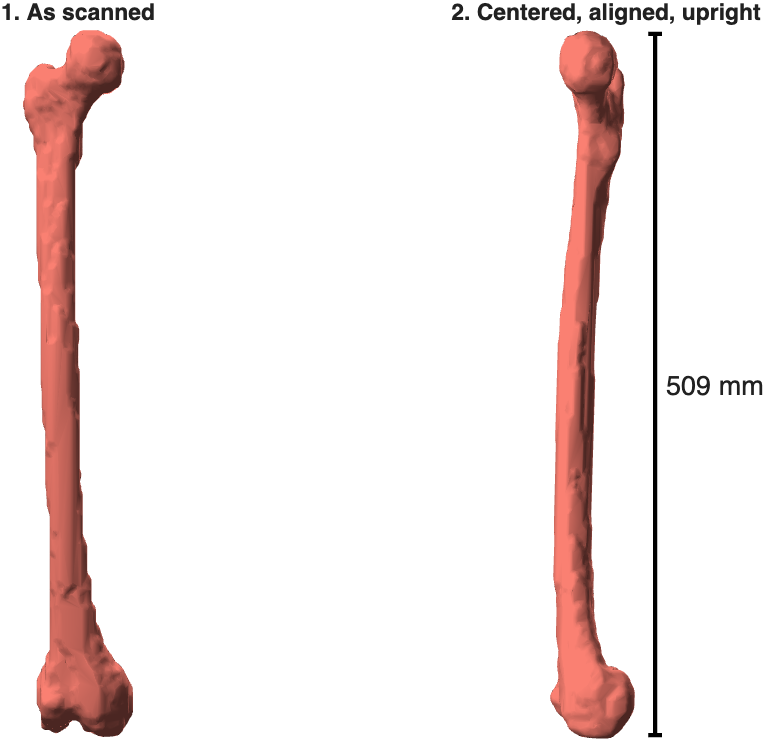{ width="450"}

> Left: the femur segmentation of donor 9553F, with a hip implant in the left femur. Right: the right femur, centered and aligned. Its length is 509 mm.

### Diameter along the length

`mmCrossSectionProfile` cuts a bone or vessel into thin slabs, perpendicular to its long axis, and measures every slab: its area, its equivalent diameter, and its narrowest and widest widths.

```matlab linenums="1" title="Cross-sections (SLCR4)"
[profileT, info] = mmCrossSectionProfile(rSeg, Title="Right femur");
info.At          % the cross-section at midshaft (50% of the length)
```

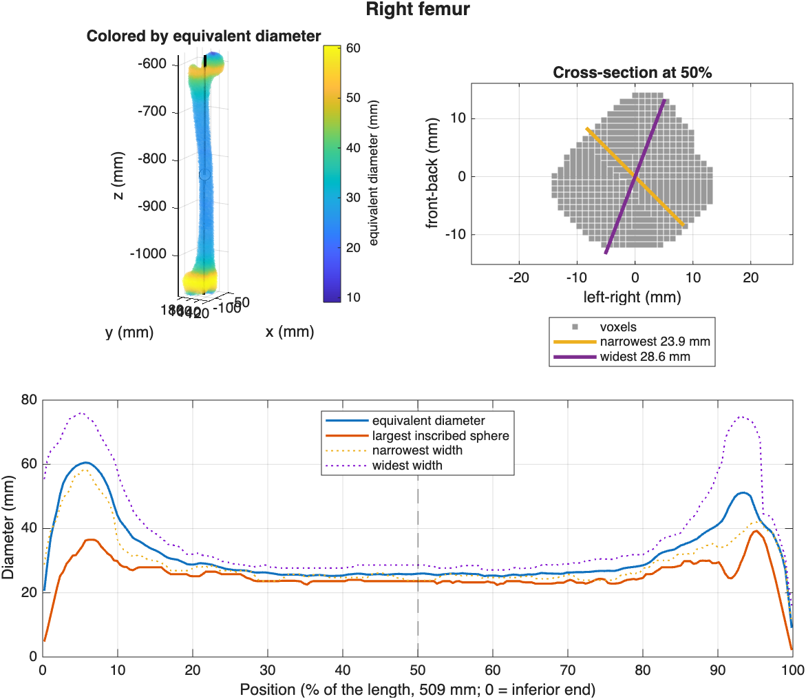{ width="550"}

> The femur colored by diameter (top left), the cross-section at midshaft with its narrowest and widest widths (top right), and the diameter profile from the knee (0%) to the hip (100%).

Plot two profiles together to compare bones. The implant hardly changes the diameter of the left femur:

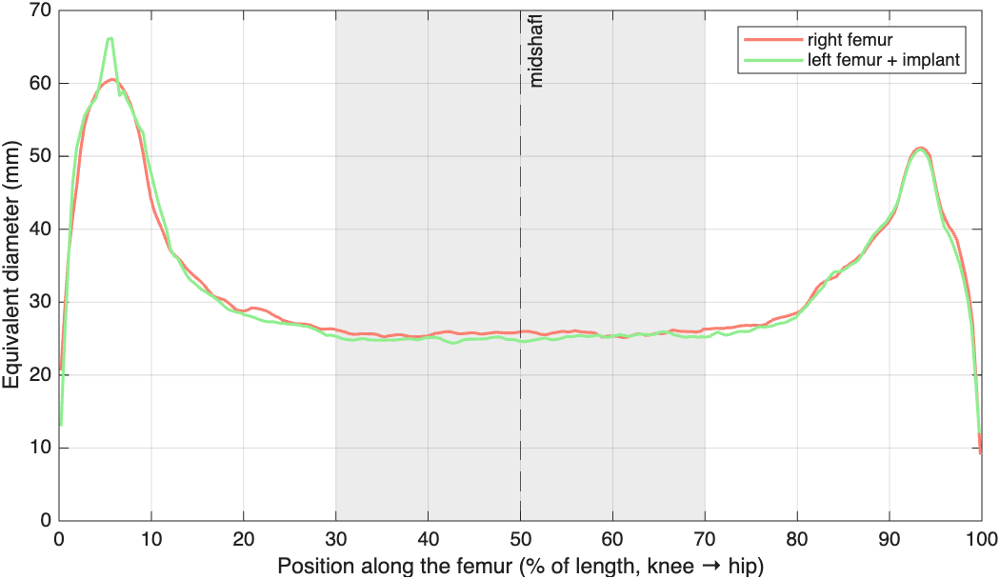{ width="550"}

!!! tip "Curved structures"
    For a curved vessel like the aorta, use `Centerline="curved"`. The function then follows the middle of the vessel instead of a straight axis. Try it in the challenge at the end of SLCR4.

## 6. Compare two segmentations

How well do two segmentations of the same structure agree? In SLCR2 you compare your kidney with the kidney from [TotalSegmentator](TotalSegmentator.md). In SLCR3 you compare two segmentations of the same tumor.

### Where do they overlap?

The **Dice coefficient** measures the overlap: 1 is a perfect match, 0 is no overlap. To see *where* they differ, color each voxel by which segmentation it belongs to:

```matlab linenums="1" title="Overlap (SLCR2)"
mySeg = mmGetMedicalVolumeSegment(segMV, segT, segName="right kidney");
totSeg = mmGetMedicalVolumeSegment(totalMV, totalT, segName="right kidney");
dice(mySeg.mask, totSeg.mask)      % 0.78

compare = zeros(size(mySeg.mask), "uint8");
compare(mySeg.mask & totSeg.mask) = 1;      % both (green)
compare(totSeg.mask & ~mySeg.mask) = 2;     % TotalSegmentator only (cyan)
compare(mySeg.mask & ~totSeg.mask) = 3;     % ours only (magenta)
```

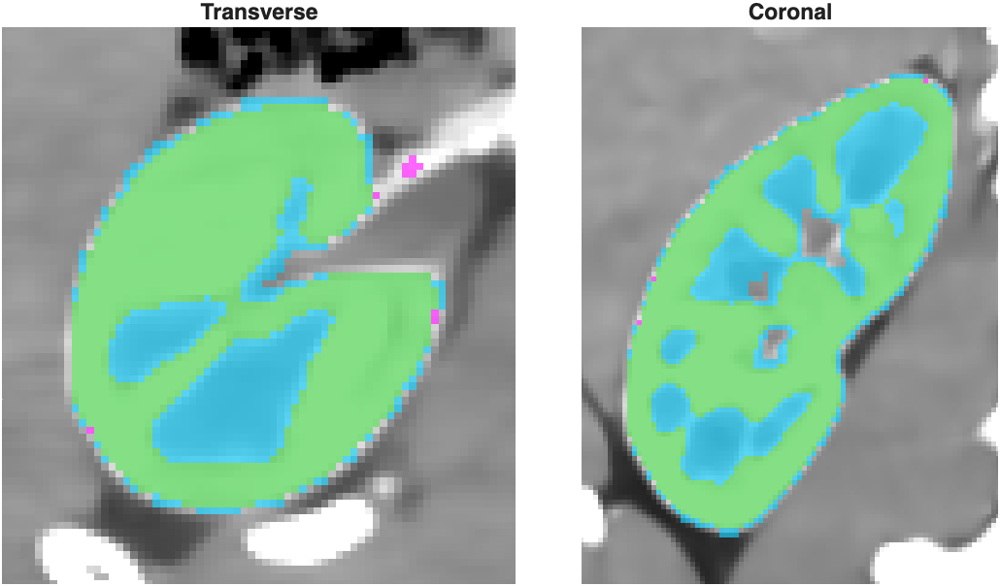{ width="550"}

> Green: in both segmentations. Cyan: only in TotalSegmentator's. Our kidney leaves out the renal sinus (the cyan areas inside), which TotalSegmentator fills in.

### How far apart are the surfaces?

`mmSurfaceDistance` measures, for every point on one surface, the distance to the other surface: negative (blue) if the point is inside the other segmentation, positive (red) if it is outside. The table summarizes the distances.

```matlab linenums="1" title="Surface distance (SLCR2)"
T = mmSurfaceDistance(mySeg, totSeg, Names=["Ours" "TotalSegmentator"])
```

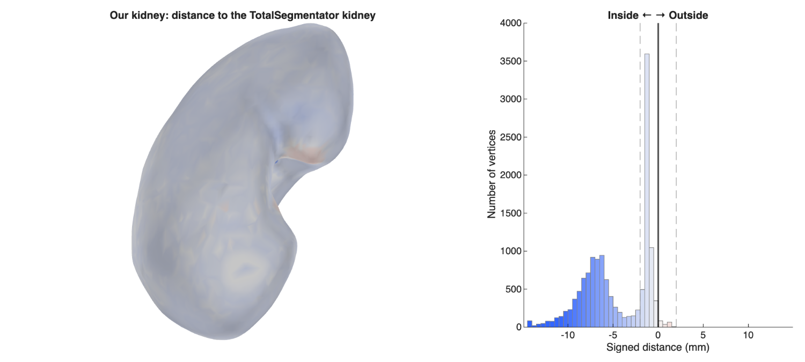{ width="600"}

> The outside of our kidney agrees with TotalSegmentator's (white). The blue peak in the histogram, 5–10 mm inside, comes from the surfaces of the holes inside our kidney. SLCR2 shows how to fill them.

When neither segmentation is the reference, as with the two tumor segmentations in SLCR3, measure in both directions:

```matlab linenums="1" title="Two tumor segmentations (SLCR3)"
T = mmSurfaceDistance(t1Seg, t2Seg, Names=["Tumor1" "Tumor2"], Direction="both")
```

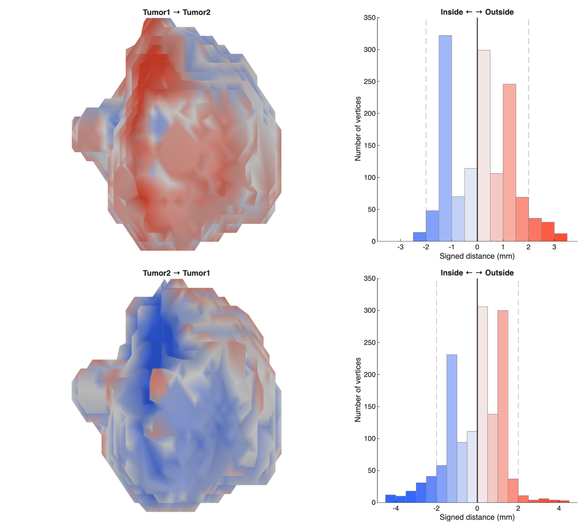{ width="550"}

> Top: Tumor1 measured against Tumor2. Bottom: Tumor2 measured against Tumor1. More than 90% of both surfaces are within 2 mm of each other (Dice 0.93).

## 7. Compare left and right

Are the left and right kidneys the same shape? To compare them, `mmMirrorAlign` flips the left kidney across the midline, then rotates and moves it until it fits the right kidney as closely as possible. Now both are on the same voxel grid, and you can compare them like two segmentations of the same structure.

```matlab linenums="1" title="Mirror and align (SLCR5)"
rk = mmGetMedicalVolumeSegment(segMV, segT, segName="right kidney");
lk = mmGetMedicalVolumeSegment(segMV, segT, segName="left kidney");
[lkOnRk, rmse] = mmMirrorAlign(rk, lk);
mmSurfaceDistance(rk, lkOnRk, Names=["Right kidney" "Left kidney (mirrored)"], Direction="both")
```

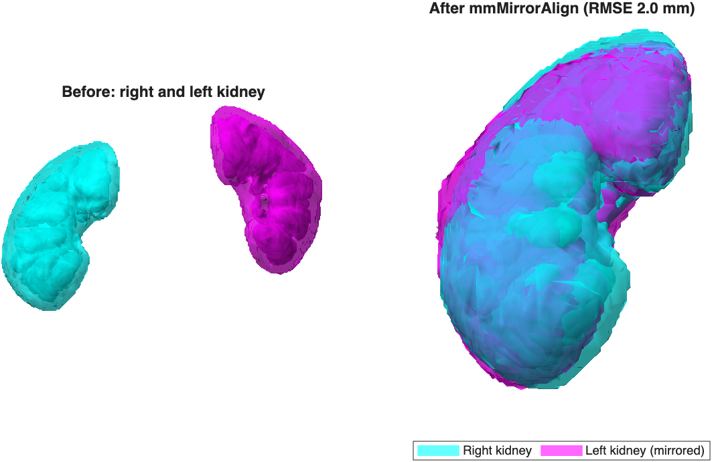{ width="550"}

> Before: the two kidneys where they sit in the body. After: the left kidney, mirrored and aligned on the right kidney.

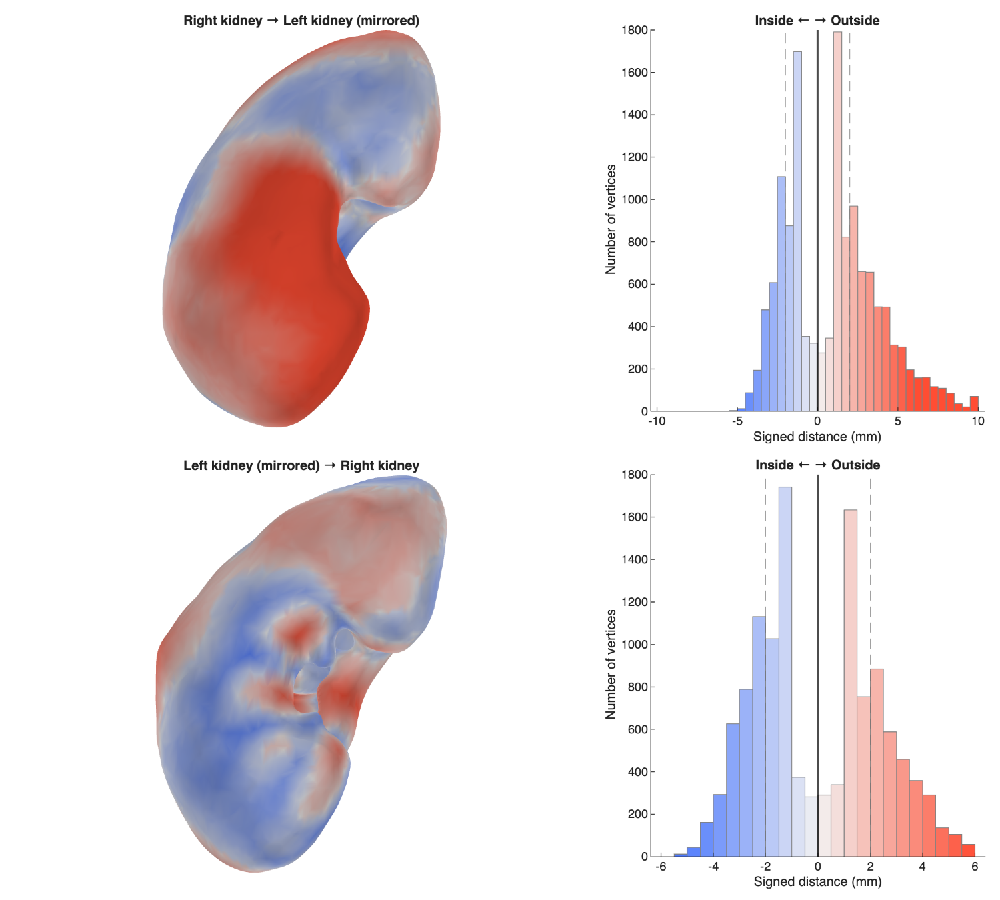{ width="550"}

> The right kidney is mostly outside the mirrored left kidney (red): in this donor, the right kidney is larger.

## 8. Compare a whole class

One segmentation is one opinion. With everyone's segmentations of the same scan, you can ask two new questions: how much do the raters disagree, and is a left–right difference bigger than that disagreement?

!!! note "The figures in this step use made-up class data"
    The ten "students" below are fake segmentations, each with a typical mistake built in. Your class results will look different.

### Load every file in a folder

Put everyone's `.seg.nrrd` files in one folder. `mmGetSlicerSegmentInfoAll` reads all of them, and takes each student's ID from the start of the file name:

```matlab linenums="1" title="Every file (SLCR5, SLCR6)"
[classSegT, contentT] = mmGetSlicerSegmentInfoAll(classFolder);
groupsummary(classSegT, "SegName")      % did everyone name their segments the same way?
```

Then measure each file in a loop. Wrap each file in `try`/`catch`, so that one bad file doesn't stop the loop. The local functions in SLCR5 and SLCR6 (`measureKidneys`, `loadFemur`) also fix common mistakes, like swapped left and right labels or names in capital letters.

```matlab linenums="1" title="Measure every file (SLCR5)"
kidneyT = table();
for k = 1:height(contentT)
    file = fullfile(contentT.folder(k), contentT.name(k));
    try
        kidneyT = [kidneyT; measureKidneys(file, contentT.ID(k))];
    catch err
        warning("%s: %s", contentT.ID(k), err.message)   % skip this file
    end
end
```

### Look for mistakes first

Before you calculate anything, look at every segmentation. A class script can't repair a file, so each file must already pass the [four checks](#check-your-segmentation-file): a file with the wrong segment name is skipped, and a file with voxels that are not isotropic gives wrong lengths and diameters. Its owner can make a corrected copy with [`mmResampleSlicerFiles`](#save-a-corrected-file). Other mistakes are easy to see in a gallery:

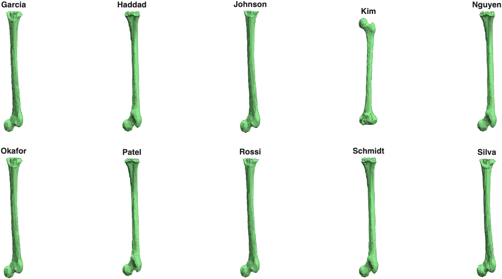{ width="650"}

> The left femur of each (made-up) student. Kim forgot to cut the femur at the base of the implant, so the whole femur is included. Kim's left femur is 40 mm longer than everyone else's, and it shows up as an outlier in the next plot.

### Plot the class

`mmBoxSwarm` draws a box chart with each measurement as a point on top, so you can see every student and the spread at once:

```matlab linenums="1" title="Box and swarm (SLCR5, SLCR6)"
mmBoxSwarm(femurT.Side, femurT.Length_mm);
```

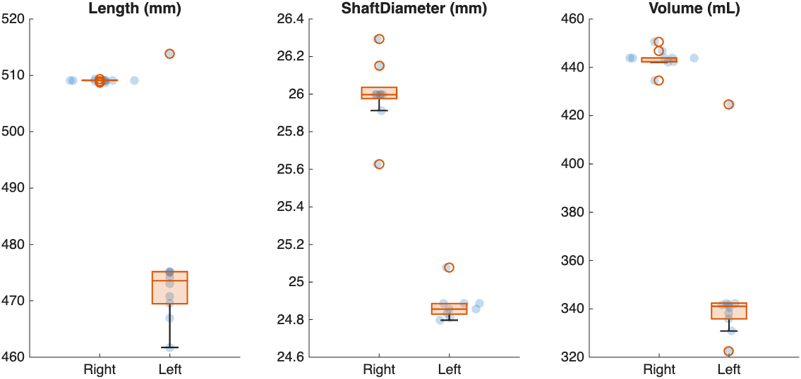{ width="600"}

> Femur length, shaft diameter, and volume for each student. The right femur (segmented automatically) barely varies. The left femur (cut by hand) varies more, and Kim's femur is the outlier at the top.

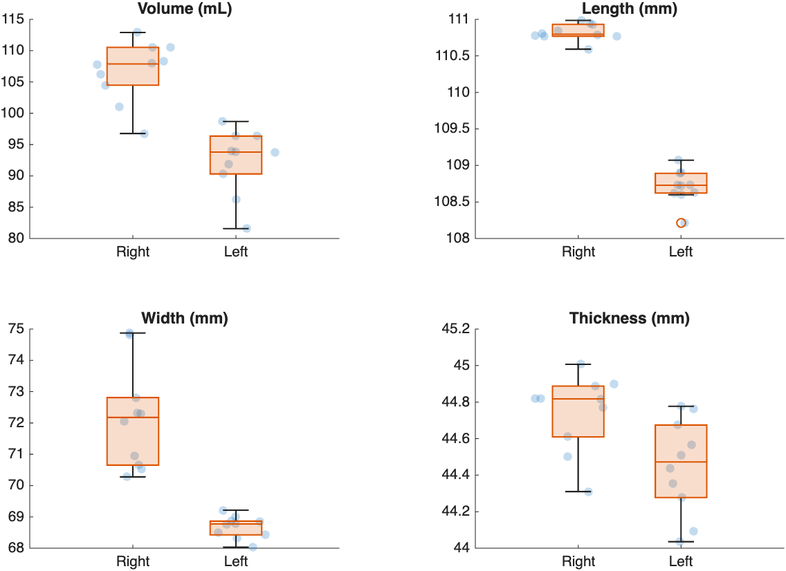{ width="500"}

> Kidney measurements for each student. Every student found the right kidney larger than the left.

### How much do the raters disagree?

The **coefficient of variation** (CV) is the standard deviation between raters as a percent of the mean. Below 5% is good agreement. Above 10% is poor.

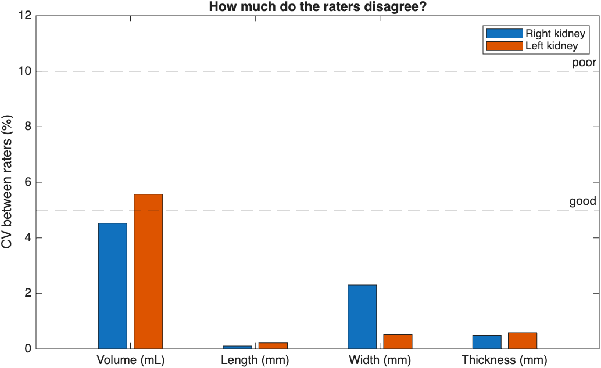{ width="450"}

> The raters agree closely on length, width, and thickness, but less on volume, which depends on every voxel at the edge.

### Is the difference real?

Pair each student's right and left measurements. If every line slopes the same way, the difference is in the anatomy, not in the raters:

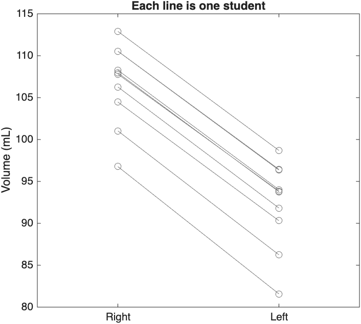{ width="350"}

> Each line is one student. Every student's right kidney is larger than their left. SLCR5 tests this with a signed-rank test, and compares the difference with the disagreement between raters.

## Shortcut: let AI segment for you

Two toolbox functions segment scans without opening Slicer, so you can process many scans in a loop:

- [mmTotalSegmentator](../reference/courseFunctions.md#mmtotalsegmentator) segments a CT into more than 100 structures (see SLCR7)
- [mmSynthSeg2](../reference/courseFunctions.md#mmsynthseg2) segments a brain MRI into 32 structures (See the SynthSeg_Brain_Segmentation.m script)

Their output works with every step on this page, starting at step 2.
