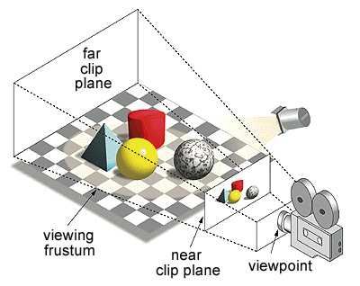
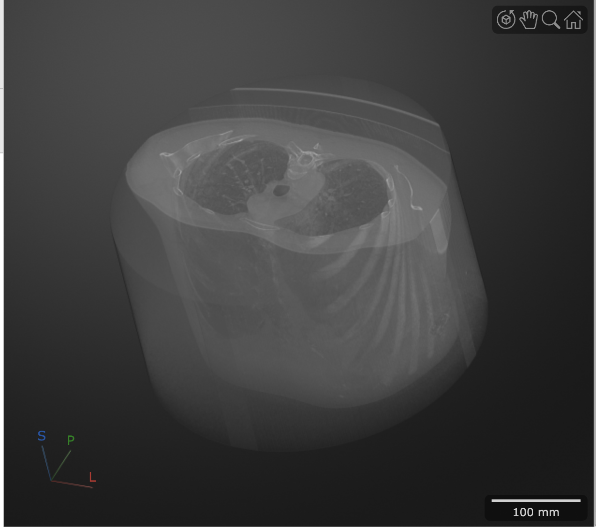
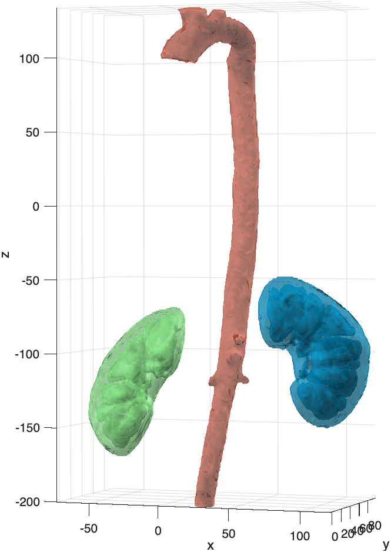

# Volume and Surface Rendering

For volume processing, it is often useful to see "inside" a volume — that is, to construct 3D representations of internal structures inside that volume. The term **3D rendering** refers to the computer graphics process of converting 3D models into 2D images for display on a screen. This process considers the positioning of the objects in a 3D scene and creates a 2D image based on this perspective. Any change in the view—such as rotating the scene—generates a new render that reflects this new perspective, as shown below.

{ width="250"}

>In 3D graphics, a **viewing frustum** is the computed view from a virtual camera, represented as a truncated pyramid lying on its side. Notice the smaller end of the pyramid is closest to the camera, while the larger end is farther away, representing foreshortening. Everything between the near and far clip planes is the viewing area and will be rendered. Here, the "near clip plane" represents what is rendered in the 3D Scene. Moving the camera changes the position of the viewing frustum and renders a different image. For example, if you rotate the camera to the right, the red cylinder would appear in front of the yellow sphere.

There are two main types of rendering that we deal with in this course: **Volume** and **Surface Rendering**.

## Volume Rendering

With Volume Rendering, you visualize 3D structures by adjusting the transparency of voxels in a 3D volume. Often in this type of rendering, outer edge and background voxels are made completely transparent to allow viewing inside the volume. Voxels within structures of interest are set to varying opacity levels to reveal these structures. In effect, each voxel in the volume has an opacity setting based on its intensity value. These opacity values are set using a lookup table called an **alphamap**, which maps intensity values to opacity levels.

In this way, volume rendering can be used as a quick and easy way to explore the internal structures of a volume. By simply adjusting the alphamap, you can visualize different structures in the volume.

{ width="350"}
>Volume Render of a CT Volume

## Surface Rendering

With Surface Rendering, you first need to create a 3D surface model, which is made up of vertices and faces (not voxels). Other pre-processing steps may be required, often making surface rendering more time-consuming than volume rendering, but the final result can appear more realistic and detailed. In this method, only the surface is rendered while the rest of the volume is ignored.

Surface Rendering is useful when you want to:

- Visualize a segmented internal structure (e.g., an aorta or the kidneys)
- Rotate or translate the surface in 3D space
- Measure the extent of your 3D surface (e.g., the length of a femur)
- Compare the morphology of two different surfaces
- 3D print a surface

{ width="250"}
>Surface render of an aorta and kidneys

## Choosing a Rendering Tool

MATLAB offers several ways to render volumes and surfaces. They overlap quite a bit, so here is a guide to which tool to reach for, and when.

| Tool | Kind | Renders | Best for | Requires | Learn more |
| :--- | :--- | :------ | :------- | :------- | :--------- |
| **Medical Volume Viewer** `medicalVolumeViewer` | App | Volume, isosurface, label overlays | Interactively exploring CT and MRI datasets using medical alphamap presets (e.g., CT-Bone, CT-Lung), displayed in patient coordinates | Medical Imaging Toolbox, R2026a+ | [Medical Volume Viewer](medVolumeViewer.md) |
| **Volume Viewer** `volumeViewer` | App | Volume, isosurface, slice planes | Interactively exploring non-medical volumes, like confocal or EM stacks | Image Processing Toolbox | [Rendering Confocal Volumes](renderingConfocalVolumes.md) |
| **`volshow`** + **`viewer3d`** | Function | Volume, isosurface, slice planes, label overlays | Scripted, reproducible renders in live scripts; combining several volumes in one scene | Image Processing Toolbox, R2022b+ | [Rendering with volshow](volshow.md) |
| **`isosurface`** + **`patch`** (`mmPlotMask2Surface`, `mmPlotAllSeg`) | Function | Surface | Smooth surface models that you can measure, move, rotate, scale, or export for 3D printing | MATLAB only | [Creating Surface Models](surfaceModels.md), [Rendering Medical Datasets](medicalSurfaceRendering.md) |
| **`images.ui.graphics.Surface`** | Function | Surface (in a `viewer3d` scene) | Placing a surface in the same scene as a `volshow` render | Image Processing Toolbox, R2022b+ | [Rendering with viewer3d](medicalSurfaceRendering.md#rendering-with-viewer3d) |

!!! tip "Quick guide"

    - **Just want to look around?** Use an app. Choose the **Medical Volume Viewer** for CT/MRI and **Volume Viewer** for everything else.
    - **Need a figure you can reproduce or put in a report?** Use **`volshow`**. The code *is* the record of how you made the render.
    - **Need to measure, transform, or 3D print a structure?** Create a surface with **`isosurface`** and render it with **`patch`**. Surfaces are made of vertices you can work with directly; volume renders are not.

## Software Requirements

Most of the Volume Processing section needs **MATLAB R2022b or later** with two toolboxes, plus the course functions. See [MATLAB Installation](../setup/matlabInstallation.md) for how to install the toolboxes.

- **[Image Processing Toolbox](https://www.mathworks.com/products/image.html)**: viewing, segmenting, and rendering volumes (`montage`, `volshow`, `viewer3d`, `volumeViewer`, `regionprops3`, and others)
- **[Medical Imaging Toolbox](https://www.mathworks.com/products/medical-imaging.html)**: loading and displaying medical datasets as `medicalVolume` objects and using the Medical Volume Viewer app
- **[Course functions](../reference/courseFunctions.md)**: the `mm` functions (e.g., `mmSetUnitDataFolder`, `mmPlotMask2Surface`) must be on your MATLAB path
- **[Bio-Formats (bfmatlab)](../setup/githubRepoInstallation.md)**: needed only to load proprietary microscopy files with `mmReadImgND`

??? abstract "Requirements by page"

    | Page | Minimum release | Toolboxes |
    | :--- | :-------------- | :-------- |
    | [Loading Confocal Datasets](loadingConfocalDatasets.md) | — | bfmatlab (for `mmReadImgND`); the `imread` method needs only MATLAB |
    | [Loading Medical Datasets](loadingMedicalDatasets.md) | R2022b | Image Processing, Medical Imaging |
    | [Viewing Image Slices](volumeVisualization.md) | — | Image Processing |
    | [Medical Volume Viewer](medVolumeViewer.md) | **R2026a** | Medical Imaging |
    | [Rendering with volshow](volshow.md) | R2022b | Image Processing, Medical Imaging |
    | [Rendering Confocal Volumes](renderingConfocalVolumes.md) | R2022b | Image Processing, bfmatlab (for `mmReadImgND`) |
    | [Creating Surface Models](surfaceModels.md) | — | MATLAB only (the optional figure code uses `volumeViewer` from the Image Processing Toolbox) |
    | [Rendering Medical Datasets](medicalSurfaceRendering.md) | R2022b | Image Processing, Medical Imaging |
    | [Transforming Surface Models](surfaceModelTransformation.md) | R2023b (for the `abyss` colormap) | MATLAB only |
    | [Volume Segmentation](volumeSegmentation.md) | R2022b | Image Processing |

    >The Medical Volume Viewer app (`medicalVolumeViewer`) was introduced in R2026a. On earlier releases, use [`volshow`](volshow.md) to render medical volumes instead.
