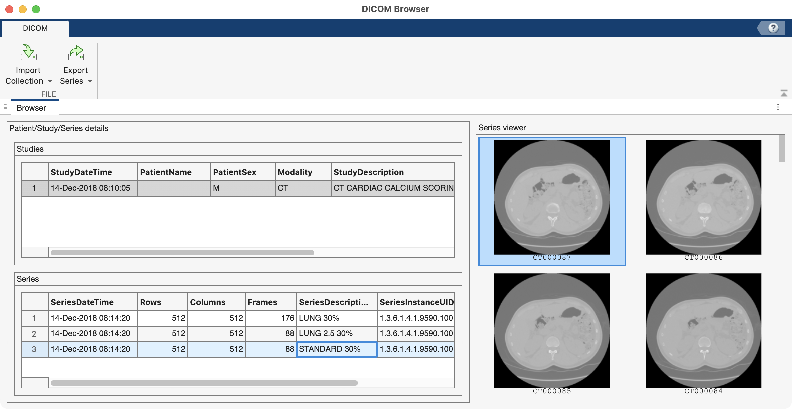

# Loading Medical Datasets

To load medical datasets into MATLAB, we will load them as [medicalVolume](https://www.mathworks.com/help/medical-imaging/ref/medicalvolume.html){target="_blank"} objects (1).
{ .annotate}

1. Requires the [Medical Imaging Toolbox](https://www.mathworks.com/products/medical-imaging.html).

!!! note "What are medicalVolume objects anyway?"

    A medicalVolume is a variable class that packages together the voxel information (i.e., the volume), the metadata, and the Volume Geometry, which can transform the volume into [Anatomical Coordinate Space](https://slicer.readthedocs.io/en/latest/user_guide/coordinate_systems.html) (e.g. LPS). Although it looks like a `structure`, a medicalVolume is an `object`, which is a variable class that combines data (properties) with functions (methods). As such, there are defined ways to modify any of its fields, and you can't, for example, simply add a new field to a medicalVolume object using dot notation. But not to worry—we will be using medicalVolume objects primarily as read-only variables and we won't really mess with modifying any of its fields. 

## Loading DICOM Datasets

DICOM datasets are organized as a series of images in folders. For this example, we will use the DICOM data found in the `unit3/MedicalVolumeDICOMData` folder.

```
MedicalVolumeDICOMData/
├── LungCT01
│   ├── CT000000.dcm
│   ├── CT000001.dcm
│   ├── CT000002.dcm
|   ⋮
│   └── CT000087.dcm
├── LungCT02
│   ├── CT000000.dcm
│   ├── CT000001.dcm
│   ├── CT000002.dcm
|   ⋮
│   └── CT000175.dcm
└── LungCT03
    ├── CT000000.dcm
    ├── CT000001.dcm
    ├── CT000002.dcm
    ⋮
    └── CT000087.dcm
```

>The MedicalVolumeDICOMData folder contains three lung CT datasets: LungCT01, LungCT02, and LungCT03. Each of these folders contains a series of DICOM images (.dcm files) that comprise the dataset. The LungCT02 dataset is larger, containing 176 images, whereas the other two datasets only contain 88 images each.

MATLAB has many functions and apps that can handle DICOM datasets. **`dicominfo`** loads the DICOM metadata. Every single image in a DICOM volume contains the metadata for the entire volume, so here we input the first image from the LungCT02 folder.

```matlab linenums="1" title="Load DICOM Metadata"
mmSetUnitDataFolder(3); % change Current Folder to the Unit 3 Data Folder
meta = dicominfo(fullfile("MedicalVolumeDICOMData","LungCT02","CT000000.dcm")) % path to the first DICOM image in the LungCT02 dataset
```

```matlab
 meta = struct with fields:
                             Filename: '/Users/ernesto/MATLAB-Drive/MtMresources/MtMdata/unit3/MedicalVolumeDICOMData/LungCT02/CT000000.dcm'
                          FileModDate: '18-Apr-2022 18:04:00'
                             FileSize: 256798
                               Format: 'DICOM'
                        FormatVersion: 3
                                Width: 512
                               Height: 512
                             BitDepth: 16
                            ColorType: 'grayscale'
       FileMetaInformationGroupLength: 212
           FileMetaInformationVersion: [2×1 uint8]
              MediaStorageSOPClassUID: '1.2.840.10008.5.1.4.1.1.2'
           MediaStorageSOPInstanceUID: '1.3.6.1.4.1.9590.100.1.2.286066201332069648426726334394087096117'
                    TransferSyntaxUID: '1.2.840.10008.1.2.4.70'
               ImplementationClassUID: '1.3.6.1.4.1.9590.100.1.3.100.9.4'
            ImplementationVersionName: 'MATLAB IPT 9.4'

```

>**`dicominfo`** returns a structure (`meta`) containing the DICOM metadata.

The DICOM Browser can be used to browse individual image slices in a DICOM dataset.

```matlab linenums="1" title="Bring up the DICOM browser" 
 dicomBrowser("MedicalVolumeDICOMData") % input the folder containing the DICOM datasets
```

{ width="750"}

>The DICOM Browser displays some metadata and the image slices. Click on the row in the "Studies" panel (top) to bring up a list of the datasets (called "series") in the "Series" panel (bottom). Notice that the series are named not by their folder name, but by the "SeriesDescription" found in the metadata. Click on one row of the series table to bring up the series images in the "Series Viewer" panel (right). By scrubbing up and down you can view all the images in a given series.

A DICOM dataset can be loaded into the MATLAB workspace as a `medicalVolume`. Here we load the data from the `LungCT02` folder ("Lung 30%").

```matlab linenums="1" title="Load DICOM as a medicalVolume"
 mV = medicalVolume("MedicalVolumeDICOMData/LungCT02") % input DICOM folder
```

```matlab
 mV = 
  medicalVolume with properties:

                  Voxels: [512×512×176 int16]
          VolumeGeometry: [1×1 medicalref3d]
            SpatialUnits: "mm"
             Orientation: "transverse"
            VoxelSpacing: [0.76172 0.76172 1.25]
            NormalVector: [0 0 1]
        NumCoronalSlices: 512
       NumSagittalSlices: 512
     NumTransverseSlices: 176
            PlaneMapping: ["sagittal"    "coronal"    "transverse"]
    DataDimensionMeaning: ["left"    "posterior"    "superior"]
                Modality: "CT"
           WindowCenters: [176×1 double]
            WindowWidths: [176×1 double]
```

## Loading 3D Slicer Datasets

3D Slicer files usually end with the `.nrrd` extension (1). You can load these files into MATLAB as a `medicalVolume`. In this example, we load the [CT Angiogram dataset](../slicer/CTACardioSegment.md) found in the `unit3/CTACardio` folder.
{ .annotate }

1. That's right. It's a "NERD" file. Read all about it in the [3D Slicer documentation](https://slicer.readthedocs.io/en/latest/user_guide/data_loading_and_saving.html#supported-data-formats).

```matlab linenums="1" title="Load Slicer Intensity Volume"
mmSetUnitDataFolder(3); % change folder to the Unit 3 Data Folder
mV = medicalVolume("CTACardio/CTACardio Crop.nrrd") % note the .nrrd extension
```

In addition to loading the volume itself (Voxels field), you also get metadata (all the other fields).
```matlab  
mV = 

  medicalVolume with properties:

                  Voxels: [465×276×390 int16]
          VolumeGeometry: [1×1 medicalref3d]
            SpatialUnits: "unknown"
             Orientation: "transverse"
            VoxelSpacing: [1.027 1.027 1.027]
            NormalVector: [0 0 1]
        NumCoronalSlices: 276
       NumSagittalSlices: 465
     NumTransverseSlices: 390
            PlaneMapping: ["sagittal"    "coronal"    "transverse"]
    DataDimensionMeaning: ["right"    "anterior"    "superior"]
                Modality: "unknown"
           WindowCenters: []
            WindowWidths: []
```

As you can see, the intensity volume is `465×276×390` and is a signed 16-bit integer (`int16`) array. This means there can be negative values in the volume to accommodate the Hounsfield units found in CT datasets.

Slicer segmentation files end with the `.seg.nrrd` extension. We can also load Slicer Segmentation Volumes as medicalVolumes:

```matlab linenums="1" title="Load Segmentation Volume"
mmSetUnitDataFolder(3);
segFile = fullfile('CTACardio', 'Salcedo Segmentation.seg.nrrd') % .seg.nrrd extension
segMV = medicalVolume(segFile) % load as medical volume
```

!!! warning "Missing Endian Values"
    
    You may get a warning stating "Missing 'endian' value in the file metadata." Don't worry, this warning is safe to ignore. If you want to force MATLAB to ignore the warning, you can use the following syntax prior to loading the Segmentation Volume:

    ```matlab
    warning('off', 'medical:medicalVolume:noEndian')
    ```
    

```matlab title="Segmentation Volume loaded as a medicalVolume" 
 segMV = 

  medicalVolume with properties:

                  Voxels: [465×276×390 uint8]
          VolumeGeometry: [1×1 medicalref3d]
            SpatialUnits: "unknown"
             Orientation: "transverse"
            VoxelSpacing: [1.027 1.027 1.027]
            NormalVector: [0 0 1]
        NumCoronalSlices: 276
       NumSagittalSlices: 465
     NumTransverseSlices: 390
            PlaneMapping: ["sagittal"    "coronal"    "transverse"]
    DataDimensionMeaning: ["right"    "anterior"    "superior"]
                Modality: "unknown"
           WindowCenters: []
            WindowWidths: []
```

Notice that the Segmentation volume has the same dimensions as the intensity volume, but is unsigned 8-bit. And, instead of intensity values, these volumes contain labels (unsigned whole numbers) that signify the segmented internal structures.

While a `medicalVolume` object contains information critical to processing and visualizing the volume, it lacks the properties set in Slicer, like label values, names, and colors. To load these properties, you can use the course function **`mmGetSlicerSegmentInfo`**.

```matlab linenums="1" title="Load Segmentation Metadata"
segT = mmGetSlicerSegmentInfo(segFile) % input path to a .seg.nrrd file
```

```matlab title="Segmentation Metadata" 
segT =

  3×4 table

       SegName        Layer    LabelValue                Color            
    ______________    _____    __________    _____________________________

    "right kidney"      1          1         0.56471    0.93333    0.56471
    "left kidney"       1          2               0    0.59216    0.80784
    "aorta"             1          3         0.84706    0.39608     0.3098
```

`mmGetSlicerSegmentInfo` returns a table containing the Slicer properties, with columns for segmentation name, layer, label value, and color. As you can see, this segmentation volume has three segmentations: 'right kidney', 'left kidney', and 'aorta' labeled by the values `1`, `2`, and `3`. So in the entire volume, there are only four different values: `0-3`, where `0` means no segmentation. The Color column contains the color of each segmentation, as it was set in 3D Slicer.

!!! note "What is a Layer?"

    In the Slicer metadata, there is a column for layer. In this example, the value is the same for all segmentations (1) and the segmentation volume is 3D. In other volumes, the layer values can differ, if "overlaying segments" was enabled in Slicer. Overlaying segments allows you to have more than one segment in the same physical space, like Total Lung and Right Lung, where the right side of Total Lung and Right Lung are virtually identical. So, if there is more than one layer value, then the segmentation volume is 4D, not 3D, and "Layer" indicates the index value in the 4th dimension.  You would index in the 4th dimension to access these separate segmentations.

## Voxel and Patient Coordinates

Every voxel in a medical volume can be located in two different ways:

- **Intrinsic (voxel) coordinates** — the row, column, and slice indices of the voxel in the `Voxels` array. These are unitless and simply count voxels from the corner of the array, starting at `(1,1,1)`.
- **Patient (world) coordinates** — the physical position of the voxel in millimeters, measured along the anatomical axes of the patient's body.

Intrinsic coordinates tell you *where a voxel is stored*. Patient coordinates tell you *where that voxel is in the body*. The `VolumeGeometry` property of a `medicalVolume` contains everything needed to convert between the two.

### Anatomical Axes: LPS vs RAS

Patient coordinates are measured along three anatomical axes. There are two common conventions for which direction counts as positive:

| Convention | +x points toward | +y points toward | +z points toward | Used by |
| :--------- | :--------------- | :--------------- | :--------------- | :------ |
| **LPS**    | patient's **L**eft | **P**osterior    | **S**uperior     | DICOM, MATLAB `medicalVolume` |
| **RAS**    | patient's **R**ight | **A**nterior     | **S**uperior     | 3D Slicer (display) |

The two conventions differ only in the sign of x and y. MATLAB always reports patient coordinates in LPS, so a point at x = +50 mm in MATLAB is 50 mm to the patient's *left*. (See the [3D Slicer documentation on coordinate systems](https://slicer.readthedocs.io/en/latest/user_guide/coordinate_systems.html) for more detail.)

### How the Voxels are Stored: `DataDimensionMeaning`

Compare the `DataDimensionMeaning` property of the two volumes we loaded above:

```matlab
% LungCT02 (DICOM)
DataDimensionMeaning: ["left"    "posterior"    "superior"]

% CTACardio Crop (Slicer .nrrd)
DataDimensionMeaning: ["right"    "anterior"    "superior"]
```

`DataDimensionMeaning` tells you which direction in the body each array dimension moves toward as its index *increases*. In the DICOM volume, moving down the rows (dimension 1) moves toward the patient's **left**. In the Slicer volume, moving down the rows moves toward the patient's **right**.

In other words, the two datasets store their voxels in opposite left–right and anterior–posterior orders. If you displayed slices directly from the two `Voxels` arrays (e.g., with `imshow`), one would appear mirrored relative to the other. Neither is wrong — they are just stored differently. This is why it matters to keep the `VolumeGeometry` along with the voxel data.

### Converting Between Coordinate Systems

The function **`intrinsicToWorld`** converts voxel indices into patient coordinates. Here we step one voxel at a time along each dimension of the Slicer segmentation volume:

```matlab linenums="1" title="Convert voxel indices to patient coordinates"
R = segMV.VolumeGeometry;            % spatial referencing information
[x,y,z] = intrinsicToWorld(R,1,1,1)  % first voxel in the array
[x,y,z] = intrinsicToWorld(R,2,1,1)  % one step along dimension 1 (rows)
[x,y,z] = intrinsicToWorld(R,1,2,1)  % one step along dimension 2 (columns)
[x,y,z] = intrinsicToWorld(R,1,1,2)  % one step along dimension 3 (slices)
```

| Voxel index `(I,J,K)` | x (mm)  | y (mm)  | z (mm)   | Change |
| :-------------------- | ------: | ------: | -------: | :----- |
| (1,1,1)               | 238.25  | 166.11  | −199.74  | —      |
| (2,1,1)               | 237.23  | 166.11  | −199.74  | x decreases 1.027 mm → toward the **right** |
| (1,2,1)               | 238.25  | 165.08  | −199.74  | y decreases 1.027 mm → toward the **anterior** |
| (1,1,2)               | 238.25  | 166.11  | −198.72  | z increases 1.027 mm → toward the **superior** |

Each step moves exactly one voxel width (1.027 mm), in exactly the directions listed in `DataDimensionMeaning`: right, anterior, superior.

The same conversion can be expressed as a single 4×4 transformation matrix, which you can get with `intrinsicToWorldMapping`:

```matlab linenums="1" title="Get the transformation matrix"
tform = intrinsicToWorldMapping(segMV.VolumeGeometry);
tform.A
```

```matlab
ans =
            0       -1.027            0       239.28
       -1.027            0            0       167.14
            0            0        1.027      -200.77
            0            0            0            1
```

>The 1.027 values are the voxel spacing (scaling), the negative signs flip the right/anterior storage order into LPS, and the last column is the patient position of the volume's corner (translation). The swapped first two columns reflect that MATLAB arrays are indexed (row, column), while points are written (x, y). This `tform` is the same transformation returned by [`mmGetMedicalVolumeSegment`](medicalSurfaceRendering.md) and used to place surface renders in millimeter space.

### Sanity Check: Which Kidney is Which?

Patient coordinates make anatomical claims we can check. Using the transformation matrix, we can convert the centroid of each kidney from voxel coordinates into patient coordinates:

```matlab linenums="1" title="Kidney centroids in patient coordinates"
segT = mmGetSlicerSegmentInfo(segFile);
for name = ["right kidney" "left kidney"]
    s = mmGetMedicalVolumeSegment(segMV,segT,segName=name);
    c = regionprops3(double(s.mask),"Centroid").Centroid;  % centroid in voxel coordinates
    p = transformPointsForward(s.tform,c);                 % centroid in patient coordinates (mm)
    fprintf("%s: x = %.1f mm\n", name, p(1))
end
```

```matlab
right kidney: x = -41.9 mm
left kidney: x = 88.1 mm
```

>Remember that in LPS, +x points to the patient's left. The right kidney has a negative x (patient's right) and the left kidney has a positive x (patient's left), so the segment labels match the anatomy. Note that we use `double(s.mask)` so that `regionprops3` returns a single centroid for the whole segment, even if the mask contains a few disconnected pieces.
