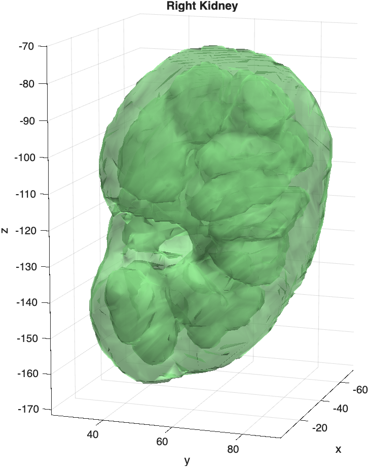
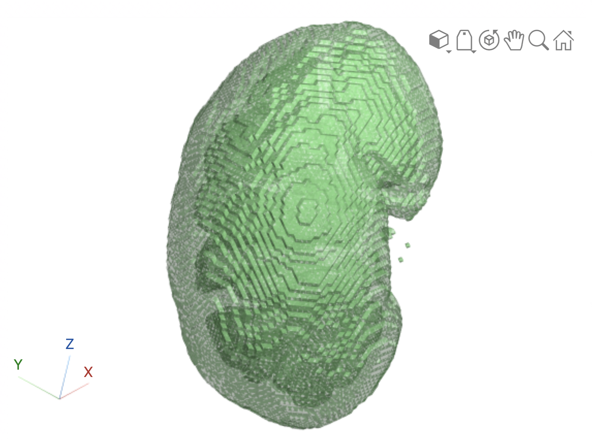

# Surface Rendering Medical Segmentations

To render a segmentation as a 3D surface, we need to:

1. Load the Segmentation volume (e.g. a `.seg.nrrd` file) into MATLAB
2. Create a 3D surface from one of the segmentations in that volume
3. Render the 3D surface

## Slicer Segmentation Files

In this example, we [load a Slicer segmentation volume as a medicalVolume](loadingMedicalDatasets.md).

```matlab linenums="1" title="Load Segmentation Volume"
mmSetUnitDataFolder(3);
segFile = fullfile('CTACardio', 'Salcedo Segmentation.seg.nrrd')
segMV = medicalVolume(segFile)
```

We also load the metadata from the volume.

```matlab linenums="1" title="Load Segmentation Metadata"
segT = mmGetSlicerSegmentInfo(segFile)
```

```matlab title="Segmentation Metadata"
segT =

  3×4 table

       SegName        Layer    LabelValue                Color            
    ______________    _____    __________    _____________________________

    "right kidney"      1          1         0.56471    0.93333    0.56471
    "left kidney"       1          2               0    0.59216    0.80784
    "aorta"             1          3         0.84706    0.39608     0.3098
```

As you can see, there are three different segmentations in this volume.

## Render a Selected Segment

If you want to specify the segment to render, you must first index out the segment from the segmentation volume and then render it. The function `mmGetMedicalVolumeSegment` simplifies this process:

```matlab linenums="1" title="Get right kidney Segment"
segS = mmGetMedicalVolumeSegment(segMV,segT,segName='right kidney') 
```

```matlab
segS = 

  struct with fields:

    segName: 'right kidney'
       mask: [465×276×390 logical]
      color: [0.56471 0.93333 0.56471]
      tform: [1×1 affinetform3d]
    spacing: [1.027 1.027 1.027]
     volume: 99574
```

`mmGetMedicalVolumeSegment` returns a structure that includes a logical mask of the specified segmentation (the `mask` field) and some basic metadata on the segment.

### Measuring the Segment Volume

Notice that the `volume` field is `99574`. This is **not** a physical volume — it is the number of voxels in the mask. To convert it into real-world units, we use the same approach we used to [measure the taste bud image stack](volumeOverview.md#measuring-the-volume): multiply the number of voxels by the volume of a single voxel.

The voxel dimensions are stored in the `spacing` field (in millimeters), so the volume of one voxel is the product of its three sides:

```matlab linenums="1" title="Convert voxel count to milliliters"
voxVol = prod(segS.spacing)         % volume of one voxel (mm^3)
kidney_mm3 = segS.volume * voxVol   % total kidney volume (mm^3)
kidney_mL = kidney_mm3 / 1000       % 1 mL = 1000 mm^3
```

```matlab
voxVol =
       1.0831

kidney_mm3 =
   1.0784e+05

kidney_mL =
       107.84
```

$$
99{,}574 \, \text{voxels} \times 1.0831 \, \tfrac{\text{mm}^3}{\text{voxel}} \approx 107{,}845 \, \text{mm}^3 \approx 108 \, \text{mL}
$$

So the segmented right kidney is about **108 mL** — a reasonable size for an adult kidney. Checking that a measurement falls within a plausible anatomical range is a quick way to catch mistakes, such as forgetting to account for voxel spacing or segmenting the wrong structure.

!!! tip "Why does `SpatialUnits` say "unknown"?"

    When you load a `.nrrd` file, `medicalVolume` often reports `SpatialUnits: "unknown"` because the units are not written into the file. 3D Slicer always works in millimeters, so you can safely treat the spacing of Slicer datasets as mm.

**Challenge:** What are the volumes of the left kidney and the aorta?

??? question "Volumes of all segments"

    ```matlab linenums="1"
    for k = 1:height(segT)
        s = mmGetMedicalVolumeSegment(segMV,segT,segName=segT.SegName(k));
        vol_mL = s.volume * prod(s.spacing) / 1000;
        fprintf("%s: %.1f mL\n", s.segName, vol_mL)
    end
    ```

    ```matlab
    right kidney: 107.8 mL
    left kidney: 91.8 mL
    aorta: 88.0 mL
    ```

## Render the Segment

Now we have the segmentation we want as its own volume (`segS.mask`). Next, we need to create a surface from this volume (using `isosurface`) and then render the surface (using `patch`). The course function `mmPlotMask2Surface` performs both of these steps in one function call.

```matlab linenums="1" title="Render Kidney Surface" 
hp = mmPlotMask2Surface(segS.mask,fcolor=segS.color,transform=segS.tform);
title("Right Kidney")
```

>`mmPlotMask2Surface` returns a handle to the surface render (`hp`). Notice here we input the mask of the kidney (`segS.mask`) as the first input. We also input the transformation, `segS.tform`, using the `transform` name-value argument. This transforms the segmentation into anatomical space (millimeter space).

{ width="250"}

## Rendering using the Medical Imaging Toolbox

You can also render a segment using the Medical Imaging Toolbox, as follows:

```matlab
hvr = viewer3d("BackgroundColor",'white','BackgroundGradient','off'); % create viewer
surf1 = images.ui.graphics.Surface(hvr,... % viewer handle
    Color=segS.color, ... % face color of render
    Data=segS.mask, ... % input mask
    Alpha = 0.75, ... % set transparency
    Wireframe="off",... % turn off wireframe
    Transformation=segS.tform); % transform into real world space
```

{ width="350"}
>In this example, the function `images.ui.graphics.Surface` creates the surface and renders it in one step. The resulting render is a little more blocky than the `mmPlotMask2Surface` render, but can be more easily combined with [`volshow` visualization methods](volshow.md).

## Render all Segments

We can render all segmentations in a segmentation volume with one function call using the course function **`mmPlotAllSeg`**:

```matlab linenums="1" title="Plot all Segmentations"
figure;
mmPlotAllSeg(segMV,segT) 
```

>`mmPlotAllSeg` uses the `isosurface` function to create the 3D surface and then the `patch` function to render the surface. For volumes with more than one segmentation, it repeats the process for each segmentation. As you can see below, we get one surface render for each segmentation in the volume.

{ width="250"}
>Surface render of kidneys and aorta using colors set in Slicer. The default transparency is set to 0.5.
