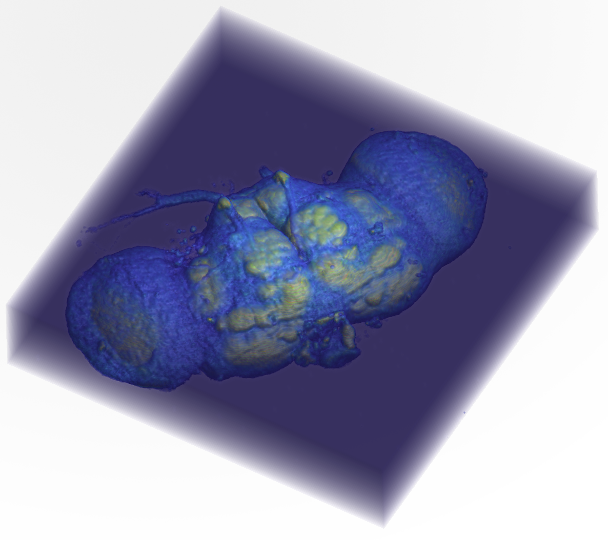
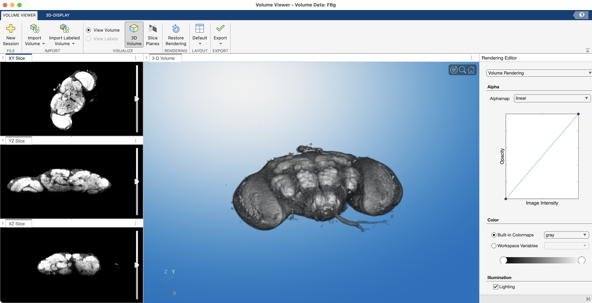
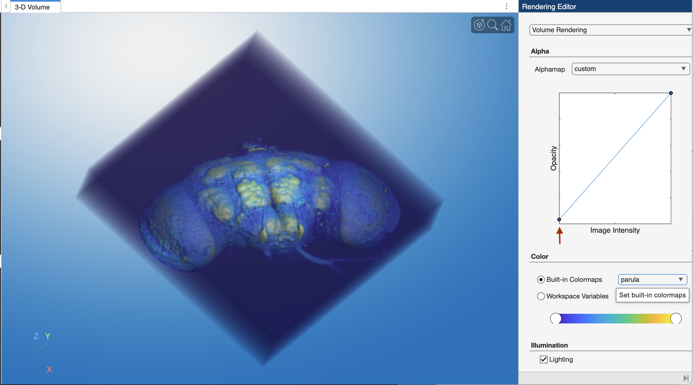
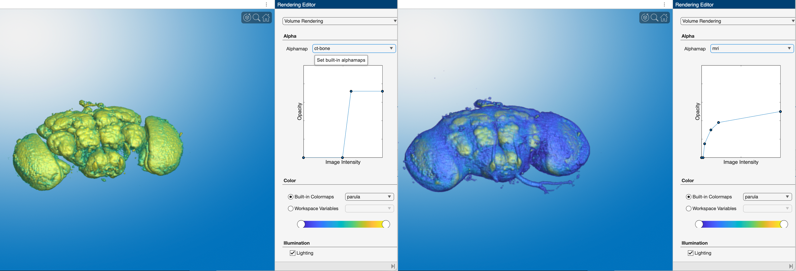
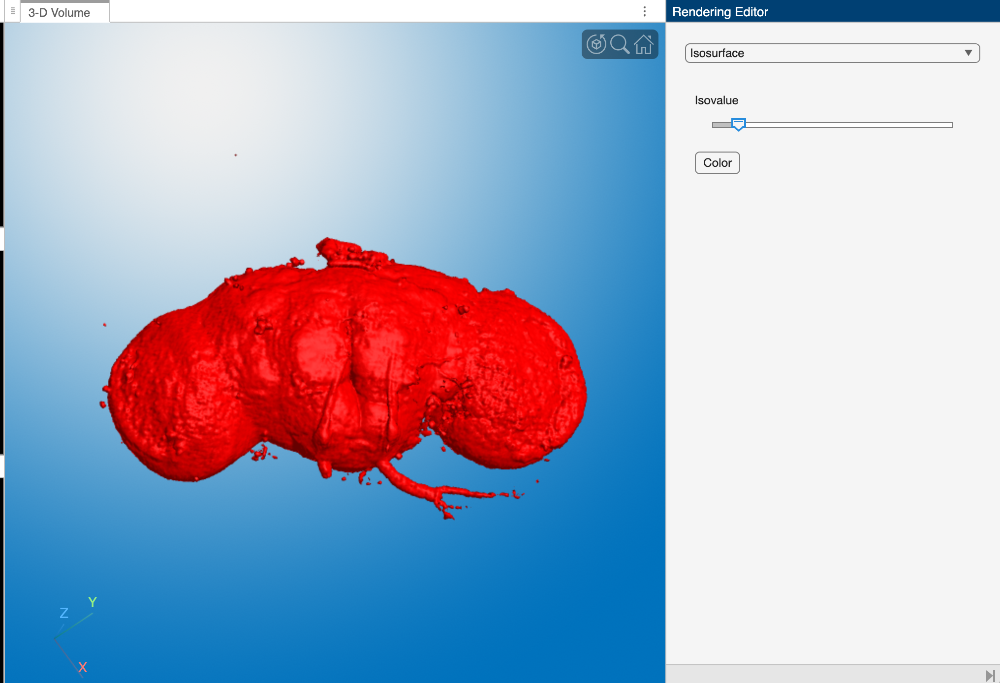
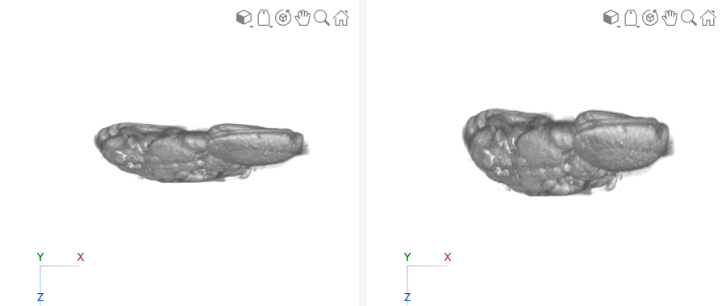
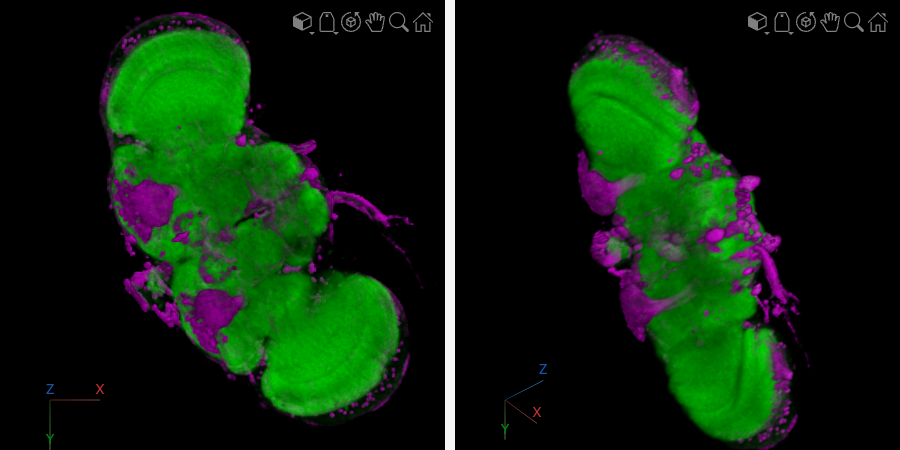

# Rendering Confocal Volumes

Confocal image stacks can be rendered in 3D just like CT or MRI volumes, but they come with a few differences that change how we render them:

- **No standard intensity scale.** CT intensities are calibrated to [Hounsfield units](medVolumeViewer.md#alphamaps), so an alphamap preset like "CT-Bone" works on any CT scan. Confocal intensities depend on the staining, the laser power, and the detector settings, so there is no universal preset. You will usually need to adjust the alphamap by hand.
- **Multiple channels.** Each fluorescent label is captured in its own color channel. Most 3D rendering tools expect a single 3D volume, so you will often render one channel at a time, or combine them deliberately.
- **Anisotropic voxels.** The distance between optical slices is usually larger than the in-plane pixel size, so the voxels are [anisotropic](volumeOverview.md#voxel-shapes). If you don't account for this, the render is squashed along the z-axis.

On this page, we render a confocal stack of a fruit fly brain, first interactively with the **Volume Viewer** app and then programmatically with **`volshow`**.

{ width="450"}

!!! info "About the dataset"

    This is the "Fly Brain" sample image included with [Fiji](https://imagej.net/software/fiji/){target="_blank"}: a confocal scan of a *Drosophila* brain.

    - **Green:** staining with the nc82 antibody, which labels synapses and outlines the brain's neuropil
    - **Red:** the expression pattern of the GAL4 driver line 78y

    The original image was smoothed and resampled 4 times in each direction. The brain was prepared and scanned in the Heisenberg lab in Würzburg, Germany. Courtesy of Benjamin Schmid, author of the ImageJ 3D Viewer ([neurofly.de](http://www.neurofly.de/){target="_blank"}).

## Loading the Fly Brain

The fly brain is stored as a TIFF stack in the `MtMdata/unit2` folder. We load it with the course function [**`mmReadImgND`**](loadingConfocalDatasets.md#mmreadimgnd):

```matlab linenums="1" title="Load Fly Brain"
mmSetUnitDataFolder(2) % set current folder to the unit2 data folder
[FB,meta] = mmReadImgND("flybrain.tif");
```

```matlab title="Review volume using whos"
  Name        Size                     Bytes  Class     Attributes

  FB        256x256x3x57            11206656  uint8               
  meta        1x1                       4135  struct              
```

…`FB` is an 8-bit 4D array with 256 rows, 256 columns, 3 channels, and 57 slices. The red channel (channel 1) holds the 78y expression pattern and the green channel (channel 2) holds the nc82 staining. The blue channel (channel 3) is blank (all zeros), so we can ignore it.

The voxel dimensions are stored in the metadata:

```matlab
meta.PixelSpacing

ans =

    2.6755    2.6755    3.9474
```

…Each voxel is 2.68 µm × 2.68 µm in the xy-plane, but 3.95 µm along the z-axis, so the voxels are anisotropic: about 1.5 times deeper than they are wide. That makes the whole brain roughly 685 µm across (256 × 2.68 µm) and 225 µm deep (57 × 3.95 µm).

## The Volume Viewer App

The Image Processing Toolbox app **`volumeViewer`** renders 3D volumes interactively, with controls for the alphamap, colormap, and rendering style. Unlike the [Medical Volume Viewer](medVolumeViewer.md), it works with any 3D array and doesn't need a `medicalVolume`.

**`volumeViewer`** can only display one 3D volume at a time, so we index out the green channel first (see [Indexing Image Stacks](volumeIndexing.md)):

```matlab linenums="1" title="Load the green channel into Volume Viewer"
FBg = squeeze(FB(:,:,2,:)); % extract channel 2 (nc82) as a 3D array
volumeViewer(FBg)           % display in the Volume Viewer app
```

{ width="750"}

>**Screen grab of the Volume Viewer app showing a volume render of the green channel from the fly brain.** The layout has been changed to "Stack 2D slices".

The **Left Panel** of the Volume Viewer has stacked orthogonal slice views. Here we show slices from the middle of the volume. The top orthogonal view (XY Slice) shows an aerial view of the volume, where the z-axis points "out of the screen," toward the viewer. The other two views show the sides of the volume, where either the x- or y-axis "comes out of the screen." Drag the scroll bar to scrub through slices along the axis that is coming out of the screen.

The **Large Middle Panel** shows a 3D render of the volume. In this render, the background voxels surrounding the fly brain are completely transparent, while the voxels that make up the brain tissue are semi-opaque.

The **Right Panel** contains the Rendering Editor. At the top, the pop-up menu is set to "Volume Rendering." The "Alpha" section shows the alphamap: a lookup table of voxel opacities. The alphamap is currently set to "linear," which means that voxels with low intensity values (like 0) are completely transparent, while brighter voxels are more opaque. This makes the background disappear while highlighting the structures of interest. The "Color" section shows the colormap settings, which in this case is set to the default gray colormap.

!!! tip "Correcting for voxel spacing"

    By default, `volumeViewer` draws every voxel as a cube, which squashes the fly brain along the z-axis. To render it with the correct proportions, pass in the voxel spacing as scale factors:

    ```matlab
    volumeViewer(FBg, ScaleFactors=meta.PixelSpacing)
    ```

    See [Correcting for Voxel Spacing](#correcting-for-voxel-spacing) below for a side-by-side comparison.

### Adjusting the Alphamap

We can adjust the volume render using the settings in the Rendering Editor.

{ width="450"}

>**Adjusting volume rendering settings.** Here we changed the volume render by adjusting the alphamap to make the background voxels more opaque. We do this by dragging the left point on the line plot *slightly* upward (red arrow). We also changed the colormap to **`parula`** in the "Color" panel.

The "Alphamap" pop-up menu also contains a variety of alphamap presets. These presets were designed for medical image datasets and are named accordingly (e.g., `ct-bone` or `mri`). Because confocal intensities aren't calibrated like CT intensities, the presets don't "mean" anything for the fly brain. They are still useful as starting shapes, though. You can also create your own alphamap by adding points to the alphamap line plot and dragging them into position.

{ width="750"}

>**Comparison of alphamap presets.** Notice how the shape of the alphamap determines which voxels in the volume are rendered. **Left Image.** The `ct-bone` preset is a steep step: dim voxels are fully transparent and bright voxels are opaque, so the render looks like a solid surface of the brightest neuropil. **Right Image.** The `mri` preset rises quickly and then levels off, so even dim voxels are partly visible, giving a translucent render. Both renders use the `parula` colormap.

### Isosurface

The Rendering Editor can also display the volume as an isosurface.

{ width="450"}

>**Isosurface render of the fly brain.** Notice the controls have changed dramatically in the Rendering Editor: you get a single "Isovalue" slider and a button to change the surface color.

For the isosurface display, **`volumeViewer`** does the processing legwork in the background. It finds the boundary where the voxel intensities cross the isovalue set by the slider and builds a 3D surface (made of vertices and faces) along that boundary, just like the [`isosurface` function](surfaceModels.md#creating-a-3d-surface-from-a-volume). It then renders that surface, shown here in red. Moving the slider recomputes the surface at the new isovalue: a low isovalue wraps the surface around the whole brain, while a higher isovalue surrounds only the brightest structures.

## Rendering with `volshow`

The Volume Viewer app is great for exploring, but its settings aren't saved in your code. With [**`volshow`**](volshow.md), every setting is part of the script, so you can reproduce a render exactly, and you can do things the app can't, like render two channels together.

### Correcting for Voxel Spacing

`volshow` accepts a `Transformation` that maps voxel indices to real-world positions. For confocal data, the simplest transformation just scales each axis by the voxel spacing:

```matlab linenums="1" title="Render with the correct voxel spacing"
FBg = squeeze(FB(:,:,2,:)); % green channel (nc82)
tform = affinetform3d(diag([meta.PixelSpacing 1])); % scale x, y, and z by the voxel spacing (µm)

hvr = viewer3d(BackgroundColor="white", BackgroundGradient="off");
volshow(FBg, Parent=hvr, Colormap=gray, Transformation=tform);
```

{ width="750"}

>**Side view of the fly brain, rendered without (left) and with (right) the voxel spacing.** Without the spacing, each voxel is drawn as a cube, so the 57 slices take up the same depth as 57 pixels, and the brain looks flattened. With the spacing, each slice is drawn 3.95 µm deep instead of 2.68 µm, and the brain recovers its true thickness.

The `diag([meta.PixelSpacing 1])` matrix is a [scaling transformation](surfaceModelTransformation.md#scaling): it stretches the x-, y-, and z-axes by 2.68, 2.68, and 3.95, respectively. This is the same idea as the transformation used to [place medical volumes in patient coordinates](loadingMedicalDatasets.md#voxel-and-patient-coordinates), just without any rotation or translation.

### Rendering Two Channels

To see where the 78y expression pattern (red) sits within the brain (green), we render the green channel as the main volume and add the red channel as a volume overlay. Each channel gets its own colormap and alphamap:

```matlab linenums="1" title="Render the green and red channels together"
FBg = squeeze(FB(:,:,2,:)); % green channel: nc82 (neuropil)
FBr = squeeze(FB(:,:,1,:)); % red channel: 78y expression pattern
tform = affinetform3d(diag([meta.PixelSpacing 1]));

% colormaps: black to green, and black to magenta
greenMap = [zeros(256,1) linspace(0,1,256)' zeros(256,1)];
magentaMap = [linspace(0,1,256)' zeros(256,1) linspace(0,1,256)'];

% alphamaps: dim voxels transparent; green faint, magenta strong
greenAlpha = [zeros(20,1); linspace(0,0.12,236)'];
magentaAlpha = [zeros(30,1); linspace(0,0.9,226)'];

hvr = viewer3d(BackgroundColor="black", BackgroundGradient="off");
volshow(FBg, Parent=hvr, Transformation=tform, ...
    Colormap=greenMap, Alphamap=greenAlpha, ...
    OverlayData=FBr, ...                    % add the red channel
    OverlayRenderingStyle="VolumeOverlay", ... % render it as a volume, not as labels
    OverlayColormap=magentaMap, OverlayAlphamap=magentaAlpha);
```

{ width="750"}

>**Two-channel render of the fly brain.** The nc82 staining (green) outlines the neuropil, and the 78y GAL4 expression pattern (magenta) is overlaid. **Left:** viewed straight down the z-axis. **Right:** rotated to show the depth of the volume.

A few things make this render work:

- **The green alphamap is faint.** The green channel fills most of the brain, so if it's too opaque, it hides everything inside it. Keeping its maximum opacity low (0.12) makes it a translucent "context" for the red channel.
- **The magenta alphamap is strong.** The red channel is sparse (fewer than 10% of its voxels are nonzero), so it can be much more opaque without blocking the view.
- **Dim voxels are fully transparent.** Both alphamaps start with a run of zeros (`zeros(20,1)` and `zeros(30,1)`), which hides the dim background noise in each channel.
- **Magenta instead of red.** Showing the red channel as magenta makes it easier to tell apart from green, including for viewers with red–green color blindness.

!!! note "Why `VolumeOverlay`?"

    By default, `volshow` treats `OverlayData` as a label map, where each integer value is a separate segment (like the kidneys and aorta in [Rendering with volshow](volshow.md#overlaying-label-maps)). The red channel is an intensity image, not a label map, so we set `OverlayRenderingStyle="VolumeOverlay"` to render it with a continuous colormap and alphamap.

## Challenge

??? question "Render the 78y channel on its own"

    === "Question"

        Using `volshow`, render only the red channel (78y) with the correct voxel spacing, a magenta colormap, and a white background.

    === "Answer"

        ```matlab linenums="1"
        FBr = squeeze(FB(:,:,1,:)); % red channel (78y)
        tform = affinetform3d(diag([meta.PixelSpacing 1]));
        magentaMap = [linspace(0,1,256)' zeros(256,1) linspace(0,1,256)'];

        hvr = viewer3d(BackgroundColor="white", BackgroundGradient="off");
        volshow(FBr, Parent=hvr, Transformation=tform, Colormap=magentaMap);
        ```

        Notice that without the green channel for context, it's much harder to tell *where* in the brain the 78y pattern is. That's the value of rendering the two channels together.
