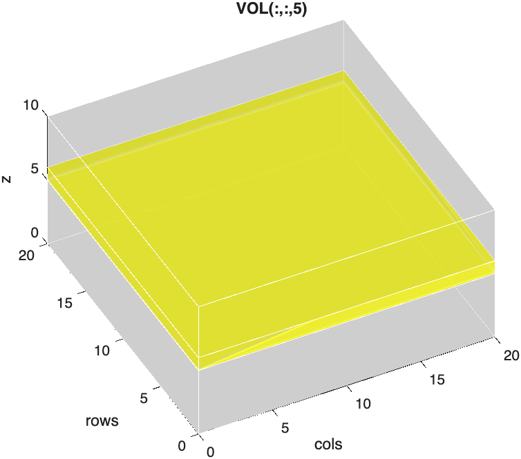
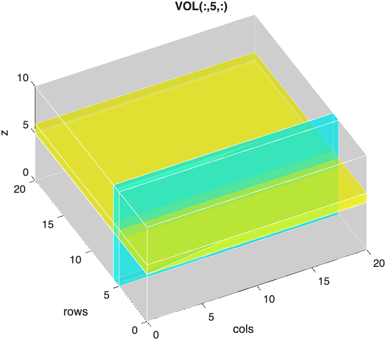
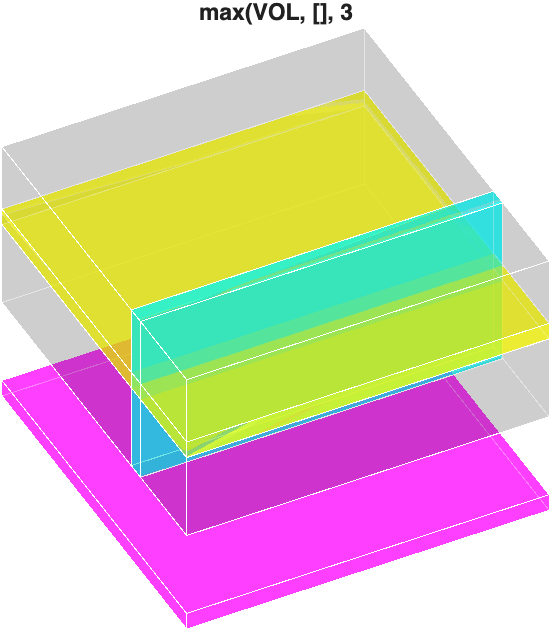

# Indexing Image Stacks

Volume processing often requires indexing the stack to pull out smaller stacks or individual slices.

Indexing image stacks is fairly straightforward — you just need to keep track of the dimensions. For example, if we have a 3D volume, `VOL`, with dimensions `20x20x10`, we can index out the fifth slice using the following syntax:

```matlab
VOL(:,:,5)
```

{ width="350"}

We can similarly index out an orthogonal plane:

```matlab
VOL(:,5,:)
```

{ width="350"}

## Squeezing Out Singleton Dimensions

These two planes look similar, but MATLAB treats them differently. Compare their sizes:

```matlab title="Sizes of the two planes"
size(VOL(:,:,5))

ans =

    20    20

size(VOL(:,5,:))

ans =

    20     1    10
```

The first plane is a `20x20` image. MATLAB automatically drops *trailing* dimensions of size 1, so indexing a single z-slice gives you a 2D matrix.

The orthogonal plane, however, is `20x1x10`. Its singleton dimension (the `1`) is in the *middle*, so MATLAB keeps it. The result is still a 3D array, even though it only contains a single plane of data. If you try to display it, you get an error:

```matlab
imshow(VOL(:,5,:))
```

```matlab title="Error"
Multi-plane image inputs must be RGB images of size MxNx3.
```

The function **`squeeze`** removes all singleton dimensions from an array, leaving a true 2D image:

```matlab linenums="1" title="Squeeze the orthogonal plane into a 2D image"
plane = squeeze(VOL(:,5,:));
size(plane)

ans =

    20    10
```

…Now *`plane`* is a `20x10` image (20 rows by 10 slices) that you can display with `imshow`.

!!! tip "When do you need `squeeze`?"

    Use `squeeze` whenever you index out a single element along a dimension that is *not* the last one, like a single column (`VOL(:,5,:)`), a single row (`VOL(5,:,:)`), or a single color channel from a 4D stack (`RGB4(:,:,1,:)`, below).

## Indexing Sub-stacks

You don't have to index out just one slice. Using ranges, you can pull out any smaller block of the volume. For example, to crop out the center of `VOL`:

```matlab linenums="1" title="Crop a sub-stack"
SUB = VOL(5:15, 5:15, 3:8); % rows 5-15, columns 5-15, slices 3-8
size(SUB)

ans =

    11    11     6
```

…`SUB` is an `11x11x6` sub-stack. Notice that ranges include both endpoints, so `5:15` contains 11 rows.

The keyword **`end`** refers to the last index along a dimension, which saves you from having to look up the size of the stack:

```matlab linenums="1" title="Index using end"
lastSlice = VOL(:,:,end);         % the last slice
lastThree = VOL(:,:,end-2:end);   % the last three slices
everyOther = VOL(:,:,1:2:end);    % every other slice (1, 3, 5, ...)
```

>Taking every other slice (`1:2:end`) is a quick way to downsample a stack along the z-axis.

## Multi-dimensional Indexing

We can use the same strategy for arrays with any number of dimensions.

Imaging datasets usually organize the data as XYCZT, where the first two dimensions are the columns and rows, and the remaining dimensions are dedicated to Color, depth (Z), and Time. **Note, in MATLAB, the first two dimensions are swapped: YXCZT, or rows-columns-CZT.**

So, for a 4D volume, `RGB4`, with the dimensions `512x512x3x12`, we can index out the Red channel using the following syntax:

```matlab linenums="1" title="Index out the Red Channel"
RED = RGB4(:,:,1,:); % all rows, all columns, channel 1, all z-slices
```

…This returns a 4D array with just 1 channel.

```matlab title="Size of RED"
size(RED)

ans =

   512   512     1    12
```

Just like the orthogonal plane above, the singleton dimension (dimension three) is not the last dimension, so MATLAB keeps it. We can drop it using **`squeeze`**:

```matlab title="Squeeze 4D array into a 3D array"
RED = squeeze(RED);

size(RED)

ans =

   512   512    12
```

…Now *`RED`* is a 3D array.

We can index a single slice out of *`RED`* using the following syntax:

```matlab linenums="1" title="Indexing out the Sixth Slice from RED"
redSlice = RED(:,:,6)
```

```matlab title="Size of redSlice"
size(redSlice)

ans =

   512   512
```

…*`redSlice`* is a `512x512` image.

!!! warning "Avoid naming variables `slice`"

    It's tempting to call a single image from a stack `slice`, but `slice` is already the name of a built-in MATLAB function (for drawing slice planes through volumes). Naming a variable `slice` hides that function until you clear the variable. Use a more specific name, like `redSlice` or `slice6`, instead.

If we wanted all three channels in a slice, we simply index the original, 4D volume, *`RGB4`*.

```matlab linenums="1" title="Index out 6th Slice from RGB4"
rgb_slice = RGB4(:,:,:,6); % all rows, all columns, all channels, slice 6
```

```matlab title="Size of rgb_slice"
size(rgb_slice)

ans =

   512   512     3
```

…*`rgb_slice`* is an image with 3 channels (RGB image).

So, we can index out a color channel by accessing the third dimension and index out a z-plane by accessing the fourth dimension.

## Max Projections

Indexing pulls out *part* of a volume. A max projection does the opposite: it collapses an *entire* dimension into one image by keeping only the brightest value along that dimension. You create a max projection with the `max` function, where the third input specifies which dimension to collapse:

```matlab linenums="1" title="Max Projection 3D volume"
proj = max(VOL, [], 3) % max project along the 3rd dimension
```

{ width="350"}

The result is a 2D grayscale image (shown here as a magenta plane).

Projecting along the other dimensions works the same way, but watch out for singleton dimensions. Collapsing the first dimension leaves a `1` at the front of the array, so you need `squeeze` again:

```matlab title="Max projection along the rows"
size(max(VOL, [], 1))

ans =

     1    20    10

size(squeeze(max(VOL, [], 1)))

ans =

    20    10
```

We can similarly create a max projection from a 4D array across the z-dimension using the following syntax:

```matlab linenums="1" title="Max Projection on 4D Volume"
proj4 = max(RGB4, [], 4) % across the 4th dimension
```

In this example, RGB4 has three channels, so the returned projection is a 3-channel array:

```matlab title="size of projection" 
size(proj4)

ans = 1×3
     512     512     3
```

To see what these projections look like on real data, and how to display them, see [Max Projections in Viewing Image Slices](volumeVisualization.md#max-projections).

## Challenge

??? question "Extract a green sub-stack"

    === "Question"

        Using `RGB4` (`512x512x3x12`), extract slices 4 through 8 of only the **green** channel, as a 3D array. What is its size?

    === "Answer"

        ```matlab linenums="1"
        GREEN = squeeze(RGB4(:,:,2,4:8)); % channel 2, slices 4-8
        size(GREEN)
        ```

        ```matlab
        ans =

           512   512     5
        ```

        The green channel is channel 2. Indexing returns a `512x512x1x5` array, and `squeeze` removes the singleton channel dimension, leaving a `512x512x5` 3D array.
